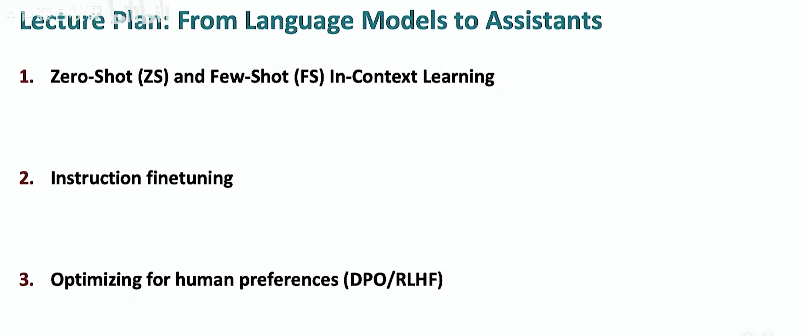
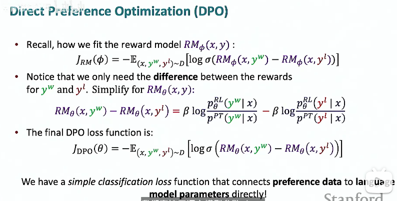
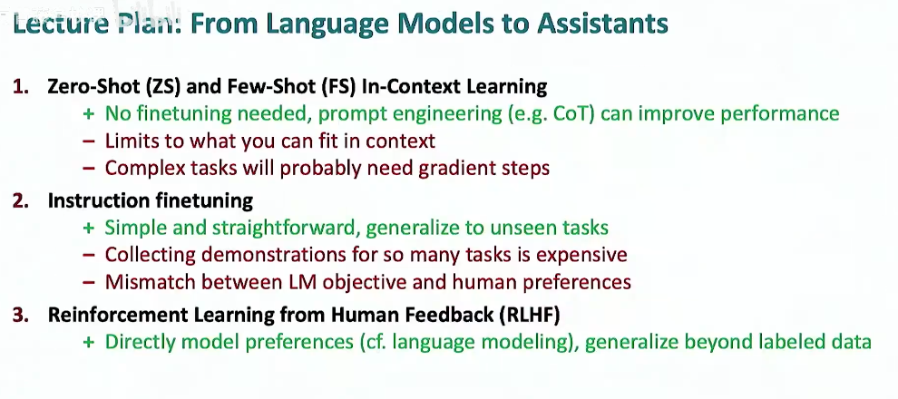

1、零样本、少样本、上下文学习
	随着模型能力的变强，越发会零样本学习起来了
	思维链
	
2、指令微调（监督微调**SFT**（Supervised Fine-Tuning））
  做法：用大量高质量的 （指令，标准回答） 数据对模型进行训练。让模型学会：看到指令，就要给出有帮助的回答，而不是无意义地续写。
  
3、优化人类偏好（对齐），直接偏好优化&基于人类反馈强化学习

**DPO (Direct Preference Optimization，直接偏好优化)**： 一种较新的方法。直接拿人类对模型回答的“排序数据”（比如人类觉得回答 A 比回答 B 好），通过数学变换直接优化模型，让模型倾向于生成 A 这类回答。比 RLHF 更简单、更稳定。

DPO 通过数学推导，证明了“奖励”可以等价于“当前模型与基准模型输出概率的比值”，从而把复杂的强化学习问题，转化成了一个简单的、直接用偏好数据（好/坏回答对）来优化语言模型的分类问题

**RLHF (Reinforcement Learning from Human Feedback**，**基于人类反馈的强化学习)**： 经典方法（ChatGPT 早期用的）。先训练一个“奖励模型（Reward Model）”来模拟人类打分，然后用强化学习（如 PPO 算法）让模型去“讨好”这个奖励模型，从而学会生成更符合人类价值观（有用、诚实、无害）的回答

