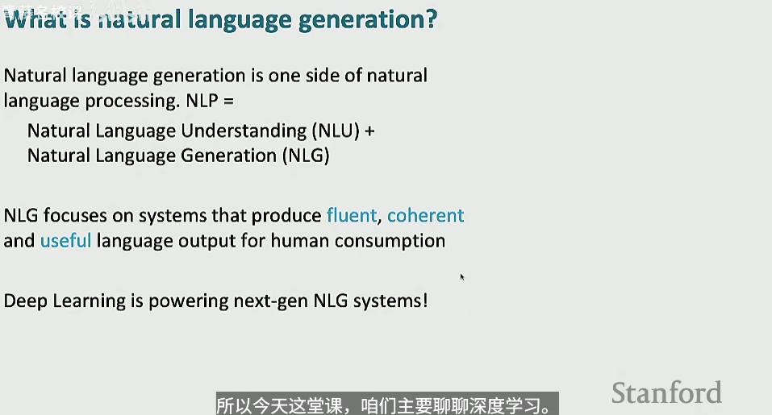
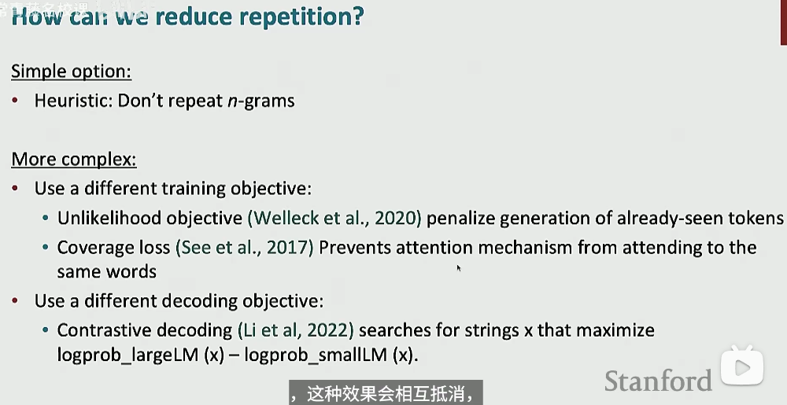
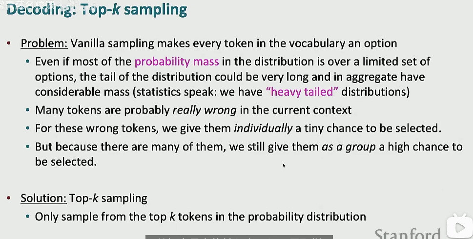
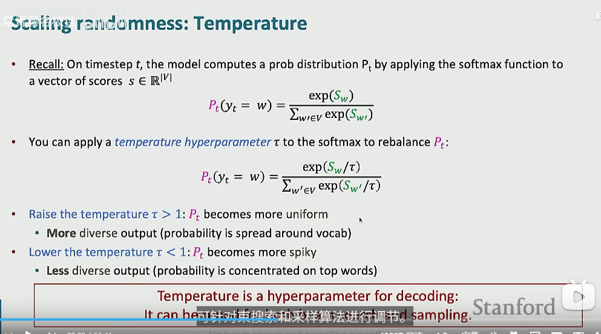
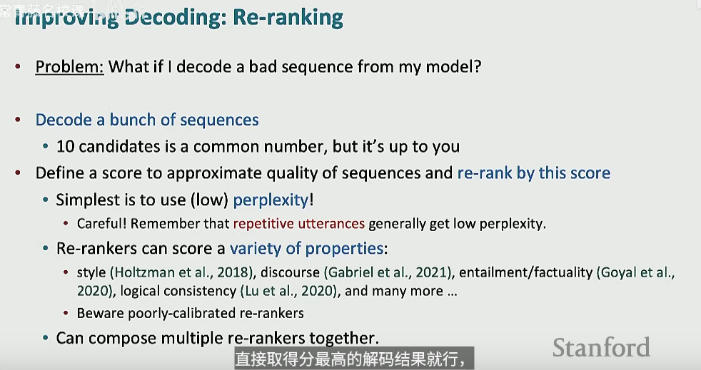
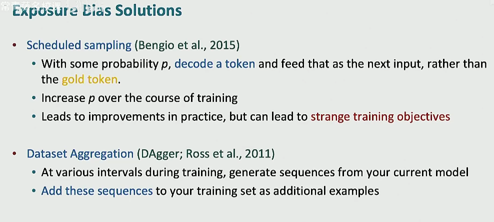
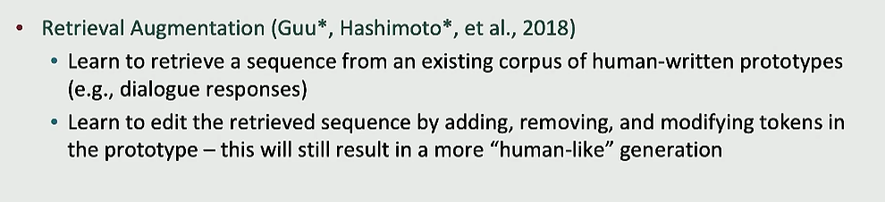
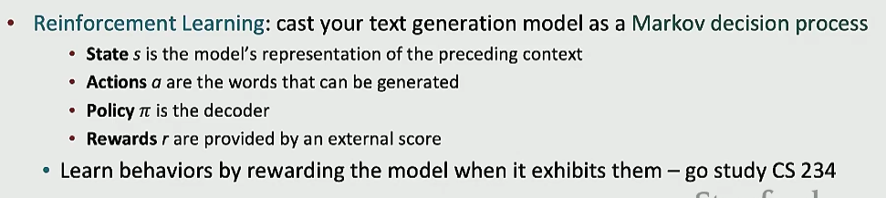

生成：非开放式生成/开放式生成

1、怎么减少重复

方法：

最粗暴： 解码时硬性禁止重复 n-gram。

改训练： 在损失函数里加惩罚项（Unlikelihood），或强迫注意力分散（Coverage loss）。

改解码： 用大模型减小模型的对比解码（Contrastive decoding），利用模型间的差异来抑制重复

2、减少跑偏或“胡言乱语”：
	（1）**Top-K采样**（截断长尾 + 局部随机）

只在概率分布排名前k 个的 Token 中进行采样，在每一步生成时，模型先计算出所有词的概率，然后按从大到小排序。我们只保留前k 个词

（2）**Top-P采样**
设定一个阈值 p（比如 p=0.9）。模型按概率从大到小累加，直到累加值刚好超过 p，就停止。只在这个“累积概率达到 p 的最小词集合”里进行采样。 这个集合被称为“核（Nucleus）。
（3）典型采样
根据概率分布的“熵（Entropy）”来重新加权分数。如果当前上下文很确定（低熵），它就只保留最可能的词；如果上下文很开放（高熵），它就保留更多样化的词。
（4）Epsilon采样
设定一个有效概率的下限阈值。设定一个极小的阈值 ϵ（比如 0.001）。在采样时，直接丢弃所有概率低于 ϵ 的词，不管它们排名多少。

（5）温度：控制着模型生成文本的随机性和创造力

在应用 Softmax 之前，把模型的原始分数除以温度τ。温度 τ 通过缩放 Softmax 前的 logits 分数来重塑概率分布：高温（τ>1）缩小分数差距使分布趋于均匀，从而增加采样随机性；低温（τ<1）放大分数差距使分布更加尖锐，从而偏向确定性输出。

（6）重排序Re-rank

它承认单次生成的不可靠性，通过“广撒网（生成多个候选）+ 精挑选（用多维度指标打分）”的方式，有效降低生成糟糕回答的概率

3、暴露偏差与解决方案
暴露偏差：模型在训练时习惯了“开卷考试”（看着正确答案预测下一个），在推理时却面临“闭卷考试”（看着自己写的答案预测下一个），一旦写错，就会在错误的道路上越走越远。

4、评估内容生成的标准方法
（1）内容重叠指标
	看生成文本和标准答案在词汇上有多像，但不严谨
（2）基于模型的指标
	 利用词和句子的学习表征
	 计算句子相似度
（3）人工评估
