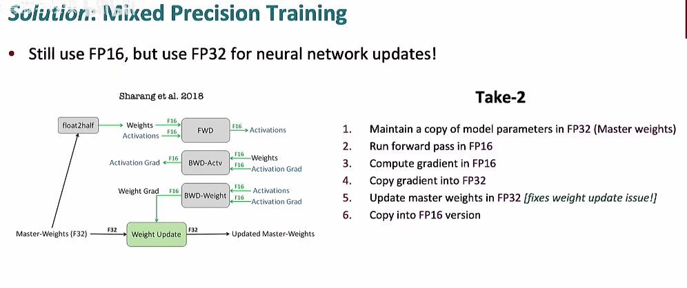
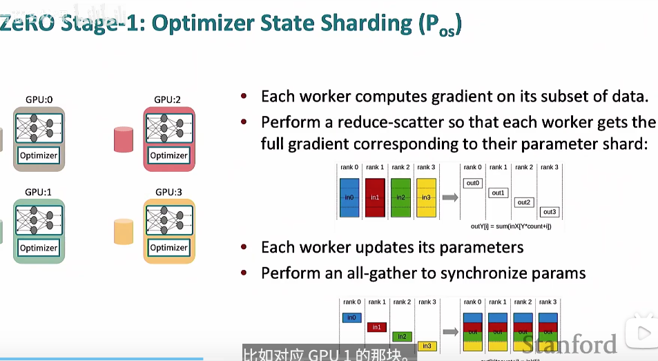
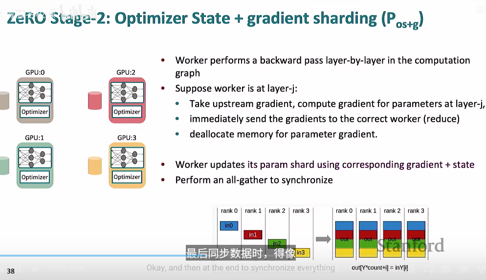
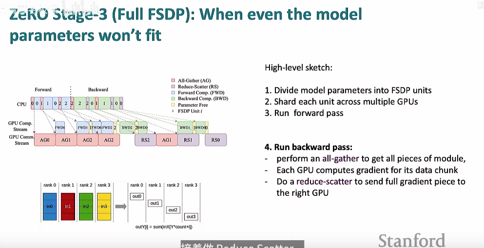

如何在有限的硬件资源（比如实验室的几张显卡）下，尽可能快、尽可能省显存地训练或微调大模型

### 1、混合精度训练（Mixed Precision Training）
在训练时，将大部分计算（如前向传播、反向传播）的 32 位浮点数（FP32）转换为 16 位浮点数（FP16 或 BF16），但在更新权重时，依然保留 FP32 的“主权重（Master Weights).

### 2、多 GPU 训练与 DDP / FSDP
解决的问题： 单张显卡显存装不下大模型，或者训练速度太慢。

（1）DDP (Distributed Data Parallel，分布式数据并行)：
**核心思想：** 每张显卡上都放一份完整的模型副本，但喂给它们不同的数据。每张卡独立计算梯度，然后同步梯度。
**适用场景**： 模型能装进单卡显存，但数据量太大，需要加速。

（2）FSDP (Fully Sharded Data Parallel，全分片数据并行)：
**核心思想：** 连模型参数、梯度和优化器状态都切碎（Shard），分散到不同的显卡上。每张卡只存一部分，计算时按需通信。

**适用场景**： 模型巨大（比如 70B 参数），单卡根本装不下。FSDP 是 PyTorch 官方推荐的、目前训练大模型的主流方案（类似于微软的 ZeRO 技术）。

### 3、参数高效微调：LoRA
解决的问题： 全量微调（更新所有参数）成本极高。如果你只有一张 24GB 的消费级显卡（如 RTX 4090），想微调 7B 的模型，全量微调根本跑不起来。
**核心思想**： 冻结预训练模型的原始权重 W，只训练两个非常小的低秩矩阵 A 和 B（即 W+AB）。
效果： 训练参数量减少 1000 倍，显存占用极低，且推理时无额外延迟。