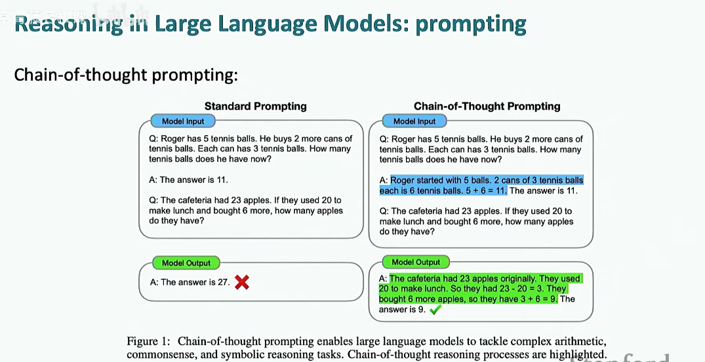
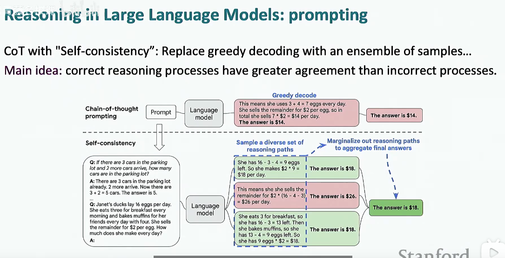

### 一、Reasoning
#### 分类：

#### 方法：
##### 1、提示词
 ###### （1）标准思维链提示词 

###### （2）带“自洽性”的思维链
核心机制：用样本采样取代贪婪解码
核心假设（最重要的一句话）：“**正确的推理过程比错误的推理过程具有更高的一致性（agreement）**。” 意思是，如果让模型多次思考同一个问题，正确的逻辑往往会得出相同的答案，而错误的逻辑往往五花八门。**正确的推理过程往往殊途同归（greater agreement）**

###### （3）、多步推理 “由少到多”
将复杂的任务分解为一系列由易到难的子问题，然后依次解决这些子问题

##### 2、让小模型也具有推理能力：蒸馏 
（1）Cot-指令微调
研究者首先让强大的教师模型（如GPT-4）去解决海量的问题。但不仅要求它给答案，还要求它写出详细的“内心独白”（即CoT推理解释）。
然后，把这些“问题+推理过程+答案”作为训练数据，喂给小型模型（Orca）进行微调。

(2)强化自训练ReST
是一种**让模型“自我进化、自我提升”的迭代微调算法**
核心步骤：

**第一步：Generate（E-Step，期望步）—— 生成并筛选数据**
**采样：** 给定一堆复杂的推理问题，让当前的语言模型去解决，并采样出多个不同的解（solutions）。这其实用到了类似于“自洽性（Self-consistency）”中的多次采样技术。
**过滤（Filter）**：使用一个“问题特定的函数”来筛选这些解。以数学题为例，这个过滤函数就是检查最终答案是否正确。只有最终答案正确的解，才会被保留下来。
**本质**：这一步类似于“拒绝采样（Rejection Sampling）”。模型通过大量尝试，筛选出了一批“高质量的解题路径”。

**第二步：Improve（M-Step，最大化步）—— 监督微调**
**更新**：拿到上一步过滤出来的“正确答案及其推理过程”，进行监督微调（Supervised Fine-tuning, SFT）。
**目标**：最大化这些被过滤出的优质解的概率。简单来说，就是告诉模型：“看，这些是你刚才做对的题的详细步骤，你要记住这种思考方式，以后遇到类似的题，按这种概率最高的方式去推。”

#### 验证
##### 1、反事实测试（Counterfactual）
 故意违背常识或改变规则的情境。如果模型具备真正的、抽象的“推理能力”，那么无论前提怎么变，它都应该能推导出正确答案；如果它只是靠“记忆”训练数据里的模式，一旦前提改变，它就会崩溃。

二、Agent
 