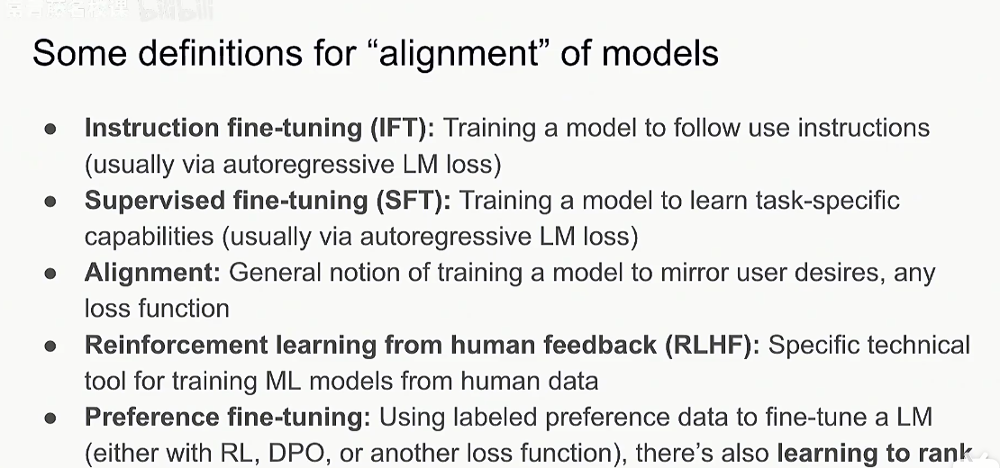
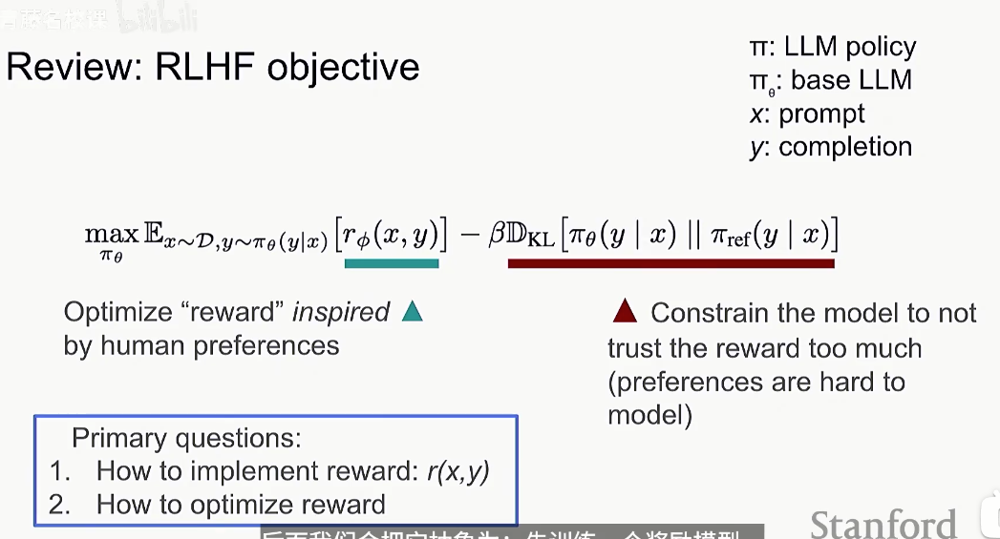
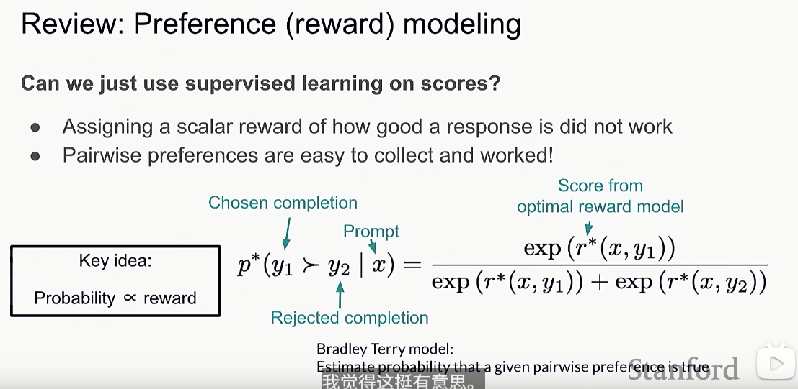
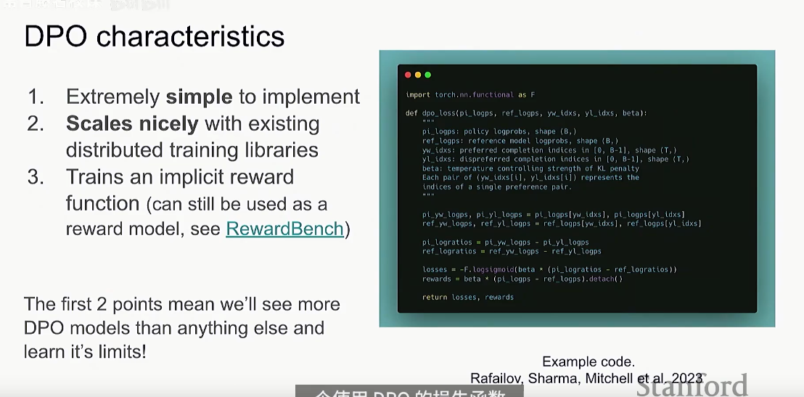

**对齐**：这是一个泛化的概念——训练模型去反映（mirror）用户的期望和价值观，可以使用任何损失函数。这是**后训练（Post-training）的终极目标**，对齐是目标，而下面的 RLHF等只是实现它的工具。
"对齐"术语表：

### 一、RLHF

#### 1、目标函数

π θ：当前的 LLM 策略（即正在被训练的大模型，比如 Actor）。

π θ(y∣x)：大模型在看到问题 x 时，生成回答 y 的概率。

π ref：参考模型（Reference Model）。通常是 SFT（监督微调）完的模型，它的参数是冻结不动的。

x：Prompt（用户输入）。

y：Completion（模型生成的完整回答）。

r ϕ(x,y)：奖励模型（Reward Model）。它给“问题+回答”打分，代表人类有多喜欢这个回答

RLHF的目标是让当前策略模型（π θ）针对提示词（x）生成回答（y）时，在期望（E）层面最大化奖励模型（𝑟ϕ）的得分，同时利用系数（β）乘以KL散度（D KL）作为惩罚项，约束其不能偏离参考模型（π ref）太远，以此在迎合人类偏好与保持语言模型基础能力之间取得平衡（防止Reward Hacking）。

#### 2、实际偏好（奖励）模型

### 二、DPO

#### 1、标准DPO（离线）

##### 1&2、极其简单（Extremely simple）且利于扩展（Scales nicely）
DPO把强化学习的问题，转化成了一个类似监督学习的分类问题。你只需要加载2个模型（当前的Policy模型和冻结的Reference模型），用普通的分布式训练库（如DeepSpeed, FSDP）就能稳定训练
##### 3、训练了一个隐式奖励函数（Trains an implicit reward function）

##### 总结：
它利用 Bradley-Terry 模型证明了“奖励差可以转化为概率差”，从而在代码实现上彻底去掉了奖励模型和PPO强化学习，通过两行对数概率相减的交叉熵损失（logsigmoid），实现了“隐式奖励对齐”。它简单、稳定、易扩展，是目前开源大模型后训练的主流，但也因为“离线学习”的特性，在极致的逻辑推理探索上留下了让位给新一代在线强化学习（RLVR）的空间。

#### 2、在线DPO
在每一次训练迭代中，动态地从当前正在训练的模型采样生成两个回答，然后由一个“裁判”（如奖励模型或LLM）实时判断哪个更好，从而提供在线反馈（on-policy）

在线DPO流程：

1. 生成 (Generate)：输入一个Prompt，让当前模型生成两个不同的回答。

2. 评判 (Judge)：使用一个奖励模型或LLM裁判，对这两个回答进行偏好评估，选出胜者（Chosen）和败者（Rejected）--1。

3. 优化 (Optimize)：将这对实时生成的偏好数据作为输入，立即应用DPO损失函数来更新当前模型的参数-1。

4. 迭代 (Iterate)：重复以上步骤，模型在每一轮迭代中，都基于自己最新的生成结果进行学习和改进