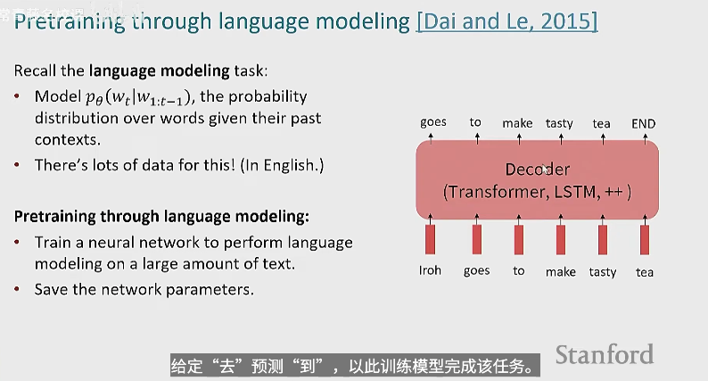
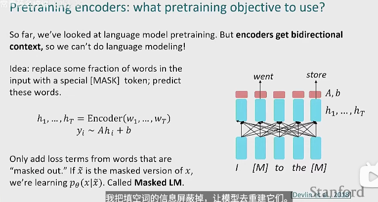
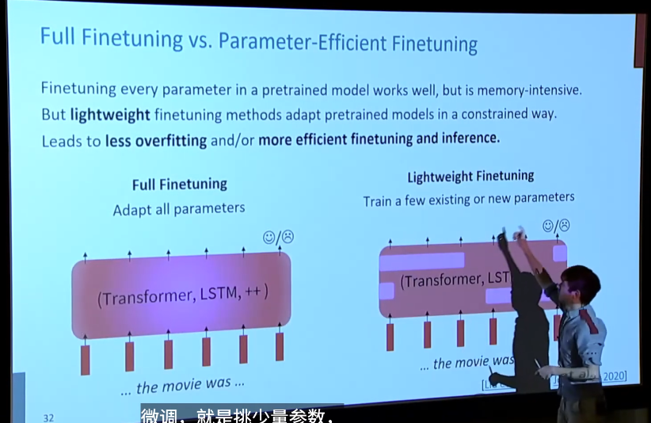
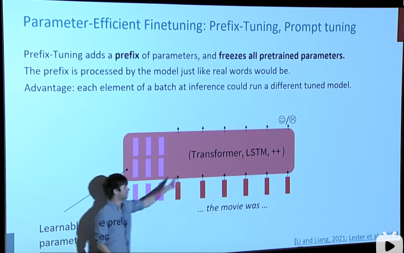
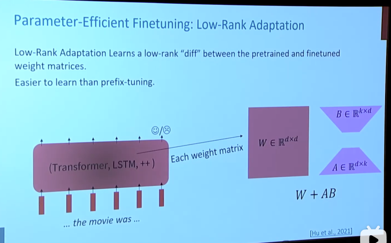
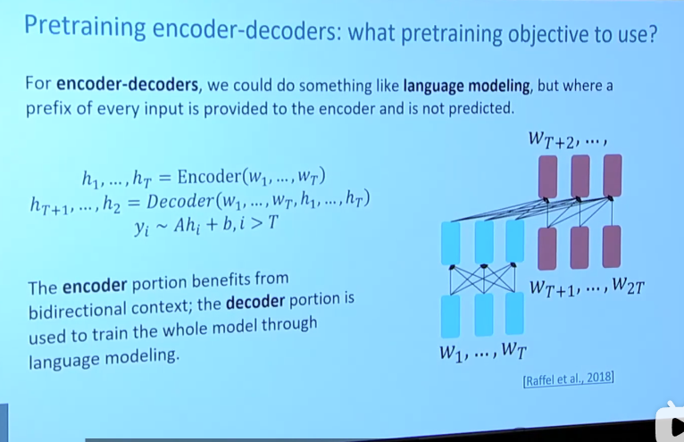
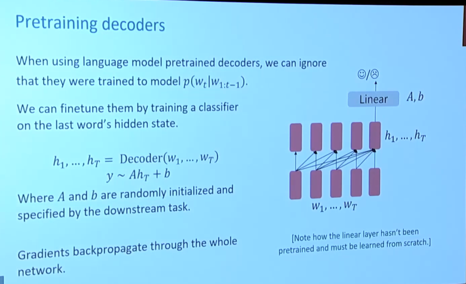

### 1、对于词
我们关注子词结构和子词建模。**字节对编码（Byte-Pair Encoding, 简称 BPE）算法**
即：从单个字符开始，不断把出现频率最高的相邻字符对拼在一起，形成更长的子词

算法：
	
1. 初始化（Start）： 词汇表（Vocabulary）最初只包含单个字符（比如 a-z, 0-9）以及一个特殊的“词尾符号”（"end-of-word" symbol，通常写作 </w>，用来区分词中间的字符和词尾的字符）。

2. 统计（Find）： 使用一个语料库（Corpus），找出最常相邻出现的字符对。例如，统计发现 "a" 和 "b" 经常挨在一起。

3. 合并（Add）： 将这对最频繁的相邻字符合并为一个新的子词（subword），并加入词汇表。例如，把 "a" 和 "b" 合并成 "ab"。

4. 循环（Repeat）： 将语料库中所有出现该字符对的地方，替换成新合并的子词。然后不断重复第2步和第3步，直到词汇表大小达到预设的目标值（desired vocab size）。

### 2、预训练的核心思路就是“重建输入”（属于监督学习）
就是根据上下文来填空

### 3、通过语言建模来预训练

预训练之后保留所有权重，直接用它来初始化参数（微调）

### 4、模型预训练的三种方式

#### （1）Encoders

 BERT模型预训练核心机制：为了利用编码器的双向上下文能力，我们采用“掩码”的方式，人为挖空一些词，让模型通过上下文去还原它们，以此学习深层的语言表示
 
 如果输入是 X（被掩盖后的句子），我们只训练模型去预测那些被 [MASK] 掉的原词，未掩盖的词不参与损失计算。这种方法被称为 **Masked LM（掩码语言模型）**
 

微调

##### （1）全参数微调
##### （2）部分参数微调
	预训练模型本身就不错，故保留部分通用性和优势
	
 （a）前缀微调
		
		Prefix-Tuning 在输入序列前面添加一段由参数构成的“前缀（prefix）”，同时冻结（freeze）所有预训练模型的参数。
		这段前缀会被模型像处理“真实单词”一样处理（即作为输入的一部分参与注意力计算），从而引导模型产生特定的输出，而不需要改变模型原有的权重。**前缀参数是可学习的**。
	（b）低秩适应LoRA
		
		A和B这就是 LoRA 引入的可训练参数。其秩是一个远小于d的超参数。B 矩阵通常用零初始化。A 矩阵用随机高斯分布初始化。
		冻结 W，只通过反向传播更新 A 和B。我们可以将 AB 计算出来，直接加回到原始权重 W 中，变成 𝑊′=W+AB
		
#### （2）Encoder-Decoders

将完整文本的前半段作为前缀输入编码器进行双向理解，再由解码器以语言建模的方式自回归地预测生成后半段续写内容。
效果更好的是“片段损坏”机制

（3）Decoders（llm大模型：直接把用户的问题和模型的回答拼接成一长串文本，全部输入给 Decoder）

忽略其原本的生成目标，取输入序列最后一个词的隐藏状态，接一个随机初始化的线性分类层，并通过反向传播微调整个网络