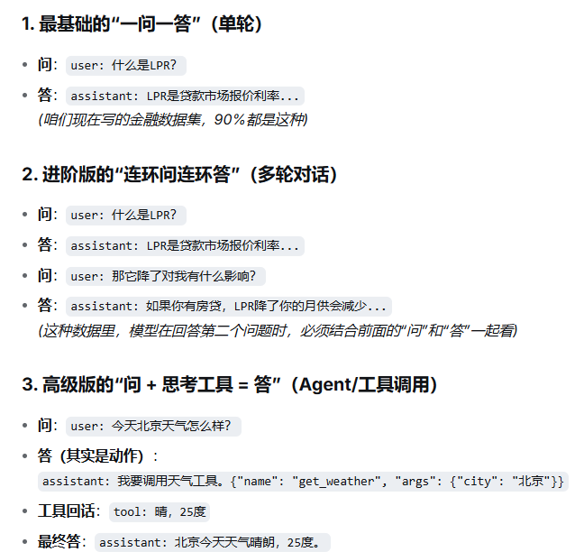

1、SFT的训练数据集都是“对话形式”的Prompt，有问有答。
SFT 的本质永远是一句话：“有问必有答，用答去改问”。

在真实的工业界，90% 的 SFT 项目，就是在造**高质量的“一问一答**”数据。

2、在足够强大的预训练后，少量高质量的后训练数据也能达到较好的结果

### 一、SFT（监督微调） Data

1. 指令微调（SFT）在我们仅仅是在“提取”预训练行为，而不是“添加”新行为时，效果最好。(SFT 真正的底层物理作用，是在已有参数池中“激活”并“规整”特定的输出路径，把预训练时学到的能力（如翻译、写代码）以人类期望的对话格式（Chat Format）释放出来。如果基座模型没学过，SFT 绝对教不会。)

2. 添加强行塞入冷门但正确的事实数据，有时反而会损害模型表现。(灾难性遗忘与分布偏移）。对于长尾正确知识，不要用 SFT，用 RAG（检索增强生成）

3. 少量正确类型的行为数据（如安全性、指令遵循、写作风格）就能带来巨大的差异；但对于长尾（Long-tail）部分，确实能从**更多**的数据中获益。 

### 二、微调方法（梯度下降）

将SFT/指令遵循放进预训练的方法越来越流行 **（中期训练）**

中期训练是在大规模通用预训练之后，在SFT/RLHF等后训练之前，用更精选、更有针对性的数据对模型进行“继续预训练”。
它的目标不是从头学习语言，而是在保持模型通用能力的基础上，定向强化特定能力，如数学、代码、推理和长上下文理解。其数据规模通常远小于预训练（百亿级 vs 数十万亿级），但远大于SFT。

⚙️ 核心**实现机制**
1. 数据配比：关键是“混合”，而非“替换”
正确做法是将领域数据与代表预训练分布的“回放数据”（Replay Data）混合。DatologyAI的研究指出，领域数据在混合配方中甚至可以少于一半，核心是让模型“在学好新东西的同时，别忘了旧东西”。ICML的实验也证实，维持与预训练数据的混合，远优于完全切换到领域数据。

2. 学习率调度：**退火（Annealing）是关键**
中期训练通常发生在预训练的“冷却”（Cooldown）阶段，核心是学习率的平滑衰减（退火）。在预训练的高学习率之后，用更平滑的方式降低学习率，可以稳定收敛、抑制梯度噪声。这种退火式的优化调度，能让模型在训练后期有效吸收高质量数据，实现能力的再次跃升。

3. 长上下文扩展：中期训练的重要任务
在中期训练阶段，模型还会进行上下文长度的扩展。例如，在最终的长上下文阶段之前，模型可能在256K的序列长度上训练数千亿Token，以便能够处理整个代码仓库或长文档。


### 三、RLHF（基于人类反馈的强化学习）

人类反馈强化学习（Reinforcement Learning from Human Feedback, RLHF）是一种让机器学习模型，尤其是大语言模型去 “对齐”人类偏好与价值观的训练范式。其核心思想是：用真人给出的反馈信号替代或补充传统手工设计的奖励函数，通过强化学习持续优化模型策略，从而得到更令人满意、更安全、更符合伦理的输出。

#### 1、RLHF Data
 ##### (1)数据格式
 工业界最主流的核心格式是 **prompt、chosen、rejected 三元组**，用于训练奖励模型（Reward Model）或直接进行DPO等偏好优化算法。

```
 {
  "prompt": "如何快速学习Python？",
  "chosen": "建议从基础语法开始，配合实际项目练习，多写代码多调试，推荐官方文档和经典教程。",
  "rejected": "直接背语法书就行，不用动手写代码。"
}
```

（2）三个阶段

==1）==RLHF的第一个阶段：监督微调（SFT）

先收集高质量的人工标注数据（SFT数据），对预训练模型做**常规监督微调**，得到“基线策略” （ 𝜋_𝑆𝐹𝑇），为后续强化学习提供起点，就是上述的第二个阶段SFT的过程，经过SFT后的模型已经具备问答能力，但是还**没有对齐人类偏好**。比如问到一些恶意的问题模型可以选择不回答，同时普通问题的回答更贴近我们想要的答案。

==🔴2）==RLHF的第二个阶段：奖励模型训练（Reward Modeling）

奖励模型通常是一个打分模型,其底层结构则复用监督微调（SFT）后的大语言模型，仅把最顶层的语言建模头替换成一个线性层，即“回归头”或“奖励头”，训练好的模型就相当于一个有人类偏好的打分器，它会为接近人类偏好的回答打高分，同时模型底座会复用大模型的参数，这样的原因能继承语言理解能力。

训练数据通常是一个模型的**同一条prompt推理**得到的不同答案，针对同一输入的 𝑋
，让模型生成多条**候选输出** (y_1,y_2,...)。首先让模型生成输出，然后**比较不同输出结果**，通常我们只需比较两个输出（比如A和B），核心问题就是**判断A是否优于B**。基于**这些成对反馈**，我们将训练一个奖励模型，其核心功能是为每个输出赋予标量分值，进而**驱动强化学习**。

以 InstructGPT指南为例，这是少数公开的企业级标注规范之一。指南明确标注员需要从三个维度评估输出：**实用性（语言清晰、准确理解问题意图、注意国际差异——如football不应默认指美式足球）、真实性（避免虚构内容）和无害性（杜绝有害不当内容）**。这些要求都很合理，但可以看出它们与OpenAI公开的模型规范之间存在微妙关联。实际应用的标注指南远比这份简版详细，**通常会列示详细要点分发给标注员**。InstructGPT通过Scale和Upwork平台，收集了约40人提供的数据，每个标注员对每个问题大概有一分钟的时间用来标注，大部分时候这个时间都是足够的，因为相比辛苦地撰写输出，标注往往简单得多。

我们也可以借助模型来标注，用**强模型**（GPT-4/Claude）替代人类：一致性高、成本低、可无限放大，但是这将面临一些风险比如**自我偏好、长度膨胀、模型幻觉循环放大**。因为这样循环标注会放大最初标注的误差。

这个训练好的奖励模型就此成为我们的奖励机制，目标是**让模型最大化这些奖励**。人工对这些输出进行排序或打分，形成偏好对。用这些偏好数据训练一个奖励模型 R_φ，让它学会给”人更喜欢的答案”打更高分。人类评估输出比生成输出更容易，且可能更偏好AI生成结果，评价总是比生成难，如果我们去找人类专家去撰写长长的回答，那么**成本**实在太高了，这也是使用RLHF的原因之一。

==🟠3）==RLHF的第三个阶段：强化学习微调（RL，Reinforcement Learning）

在 RLHF 之前，常见的策略梯度方法（如 REINFORCE）方差大、训练不稳定；而 Q-learning 类方法在巨大的动作空间（词表）下难以应用。PPO 在 2017 年由 OpenAI 提出，迅速成为 RL 领域的主流算法，原因包括PPO通过“剪切”机制限制每次更新的幅度，避免策略突变。并且使用重要性采样和多个 epoch 的更新，比传统策略梯度更高效。相对容易实现，超参数较为健壮。并且可以自然地配合价值网络（Critic）使用，且显存占用可接受（尽管仍不小）


这两个算法具体直接看：
https://datawhalechina.github.io/diy-llm/chapter13/chapter13_%E7%AC%AC%E5%8D%81%E4%B8%89%E7%AB%A0%E5%A4%A7%E6%A8%A1%E5%9E%8B%E7%9A%84%E5%9F%BA%E6%9C%AC%E8%AE%AD%E7%BB%83%E6%B5%81%E7%A8%8B.html#_6-dpo%E7%AE%97%E6%B3%95-direct-preference-optimization-dpo-%E7%9B%B4%E6%8E%A5%E5%81%8F%E5%A5%BD%E4%BC%98%E5%8C%96
#### 2、PPO(近端策略优化)
PPO 是一种基于策略梯度的方法，通过优化策略函数 𝜋(𝑎|𝑠) 最大化累积奖励。它的核心思想是**保持策略更新而且不能离旧策略太远**。[[2、Policy Gradient]]
1. 通过剪切的概率比值来限制策略更新幅度，确保新策略不会偏离旧策略太远，提高训练稳定性。
2. 使用重要性采样来提高样本效率，旧数据仍然可以用于更新，从而提升样本利用率。

#### 3、DPO
不用额外训练一个奖励模型，也不用复杂的强化学习循环；只要把人类偏好直接写进一条‘比较式’监督损失，就能让语言模型学会好答案多生成、差答案少生成。 换句话说，DPO 把原来“先训练奖励模型, 用 PPO 最大化奖励”的两段式流程，压缩成“一条最大似然损失”的单段式流程，从而把**强化学习问题变成了监督学习问题**。