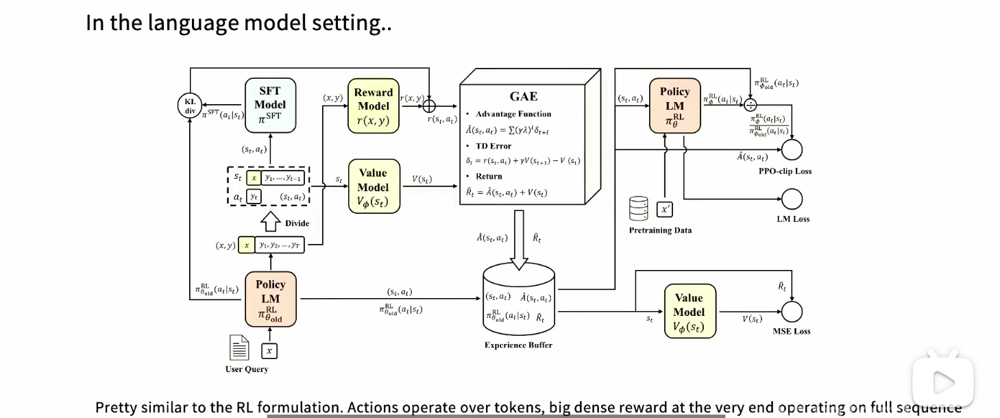
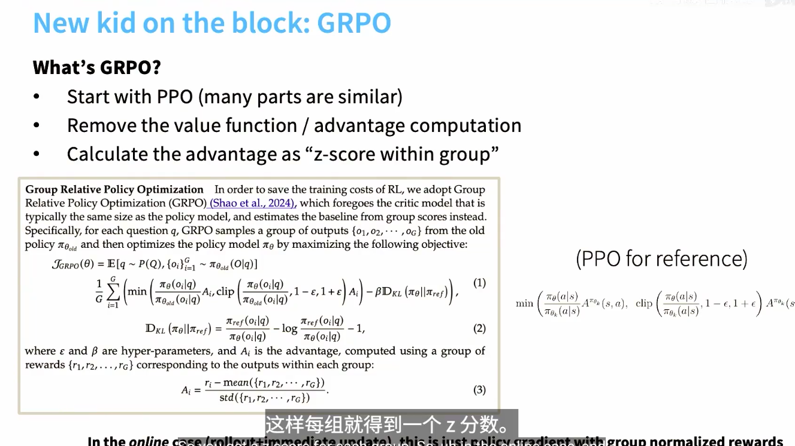
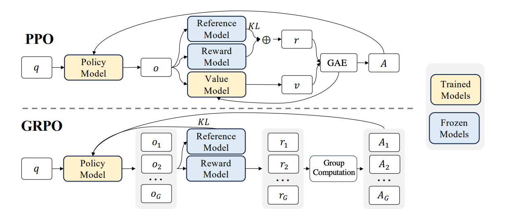
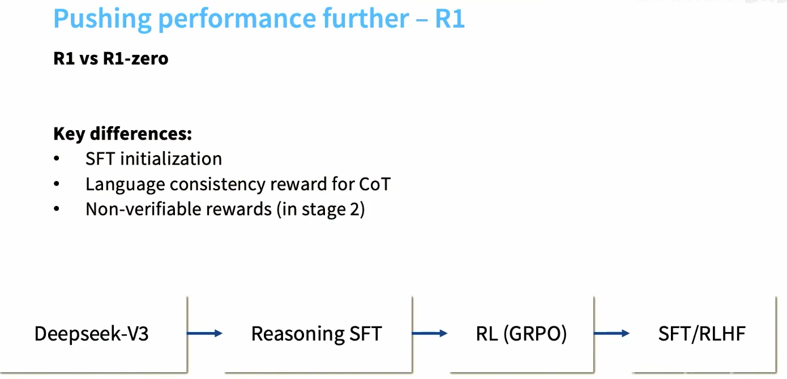
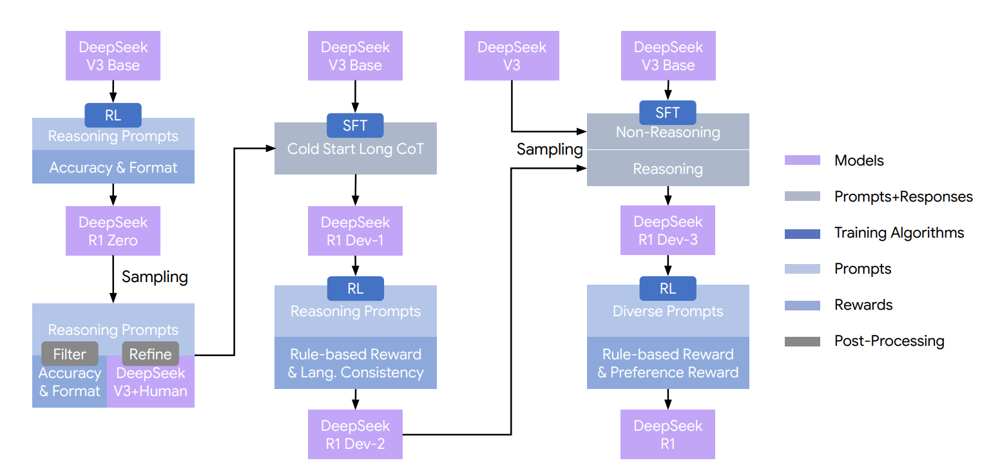

友情链接：
https://datawhalechina.github.io/diy-llm/chapter14/chapter14_%E5%8F%AF%E9%AA%8C%E8%AF%81%E5%A5%96%E5%8A%B1%E7%9A%84%E5%BC%BA%E5%8C%96%E5%AD%A6%E4%B9%A0.html
### 一、RLVR 定位

RLVR 聚焦于一类特殊任务：**输出可被程序自动判分**。典型场景包括：

- **数学推理**：答案是否与标准解一致（如 GSM8K、MATH）；
- **代码生成**：生成的程序是否通过所有测试用例；
- **形式化证明**：证明步骤是否逻辑自洽。
这些场景中 ，奖励函数R(z)可定义为0(否则)1（若z正确）函数

**RLVR 的本质**：在那些“对错可被自动判定”的窄域任务中，绕过人类偏好，直接用形式化验证机制提供强化学习的奖励信号，从而实现更可靠、可扩展、可验证的智能体训练

---

### 二、为什么RLHF 不行？

#### 1、Why not DPO?
PPO在语言模型的实现 --复杂

- 在实践中，实现极其复杂。

- 价值模型（极其消耗显存，且在训练中涉及额外的调参）。

#### 2、Why not PPO?
- **数据并非天然成对（打破了 Bradley-Terry 假设**）：DPO 的数学推导完全建立在 Bradley-Terry 模型上，即输入必须是一个 (Chosen, Rejected) 的成对偏好数据。
- **Offline 范式切断了“长思维链”的涌现**：这是最**致命**的。DPO 是纯离线（Offline）的，模型只能看静态数据集。但在长推理任务中，模型必须通过 Online Rollout 自己生成轨迹，在试错中自己发现“如果我在这一步自我纠错，最终就能拿到 1 的奖励”。DPO 只能“模仿”数据集里的写法，无法实现这种基于在线探索的自我演进（Self-evolution）。

### 三、GRPO

- Start with PPO (many parts are similar)  
    （以 PPO 为基础，很多部分非常相似）
    
- Remove the value function / advantage computation  
    （移除了价值函数 / 优势计算）
    
- Calculate the advantage as "**z-score within group**"  
    （将**优势**计算为“组内的 z-score / 标准化分数”）

#### 1：概括
**GRPO (Group Relative Policy Optimization)**

**What's GRPO? (什么是 GRPO？)**
*   Start with PPO (many parts are similar)
    （以 PPO 为基础，很多部分非常相似）
*   Remove the value function / advantage computation
    （移除了价值函数 / 优势计算）
*   Calculate the advantage as "z-score within group"
    （将优势计算为“组内的 z-score / 标准化分数”）

> **Group Relative Policy Optimization (组相对策略优化)**
> 为了节省 RL 的训练成本，我们采用了 GRPO，它**放弃了通常与策略模型同规模大小的 Critic 模型**，而是**从组得分中估计基线**。
> 具体而言，对于每个问题 $q$，GRPO 从旧策略 $\pi_{\theta_{old}}$ 中采样一组输出 $\{o_1, o_2, \cdots, o_G\}$，并通过最大化以下目标来优化策略模型 $\pi_\theta$：

*   **公式 (1) GRPO 目标函数**：

$$
\begin{aligned}
\mathcal{J}_{GRPO}(\theta) = & \mathbb{E}[q \sim P(Q), \{o_i\}_{i=1}^G \sim \pi_{\theta_{old}}(O|q)] \\
& \frac{1}{G} \sum_{i=1}^G \left( \min \left( \frac{\pi_\theta(o_i|q)}{\pi_{\theta_{old}}(o_i|q)} A_i, \text{clip} \left( \frac{\pi_\theta(o_i|q)}{\pi_{\theta_{old}}(o_i|q)}, 1 - \varepsilon, 1 + \varepsilon \right) A_i \right) - \beta \mathbb{D}_{KL} (\pi_\theta \parallel \pi_{ref}) \right),
\end{aligned}
$$

*   **公式 (2) KL 散度估计**：

$$
\mathbb{D}_{KL}(\pi_\theta \parallel \pi_{ref}) = \frac{\pi_{ref}(o_i|q)}{\pi_\theta(o_i|q)} - \log \frac{\pi_{ref}(o_i|q)}{\pi_\theta(o_i|q)} - 1
$$

*   **公式 (3) 优势函数（组内 Z-score）**：

$$
A_i = \frac{r_i - \text{mean}(\{r_1, r_2, \cdots, r_G\})}{\text{std}(\{r_1, r_2, \cdots, r_G\})}
$$

（注：这里 $\epsilon$ 和 $\beta$ 是超参数， $A_i$ 是优势，利用每组输出的奖励集合 $\{r_1, r_2, \dots, r_G\}$ 计算得出。）

#### 2：原理解释（物理瓶颈与数学重写）

==🔴核心==：**"foregoes the critic model that is typically the same size as the policy model"（放弃了通常与策略模型同规模大小的 Critic 模型）**。这是 GRPO 能够大幅度缓解 HBM 显存瓶颈的物理基础。

1）**公式(3)**：

*   **GRPO 的物理减法**：不需要 Critic 了。针对同一个 Prompt，让模型（旧策略）采样出 G 条不同的回答（比如 G=8）。把这 8 条回答丢给验证器（Verifier）（奖励函数或者可验证规则），得到 8 个奖励分数 $(r_1 \dots r_8)$。
*   **Z-Score 归一化**：公式 (3) 实际上就是把绝对奖励变成了**相对奖励**。假设 8 条轨迹中，3 条做对得 1 分，5 条做错得 0 分。算一下这 8 个数的均值（0.375）和标准差。如果一条轨迹得了 1 分，它的优势 (A_i) 就是正的；得 0 分就是负的。**优势**：如果 𝐴_𝑖>0，说明这个回复比组内平均水平好；如果 𝐴_𝑖<0，则说明它比平均水平差。
*   **物理收益**：**完全消除了一个与主模型等大的神经网络**。这部分省下来的显存，被无缝转移到了增大 `Rollout Batch Size`（并行生成更多条轨迹）和 `序列长度`（支撑更长的 KV Cache）上。

 2） **公式 (1)**：保留 PPO 的理智，但加入了全局正则
*   公式 (1) 里面，包含了 `min(...)` 和 `clip(...)`。这说明 GRPO 在算法骨架上**依然是 PPO（Trust Region 信任域机制）**，保持了训练稳定性（防止单次更新步子太大导致崩溃）。
*   区别在于，它是对 $G$ 个样本的 Loss 求平均。
3） **KL 约束的变形 (公式 (2))**：这里用了一个非负的 KL 估计器（常常被称为 `k3` 估计器）。这是为了在工程上避免计算两个分布的真实期望，只需用采样出的样本，结合策略模型 $\pi_\theta$ 和参考模型 $\pi_{ref}$ 的概率比值，就能算出一个无偏且恒大于 0 的惩罚项。它在物理上依然是为了防止策略“跑偏”（不去探索真实解法，而是去卡奖励函数的 bug）。

####  一个物理代价的转移：
在 PPO 中，生成（Rollout）和训练（Update）的显存分配是静态的。
而在 GRPO 中，**“计算优势”的时间从 GPU 搬到了 CPU**。因为公式 (3) 的均值、标准差计算，只涉及几个标量，没有矩阵乘法。GPU 不需要为了算个 Baseline 而去做大规模的前向反向，极大节约了算力和总线带宽。

**总结**：这GRPO 的本质就是一场 **“用统计学（均值/标准差）代替深度神经网络（Critic）”** 的除魅运动。它把极其珍贵的 HBM 从“价值估计”中解放出来，全盘喂给了“长推理轨迹的生成”。

### 四、训练流程

阶段 1：DeepSeek-R1-Zero

	使用 DeepSeek-V3-Base 作为基础模型， 完全依赖于强化学习，奖励信号主要来自规则型奖励（Rule-based Reward），包括准确性（Accuracy）和格式（Format）奖励。

阶段 2：搞数据

	DeepSeek-V3-Base 作为基座模型，使用冷启动长思维链数据进行 SFT 训练得到 DeepSeek-R1-Dev1。
	
	对于冷启动长思维链数据的收集，具体来说，他们首先收集了数千个高质量、多样化的推理提示。对于每个提示，使用 DeepSeek-R1-Zero 以 1.0 的相对较高 temperature 生成多个推理轨迹。接下来，过滤这些生成内容，只保留具有正确最终答案和可读格式的。对于数学输出，我们使用 sympy(https://www.sympy.org/) 进行解析和表达式比较；对于格式化，我们应用诸如重复检测和语言混合过滤之类的规则。最后，提示 DeepSeek-V3 来精炼推理和摘要，以确保正确的格式和人类友好的表达。特别是，为了解决语言混合问题，他们指示 DeepSeek-V3：“Translate the thinking process to the same language as the question.”。由于 DeepSeek-R1-Zero 的摘要仅提供最终答案，我们使用 Listing 1 中的摘要提示来生成一个简洁、易于人类阅读的解决方案，该解决方案概述了推理步骤和最终结果。
	
	
	在 DeepSeek-R1-Dev1 的基础上，奖励信号使用基于规则的奖励（准确性+格式）和语言一致性奖励，进行 RL 训练得到 DeepSeek-R1-Dev2。

阶段 3：后训练

	将 DeepSeek-V3-Base 作为基座模型，使用 800k（600k推理相关数据+200k非推理数据） 监督数据进行 SFT 训练得到 DeepSeek-R1-Dev3。
	
	通过从 DeepSeek-R1-Dev2 的检查点进行拒绝采样来生成推理轨迹，收集了大约 600k 个与推理相关的训练样本。
	
	对于非推理数据，例如写作、事实 QA、自我认知和翻译，采用 DeepSeek-V3 pipeline 并重用 DeepSeek-V3 的 SFT 数据集的部分内容。还整合了软件工程相关数据，包括程序修复和前端网页开发，以增强模型解决现实世界问题的能力。对于某些非推理任务，我们在通过提示回答问题之前，会调用 DeepSeek-V3 来生成潜在的 chain-of-thought。然而，对于较简单的查询，例如“hello”，我们不会提供 CoT 作为回应。最终，我们收集了约 200k 与推理无关的训练样本。
	
	在 DeepSeek-R1-Dev3上继续进行 RL，对于推理数据使用基于规则的奖励；通用数据由于没有一个明确的对错规则奖励信号，采用 Reward Models 来捕捉复杂且细致场景中的人类偏好，从 helpful 和 safety 两个角度计算奖励。