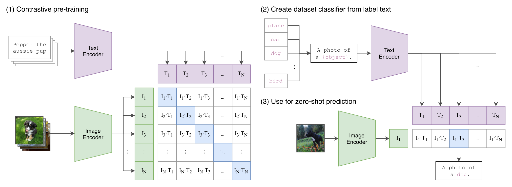
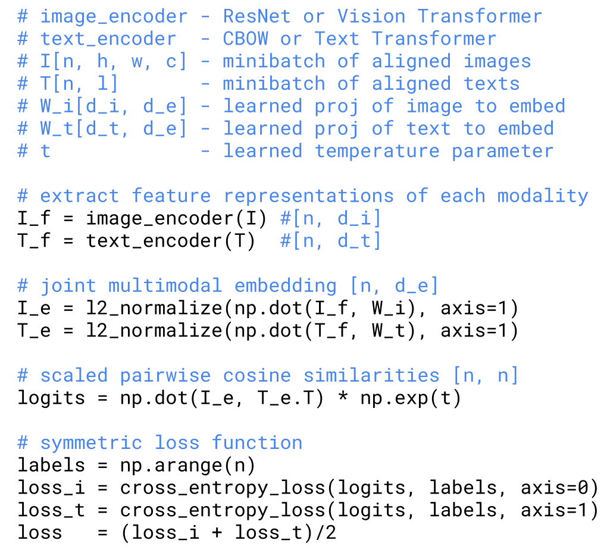
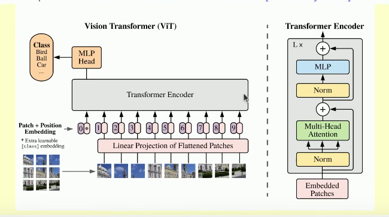
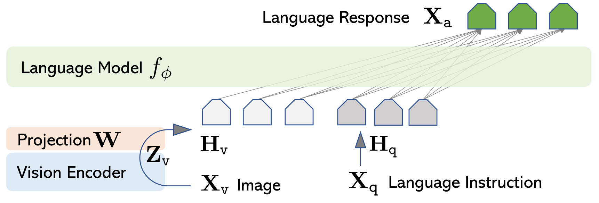
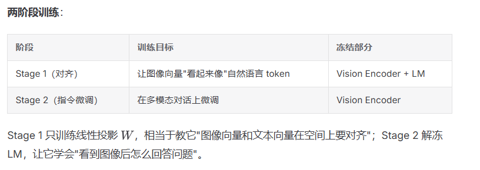

### 一、CLIP（对比式语言图像预训练）
爬取 4 亿对 **(图像, 文本)**，让模型学习"哪段文字描述了哪张图"
#### 1、目标函数
给定一批 𝑛对 (image, text) 配对数据：


- 对每张图像 𝐼_𝑖，希望它与自己对应文本 𝑇_𝑖_ 的相似度远高于与其他 𝑛−1个文本 𝑇_𝑗 的相似度；
- 反过来对每个文本也类似。这相当于：一个 𝑛 路分类问题：对图像 𝐼_𝑖，从 𝑛个候选文本中选出正确的 𝑇_𝑖；
- 另一个 𝑛 路分类问题：对文本 𝑇_𝑖，从 𝑛个候选图像中选出正确的 𝐼_𝑖。
- 两路损失加起来就是 CLIP 的总损失。本质上这就是把图文匹配建模为矩阵分类问题。

```
import torch
import torch.nn.functional as F

def clip_loss(image_embeds, text_embeds, temperature):
    """
    image_embeds: [n, d]  图像特征（已归一化）
    text_embeds:  [n, d]  文本特征（已归一化）
    temperature:  标量    温度参数（可学习）
    """
    # 相似度矩阵：[n, n]
    logits = image_embeds @ text_embeds.T * temperature.exp()

    # 标签：对角线为正例
    labels = torch.arange(logits.size(0), device=logits.device)

    # 两个方向的交叉熵
    loss_i2t = F.cross_entropy(logits, labels)        # 图像→文本
    loss_t2i = F.cross_entropy(logits.T, labels)      # 文本→图像
    return (loss_i2t + loss_t2i) / 2
```


CLIP 损失计算的核心代码：相似度矩阵 + 双向交叉熵

#### 2、数据预处理

**OpenCLIP** 复现并扩展了 CLIP：

- **数据源**：LAION-5B（公开的 50 亿图文对）；
- 训练规模：在 5B 数据上训练，模型规模覆盖多个量级；
- 工程上甚至用 CLIP 自己来过滤数据。具体来说，先用一个小 CLIP 给所有数据打分，只保留置信度高的部分训练大 CLIP。这种"自举"（bootstrapping）虽然有效，但也可能放大原始数据的偏差。

神经网络不喜欢"动态"的东西，而图像的原始分辨率五花八门。CLIP 的处理方式很直接：

- 双三次插值（Bicubic）把短边缩放到 336px；
- 中心裁剪成 336×336 的正方形；
- 归一化后送入视觉编码器。

这个流程对 ImageNet 风格的"主体居中"图像很有效，但对文档截图、卫星图等多内容图像会丢失细节。这一问题在LLaVA OneVision 中得到了解决。

#### 3、视觉编码器--Vision Transformer

ViT 的核心思想是"把图像当成一串 token"：

1. 把图像切成固定大小的 patch（CLIP 默认是 14×14 像素）；
2. 每个 patch 线性投影成一个向量，这就是一个"视觉 token"；
3. 给所有 token 加上 1D 位置编码（实验证明 2D 位置编码相对 1D 并没有显著优势）；
4. 送入标准 Transformer encoder；
5. 最后用一个 attention pooling 层把所有 token 聚合成一个向量。

	什么是 Attention Pooling？
	简单的做法是对所有 token 取平均（mean pooling），但 CLIP 团队发现用一个可学习的 query 向量对所有 token 做 attention 效果更好。换句话说，模型可以学会"重点关注哪些 patch"。这相当于给视觉编码器加了一个"软注意力"的输出层。

CLIP 的最佳配置：

- 视觉端：ViT-L/14@336px（Large 规模、14×14 patch、336×336 输入）；
- 文本端：GPT-2 风格的 Transformer（约 6300 万参数），输入是 [BOS] + 文本 + [EOS]，取 [EOS] 位置的最后一层激活作为整个文本的表示。

#### 4、局限性
设计目标是图像分类，所以学到的特征偏"高层语义"，对细粒度信息（如 OCR、计数、空间关系）不敏感；
依赖超大 batch size（32K 级别），小 batch 下性能急剧下降；
softmax 跨整个 batch 计算，无法在数据子集上独立分解，并行化困难；
对图像中的细粒度文本信息（如文档、表格、字幕）几乎无能为力。


#### 5、SigLip
https://datawhalechina.github.io/diy-llm/chapter15/chapter15_%E5%A4%9A%E6%A8%A1%E6%80%81%E6%A8%A1%E5%9E%8B.html

### 二、VLM(将图像注入语言模型)
用一个现成的LLM和图像编码器组合拼接，而不是从零训练
**核心思想**： **把图像编码成向量，然后"塞进"语言模型，让语言模型基于图像内容生成自然语言回答。**

#### 1、标准范式： Encoder + Adapter + LM

```
┌──────────────┐    ┌────────────┐    ┌──────────────────┐
│  Vision      │    │            │    │  Language        │
│  Encoder     │ ─► │  Adapter   │ ─► │  Model (LLM)     │
│  (CLIP/SigLIP)│   │  (W)       │    │  (Vicuna/Qwen)   │
└──────────────┘    └────────────┘    └──────────────────┘
   图像 → 视觉向量   维度对齐/特征转换   基于视觉条件生成文本
```
1. Vision Encoder：把图像编码成一系列向量（通常是几百个 patch token）。一般直接用现成的 CLIP 或 SigLIP 权重，冻结不训练；
2. Adapter/Projector：一个小型的"桥梁"模块（线性层、MLP 或 cross-attention），把视觉向量"翻译"成 LLM 能理解的"伪文本 token"；
3. Language Model：预训练好的 LLM，接收"文本 token + 视觉 token"的混合序列，自回归生成回答。
这其实是一种"mid-training"或"post-training"。具体做法是：我们不动两个已经预训练好的大模块，只在中间"接一根线"，训练成本远低于从零训练一个多模态模型。

#### 2、LLaVA

LLaVA 架构：CLIP + 线性投影 + Vicuna


后续与详情：
https://datawhalechina.github.io/diy-llm/chapter15/chapter15_%E5%A4%9A%E6%A8%A1%E6%80%81%E6%A8%A1%E5%9E%8B.html