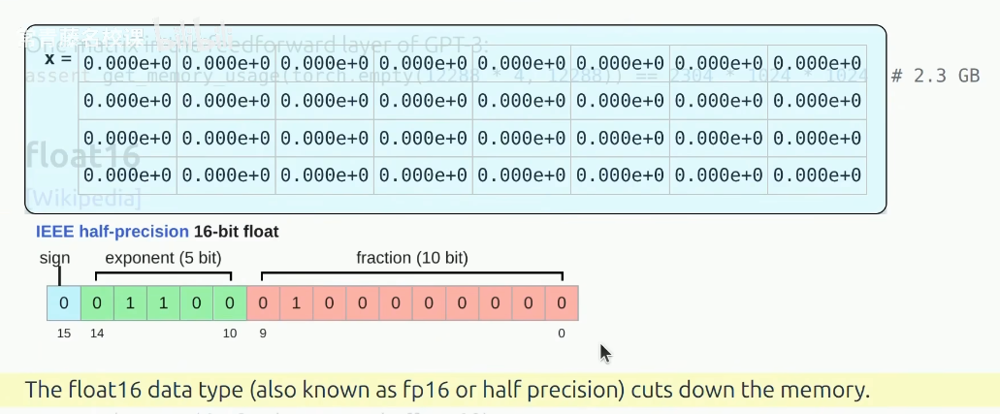
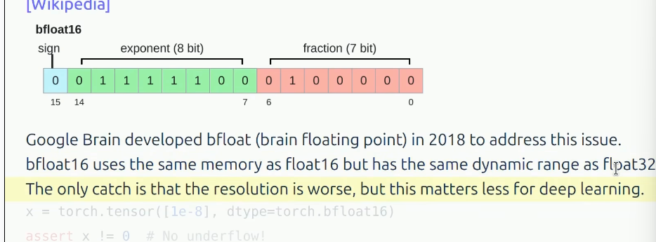
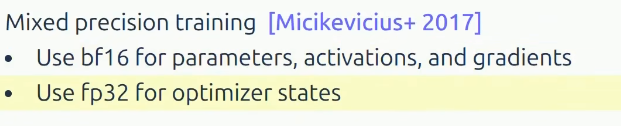
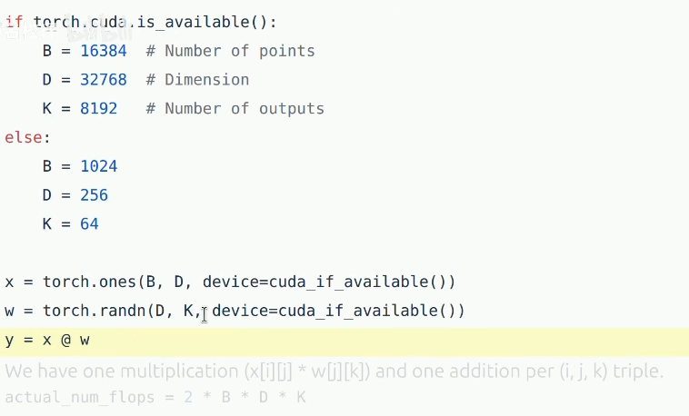
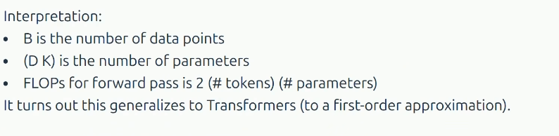
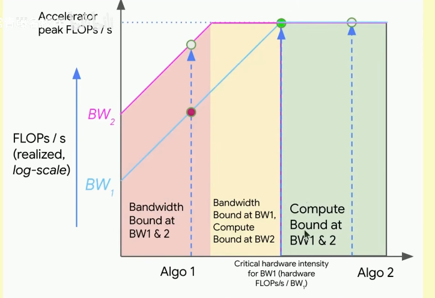

### 1、张量
#### （1）浮点数FP16
动态范围小，容易上下溢出


#### (2)BF16 
总位数不变，但将一部分尾数移到前面的的指数

#### （3）混合精度计算
 

#### （4）张量（内存）计算
张量大小* 每个元素占用的内存

### 2、einops

**命名轴操作张量，替代 reshape / permute / transpose，支持 PyTorch、NumPy、JAX 等。**
**安装**
```
	pip install einops
```
常用操作：
```
import torch

x = torch.randn(32, 3, 224, 224)  # b c h w

# 重排 / 合并 / 拆分
rearrange(x, 'b c h w -> b (h w) c')  # [32, 50176, 3]
rearrange(x, 'b c (h p1) (w p2) -> b (h w) (p1 p2 c)', p1=16, p2=16)  # ViT patch

# 归约
reduce(x, 'b c h w -> b c', 'mean')  # 全局平均池化
reduce(x, 'b c (h h2) (w w2) -> b c h w', 'max', h2=2, w2=2)  # 最大池化

# 重复
repeat(x, 'b c h w -> b c h w r', r=3)
repeat(x, 'b c h w -> b r c h w', r=5)

# einsum
q = torch.randn(2, 10, 64)
k = torch.randn(2, 20, 64)
einsum(q, k, 'b i d, b j d -> b i j')  # [2, 10, 20]
```
语法要点：
	b c h w：轴名

	...：任意维度

	()：合并 / 拆分，如 (h w)

	1：增删长度为 1 的维度

	->：目标形状

### 3、资源核算-浮点数运算
#### (1)线性计算(矩阵乘法与加法)
A(B,D)@X(D,K)其需要计算flops =  2* B* D * K 


#### （2）其他操作的浮点数计算次数
逐元素操作的浮点运算次数就等于矩阵的大小。（都不如矩阵乘法大）

#### （3）神经网络FLops估算

B：数据点数量（Batch Size）
(D,K)：参数量（对应权重矩阵的维度，如 W∈R^(D×K）
Tokens：令牌数量（Transformer 中通常为B×seq_len）
	核心公式:
**FLOPs=2×(# tokens)×(# parameters)**

#### (4) Model FLOPs utilzation(MFU)
actual_time = time_matmul(x,w)
**actual_flop_per_sec** = actual_num_flops / actual_time
**promised_flops_per_sec** = get_promised_flop_per_sec(x.dtype)
**MFU** = actual_flops_per_sec / promised_flop_per_sec (0.5) 

#### (5)屋顶曲线


坐标与概念：
	Y轴：FLops:实际达到的每秒浮点运算次数（对数坐标）
	X轴：计算强度（Compute Intensity），即 FLOPs / Byte（每字节内存传输对应的浮点运算次数）
	Accelerator peak FLOPs/s：硬件加速器的理论峰值算力（顶部的水平虚线）
	BW (Bandwidth)：内存带宽，图中分为 BW_1 和 BW_2。斜线的斜率即为带宽（BW_2 > BW_1）。
	Critical hardware intensity：拐点处的计算强度，是“带宽受限”和“计算受限”的分界线。

解读：
	粉色区域（Bandwidth Bound at BW1 & 2）：
	
	算力受限于内存带宽。
	
	实际算力 = 带宽 (BW) × 计算强度。
	
	随着计算强度增加，算力沿斜线线性上升。
	
	黄色区域（混合状态）：
	
	对 BW_1 仍是带宽受限；对 BW_2 已经变成计算受限。
	
	绿色区域（Compute Bound at BW1 & 2）：
	
	算力触及硬件峰值上限，不再随计算强度增加而上升。
	
	实际算力 = Accelerator peak FLOPs/s。
**优化方向**：
	 如果模型落在粉色区域（如 Algo 1），优化算力应先提高内存带宽（如使用更快的 HBM、减少内存访问）；如果落在绿色区域（如 Algo 2），则受限于硬件峰值算力，需通过模型并行、算子优化等方式压榨硬件极限。
在 LLM 训练中，MFU（Model FLOPs Utilization） 本质上就是衡量实际算力在 Roofline 图中的位置。若受限于带宽，MFU 就会偏低。

#### （6）考虑所有层：神经网络训练的 FLOPs 估算
推广到网络中所有参数（这是 LLM 训练算力预估（如 Scaling Laws）和 MFU 计算的基础公式。用总 Token 数替代“数据点数”，即可快速估算大模型训练所需的总算力）

汇总公式：
前向传播（Forward pass）：2 × (# 数据点数) × (# 参数量) FLOPs
反向传播（Backward pass）：4 × (# 数据点数) × (# 参数量) FLOPs
总计（Total）：**6 × (# 数据点数) × (# 参数量) FLOPs**

（7）梯度累加&激活值检查点技术->节省内存的方法