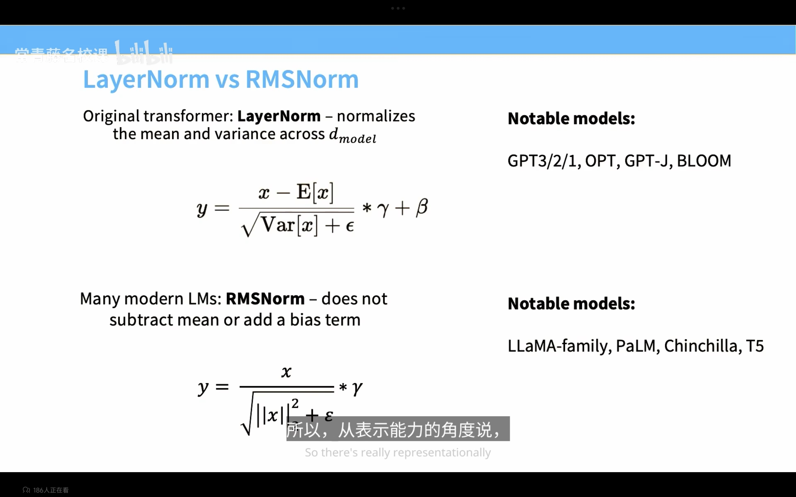
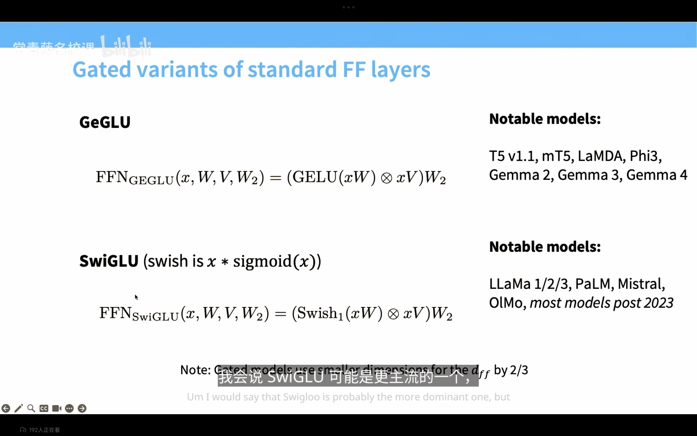
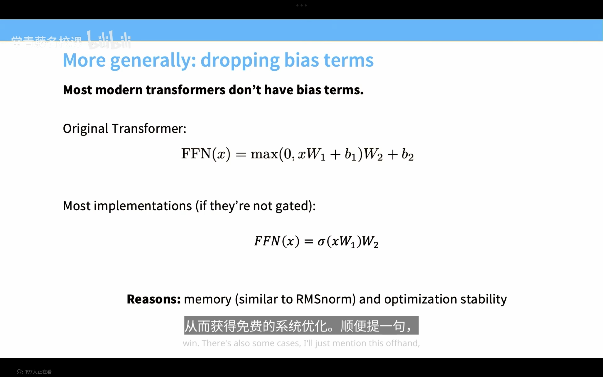
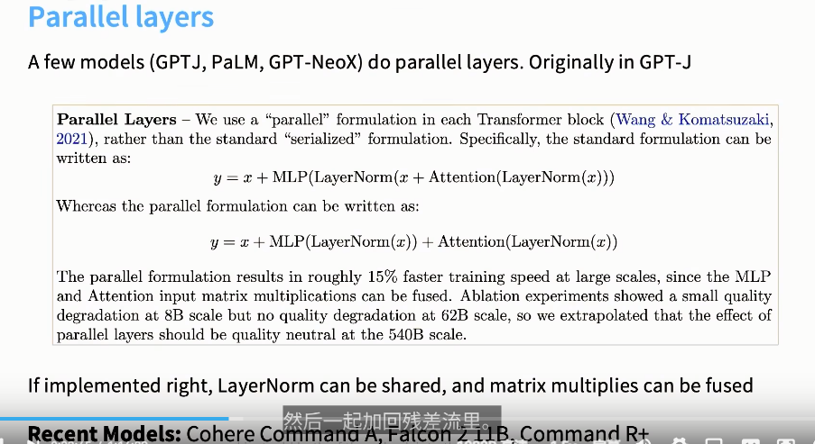
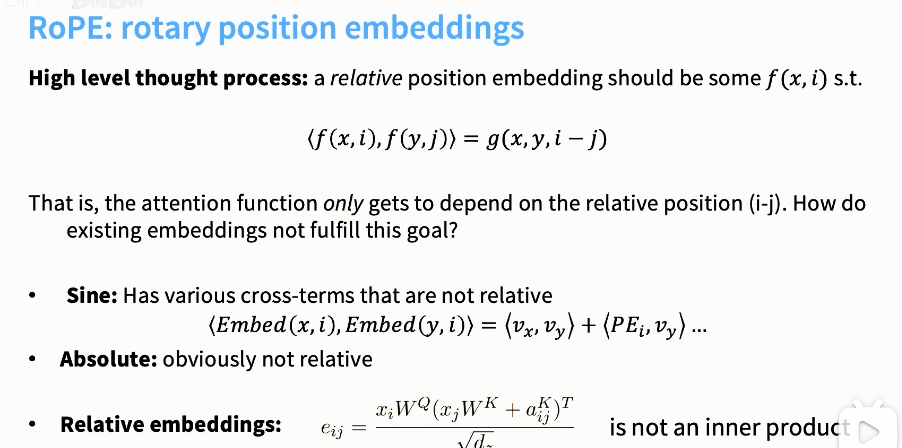
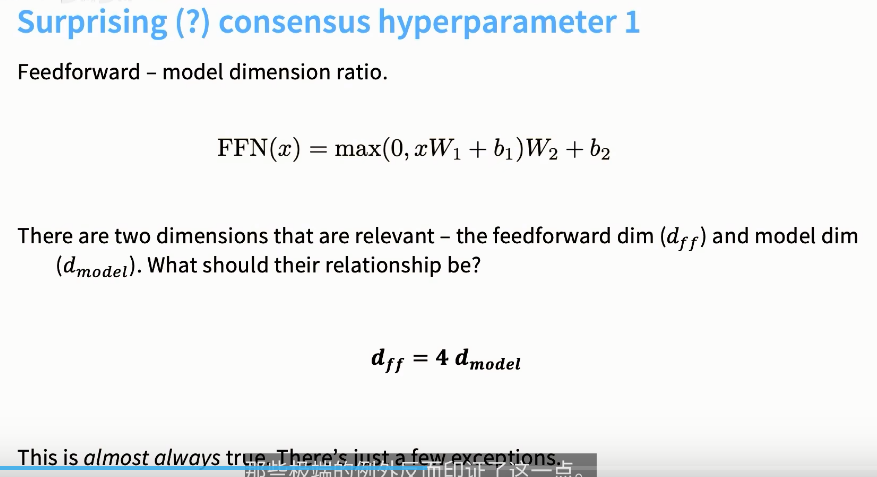
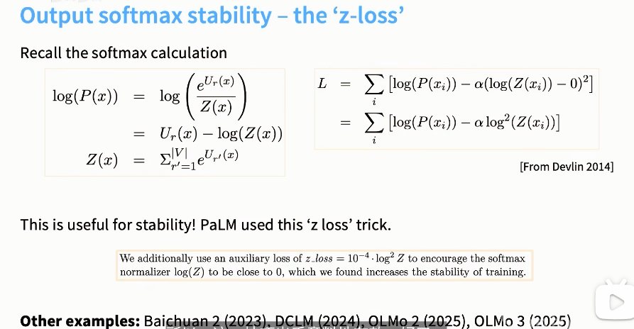
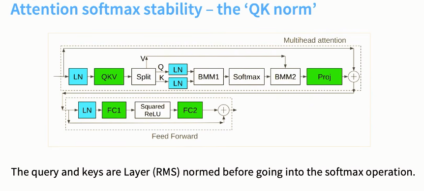
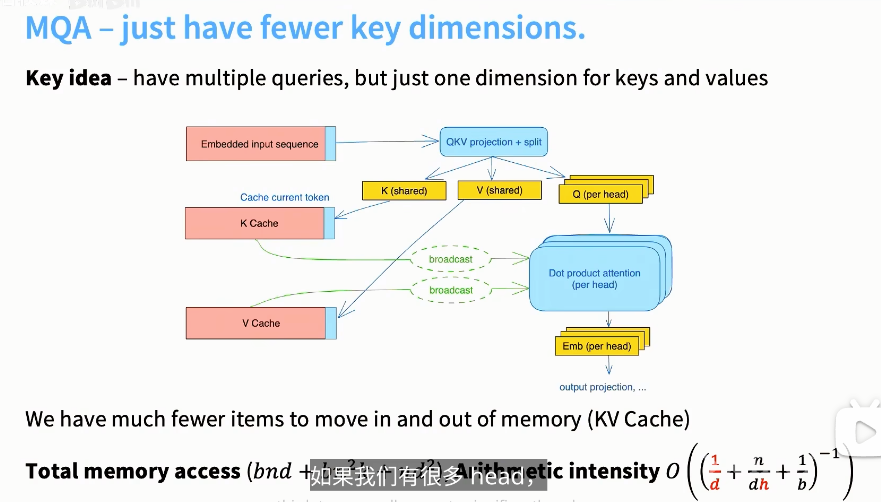
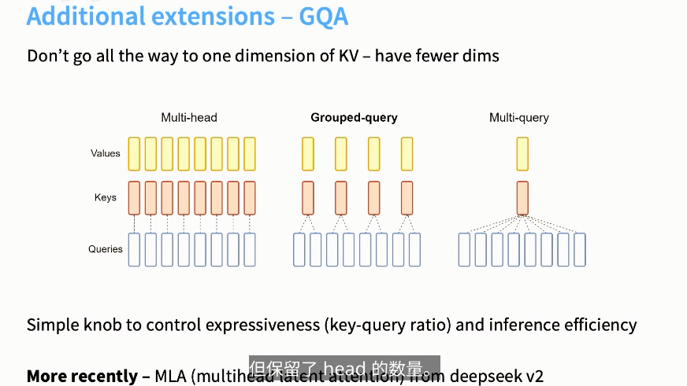

本节课主要讲当前主流 语言大模型的架构对应传统的Transformer架构的 保留部分和改动部分

#### 1、RMSNorm(均方根归一化)
RMSNorm 是当前许多现代大语言模型（LLM）默认采用的归一化方法。它是对原始 Transformer 中 LayerNorm 的简化与改进。

优势：
	减少了求均值（E[x]）的操作，以及广播减法（x−E[x]）和加法（+β）。
	在大规模矩阵运算中，减少这些逐元素的辅助操作能显著降低 GPU 的核函数启动开销和显存带宽占用，从而**加速**训练和推理。

### 2、Pre-Norm
- 归一化普遍采用 Pre-Norm（前置归一化）
- 基本上所有人都使用“**非残差流的归一化**”，通常是指 Pre-Norm（即在残差连接的分支内部进行归一化，而不是在残差相加之后）
- Pre-Norm 能带来更好的梯度传播（Nicer gradient propagation），并减少训练中的 Loss Spike（异常尖峰）
如代码所示：
```
class ResidualConnection(nn.Module):  
    def __init__(self, features: int, dropout: float) -> None:  
        super().__init__()  
        self.dropout = nn.Dropout(dropout)  
        self.norm = LayerNormalization(features)  
  
    def forward(self, x, sublayer):  
        return x + self.dropout(sublayer(self.norm(x)))
```

### 3、GLU 
主流的GeGLU与SwiGLU（更主流），其代替传统的FFN的 ReLU激活函数。即**标准 ReLU FFN 替换成 SwiGLU（带门控机制），核心变化是：把原本的 2 个线性层（w1, w2）改成 3 个线性层（w1, w3, w2），并加入门控乘法。**
改进代码所示：
```
class SwiGLUFeedForwardBlock(nn.Module):
    def __init__(self, d_model: int, d_ff: int, dropout: float) -> None:
        super().__init__()
        # 注意：为了保持参数量持平，这里的 d_ff 建议设为原来的 2/3
        self.w1 = nn.Linear(d_model, d_ff, bias=False)  # 门控分支 (Gate)
        self.w3 = nn.Linear(d_model, d_ff, bias=False)  # 值分支 (Value)
        self.w2 = nn.Linear(d_ff, d_model, bias=False)  # 输出投影
        
        self.dropout = nn.Dropout(dropout)
        self.act = nn.SiLU()  # Swish 激活函数，PyTorch 里叫 SiLU

    def forward(self, x):
        # (batch, seq_len, d_model)
        
        # 1. 门控分支：Swish(xW1)
        gate = self.act(self.w1(x))  # (batch, seq_len, d_ff)
        
        # 2. 值分支：xW3
        value = self.w3(x)  # (batch, seq_len, d_ff)
        
        # 3. 逐元素相乘（门控机制） + 投影回 d_model
        out = self.w2(self.dropout(gate * value))  # (batch, seq_len, d_model)
        return out
```
注意：
SwiGLU 增加了一个 w3（变成了 3 个矩阵）。初始化时传入的 d_ff 应该设为原来的 2/3（比如原来 d_ff=4*d_model，现在通常设为 d_ff = int(8/3 * d_model)）


### 4、去除bias
- 去除FFN线性层的bias,以**节省内存和优化稳定性**
- 如3的代码所示self.w1 = nn.Linear(d_model, d_ff, ==🔴*bias=False*==)
- **不仅FFN**, 现代大模型的Attention层（QKV 投影和输出投影）通常也加上 `bias=False`


### 5、Transformer模块并行化（并不流行）


### 6、位置编码嵌入
当前主流的位置嵌入是RoPE


### 7、超参数
#### 1、前馈层大小与模型维度的比例：4倍

如果使用GLU则缩放为2/3

#### 2、 多头注意力的并行计算的共识超参数
公式：Head-dim * Num-heads = Model-dim （即每个头的维度 × 头数 = 模型总维度）

#### 3、宽高比 **(Aspect Ratio)** 

= d_model​/N_layer​（模型维度 / 层数）,最佳纵横比大约在100左右

#### 4、词汇表大小

#### 5、正则化
在预训练阶段，现代 LLM 几乎完全放弃了 Dropout，转而全面依赖 Weight Decay（权重衰减）和 AdamW 优化器来防止过拟合、维持训练稳定。

### 8、训练稳定性
主要关注框架的softmax
#### 1、output Softmax: Z-loss

α 是一个很小的权重系数,αlog2(Z) 是一个惩罚项。它强制将 log⁡(Z)log(Z) 拉向 0（即让 ZZ 趋近于 1）。

#### 2、Attention Softmax ：QK-Norm


在注意力机制的 softmax 操作之前，对 Query (Q) 和 Key (K) 向量进行 LayerNorm 或 RMSNorm 处理

### 9、注意力机制（密集全注意力）干预机制
#### 1、GQA&MQA
降低注意力头的计算与内存开销

在自回归推理（Decoding）阶段，序列长度 n 会变得很大，而批次大小 b 通常很小（甚至为 1）。此时，bhn ^2 （标准MHA的总内存访问量）项带来的内存访问瓶颈会极大地拖慢推理速度（显卡的计算核心大量时间在等待显存读写，而非做计算）

**解法**：减少键和值（KV）的头的数量（h），从而极大降低 bhn^2中的内存访问量，提升算术强度.

##### (1)MQA:降低KV缓存开销
有多个查询头（Multiple Queries），但键和值（Keys, Values）**只有一个**维度（单头共享）。所有的注意力头共享同一份 K 和 V。

代价：丢失了 K 和 V 在多头视角下的多样性，可能在一定程度上影响模型的性能上限（表达能力）

##### （2）GQA
（不要像 MQA 那样极端地把 K、V 降到 1 个头，而是保留几个头/组。）


- 控制表达能力（Expressiveness）：通过调整 Q 和 K 的比例（组数 G），控制模型保留多少多样性。组数越多（越接近 MHA），表达能力越强；组数越少（越接近 MQA），推理越快。

- 控制推理效率（Inference Efficiency）：组数越少，KV Cache 越小，内存带宽压力越低。

- 完美折中：GQA 避免了 MQA 可能带来的明显性能下降，同时保留了大部分由 KV Cache 缩减带来的推理加速效果。
#### 2、滑动窗口注意力

每个 Token 在进行注意力计算时，不再关注前面所有的 Token，而只关注自己周围固定大小的一个“窗口”内的 Token（通常窗口大小为 w）。

滑动窗口注意力：Token i 只关注 [i−w,i] 的 Token。


