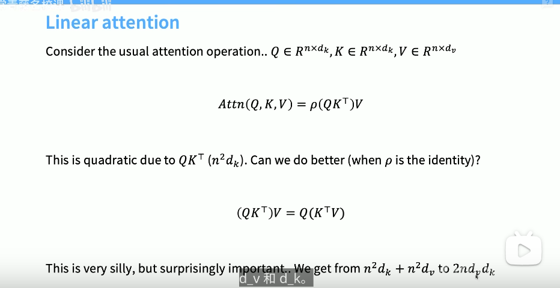
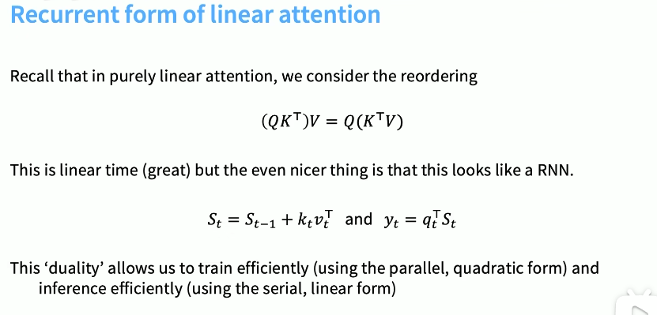
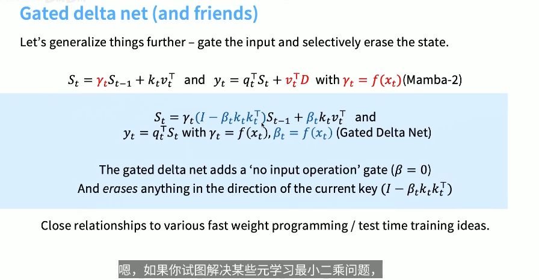
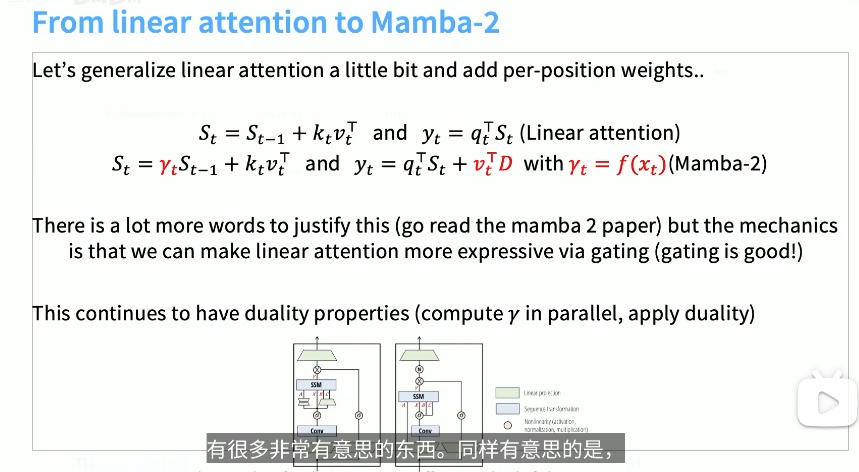
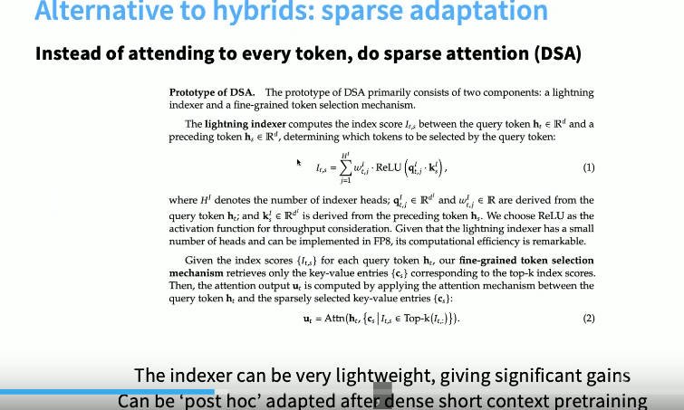
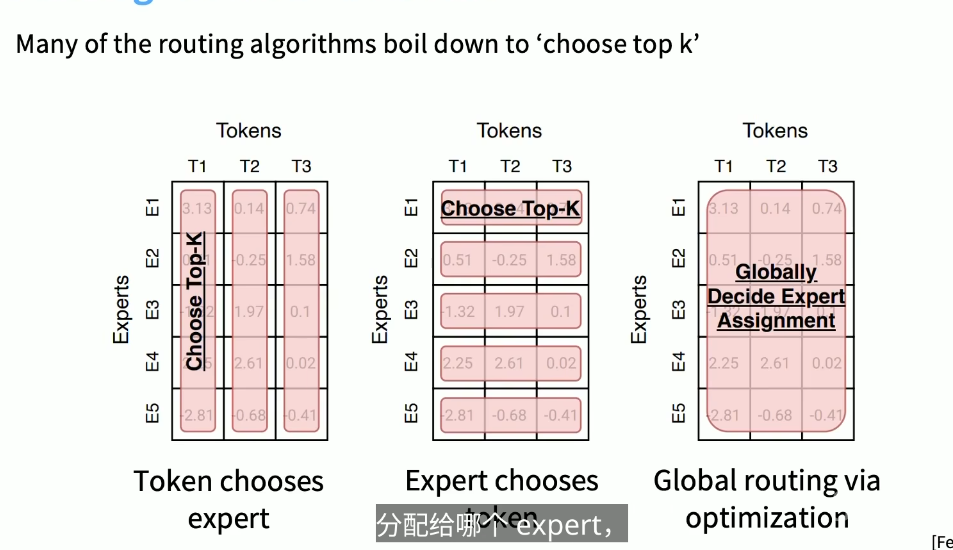
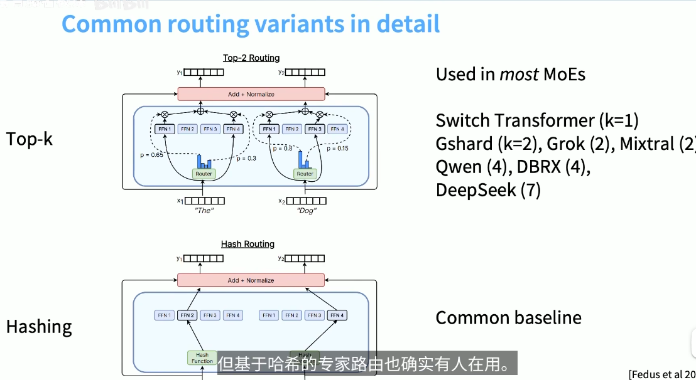
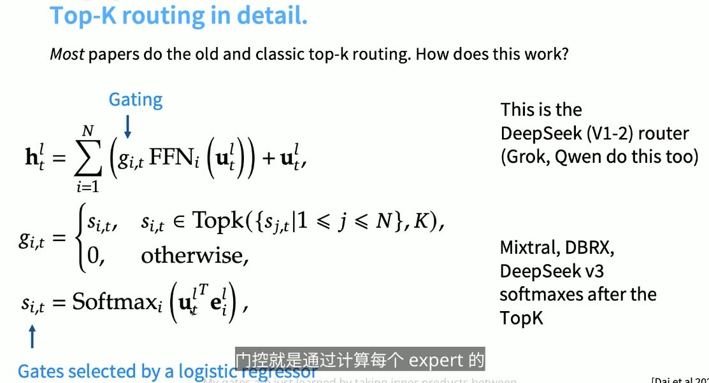
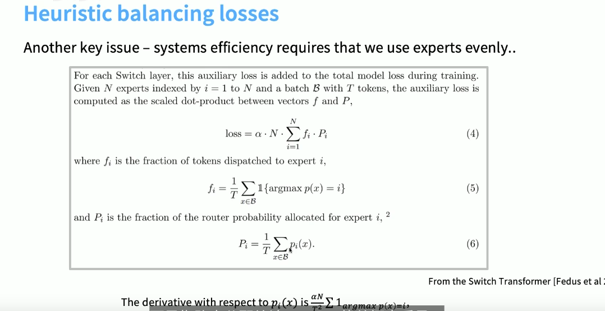

本节课第一部分主要讲的是注意力机制的替代方案，通过架构上的改进，能够处理**更长的上下文**。通过其，能让计算复杂度与序列长度呈**线性关系**，而非次方。
第二部分则是 **混合专家**，通过改进**多层感知机**（MLP）部分。混合专家MoE能显著提升硬件的利用效率。

### 一、注意力替换
#### 1、Linear attention
通过改变矩阵乘法的结合顺序，把标准注意力机制中昂贵的 O(n^2) 计算复杂度降低到 
O(n),n是序列长度
- O(n^2) 根源：标准 Attention 因 Softmax 的逐行非线性，必须显式构建 n×n 注意力矩阵，无法使用结合律。
- 理论突破口：若去除 Softmax（ρ=identity ），利用 (QK ⊤ )V=Q(K ⊤ V) 可将复杂度降至O(n) ，但实际不可直接用。
- 两大落地路线：
	- 核近似：用特征映射 ϕ(⋅) 替代 Softmax（如 Performer），恢复线性结构，但有精度损失。
	- 架构替换：放弃 Attention 范式，采用 RNN/SSM（如 RWKV、Mamba），天然实现 O(n) 推理。
- 核心权衡：Linear Attention 并非免费午餐，本质是在效率、精度与训练稳定性之间做 Trade-off。

##### （1）Linear Attention 的循环形式（RNN Form）：

其**结构天然类似RNN.**
St状态更新，Yt输出计算，每个token只需要维护一个固定大小的“记忆矩阵”St
- **训练时**：用并行化的矩阵乘法（二次形式），高效批处理。
- **推理时**：用串行的 RNN 形式（线性形式），常数内存、流式生成。
(把 Attention “伪装”成 RNN —— 训练像 Transformer，推理像 LSTM)

##### (2) Gated Delta Net(及同类架构)
在循环状态更新中引入**门控机制**，实现“选择性记忆”与“定向遗忘”

基础形式（Mamba-2）:
	其中==🔴y_t== =f(x_t) 是控制历史状态的保留比例（衰减门）
	
进阶形式（Gated Delta Net）：
	- 新增 β t门控 + 方向性擦除项 (I−β_t*  k_t^⊤) ，可主动清除与当前 key 相关的历史信息
	- 无输入操作”门（ β=0 ）：跳过更新，保持状态不变
	- 向擦除：精准抹去特定方向的历史干扰，提升长程依赖建模精度

##### (3) 从 Linear Attention → Mamba-2：关键升级

#### 2、DSA - DeepSeek Sparse Attention

DSA 是一种 推理阶段 的稀疏注意力策略，专为 DeepSeek 的 MLA（Multi-head Latent Attention）架构设计，核心思想是 "只算重要的 KV"。

### 二、MoE -Mixture of experts
一句话：更高效的MLP？
#### 1、路由函数
注意：对齐颗粒度是 Token

基本上主流做法是：**token 选择**Top-K个experts的模式

##### 1、路由策略：

###### （1）Top-K Routing(主流)
- Router（路由器）：这是一个可学习的线性层。对于每个输入 token（如 "The", "Dog"），它会计算出一个概率分布 p ，表示该 token 属于各个专家的“匹配度”。
- Top-k 选择：模型只选取概率最高的 k 个专家。

- 图中显示的是 **Top-2**：token "The" 被分给了 FFN 1 (65%) 和 FFN 2 (30%)；token "Dog" 被分给了 FFN 1 (80%) 和 FFN 4 (15%)。
	**注意：不同的模型k 值不同**。
- 加权求和：最终输出是这几个被选中专家输出的加权和（权重就是那个概率 p ）

###### （2）Hash Routing（哈希路由 / 基线方案）
- Hash Function（哈希函数）：不经过任何学习，直接根据 token 的 ID 或特征，通过数学公式（哈希）强行映射到某个固定的专家。

- 确定性：只要 token 一样，永远去同一个专家。没有概率，没有加权。

###### （3）其他方法
强化学习、赌博机方法

##### 2、Tok-K细节

u_t: 当前token的向量表示
e_i: 第 i 个专家的特征向量

ps: 细粒度专家 与 共享专家
细粒度专家：
	把原来 1 个大 FFN 拆成 N 个小 FFN（比如 256 个专家，每个隐藏层维度只有 512）。每个专家只负责极窄领域的知识或技能。解耦知识，提升表达能力。适配Top-K,但代价就是 通信开销剧增
共享专家 (Shared Expert)：
	永远被激活，不参与路由竞争。它**专门学习通用的、跨领域的、高频的基础特征**。相当于模型的“基底能力”或“操作系统”

##### 3、MoE训练中的问题：
负载不均衡--辅助损失函数

f_i:实际负载频率：专家 i 实际接收到的 token 比例
p_i:平均路由概率：所有 token 分配给专家 i 的概率均值
N:专家总数
a：权重系数
#### 2、专家大小（数量/规模）

#### 3、训练
z-loss
upcycling
MTP