  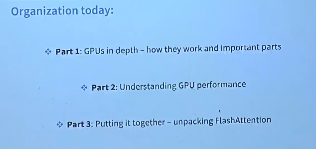
### 一、GPU的宽泛介绍
#### 1、GPU相对CPU更关注于吞吐量，而非控制与计算效率

#### 2、执行单元（三个核心层级）

SP (Streaming Processor, 流处理器)：
- 图中 SM 内部绿色的小块（类似 CUDA Core）。
- 功能：执行最基本的运算操作（加、乘等）。
- 对应软件概念：Thread（线程）。每个 SP 在某个时刻并行执行一个 Thread。

SM (Streaming Multiprocessor, 流多处理器)：
- 图中左侧包含多个 SP 的集成模块（包含绿色的 SP 和蓝色的调度/缓存单元）。
- 功能：包含多个 SP，**负责独立的调度和资源分配**。
- 对应软件概念：Block（线程块）。一个 SM 可以独立执行一个或多个 Block（任务）。

GPU (Graphics Processing Unit)：
- 图中右侧是完整的 GA100 芯片，包含 128 个 SM（专为深度学习设计的算力怪兽）。
- 功能：集成大量 SM，提供恐怖的总并行处理能力。

总结：SM 内部包含大量 SP，它们可以并行执行成千上万个线程（Threads），GPU 包含大量 SM，它们各自为战，独立并行处理任务块（Blocks）。
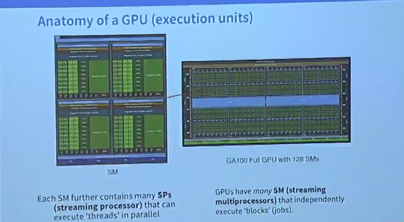

#### 4、GPU内存
全局内存 
##### 1）内存层级（Volta+ 架构）：
	- 全局内存（HBM）：大而慢，负责静态存储。
	- L2 缓存：全芯片共享，中间缓冲。
	- L1 / Shared Memory (统一 SRAM)：物理同源，容量极小，速度极快。软件可以通过 Shared Memory 接管，用于极致的数据复用。
	- 寄存器（Registers）：每个线程独有，速度最快，FlashAttention 的核心战场。

##### 2）FlashAttention &GQA/MQA
传统 Attention 最大的问题，是把庞大的 N×N 的注意力矩阵写回了极慢的 Global Memory (HBM)，随后又读出来（往返延迟极高）。
FlashAttention 的核心，就是把 Q、K、V 的切片加载到极快但极小的 SM 内部（SRAM / Registers），算完之后直接输出结果。它用极其聪明的 Online Softmax 算法，避免了中间矩阵在 HBM 和 SRAM 之间的反复搬运，把内存访问量降到了最低。

推理时，KV Cache 存储在 Global Memory (HBM) 中。每次生成 Token，都要把巨大的 KV Cache 读出。由于 HBM 的带宽和延迟存在物理瓶颈，当 Batch Size 较小时，GPU 计算单元大量时间都在等数据。GQA/MQA 直接切掉了大量 KV 头，极大降低了需要从 HBM 读出的数据量（Memory Traffic）。

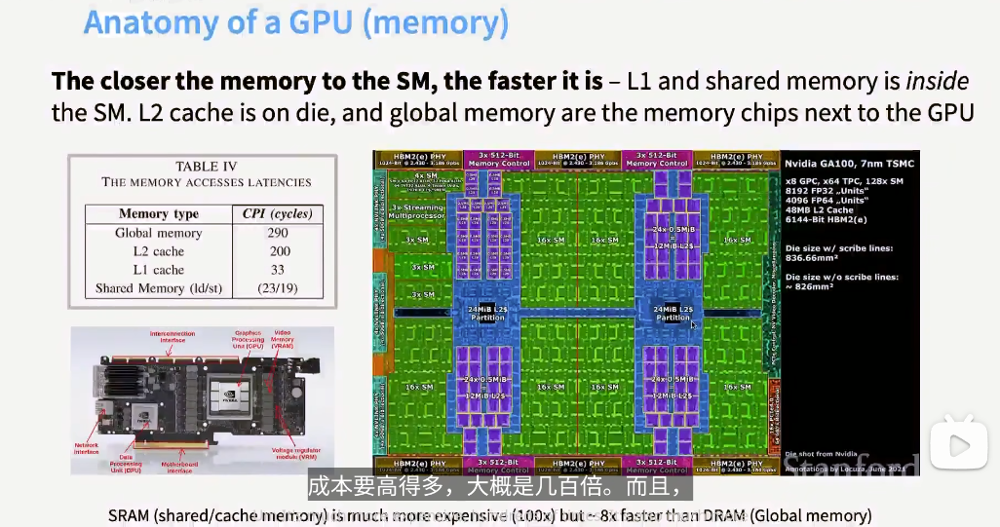

#### 5、GPU执行
重要角色：

Threads（线程）
定义：实际“干活”的单元（do the work in parallel）。
特点：SIMT (Single Instruction, Multiple Threads) 架构。所有线程执行相同的指令，但处理不同的输入数据。

Blocks（线程块）
定义：线程的分组（groups of threads）。
特点：每个 Block 会被分配给一个 SM（流多处理器） 独立运行，并且拥有自己专属的 Shared Memory（共享内存）。

Warp（线程束）
定义：GPU 硬件调度的基本单位。
特点：32 个连续编号的线程组成一个 Warp。硬件永远以 Warp 为单位进行指令的取指和执行。

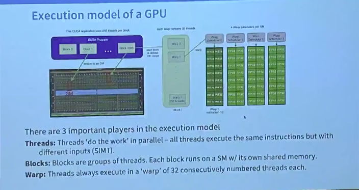

#### 6 ReCap
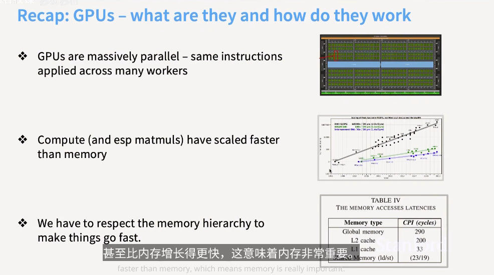

### 二、加速
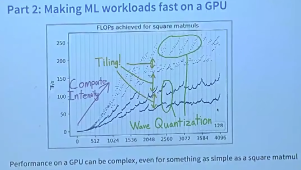
技巧：
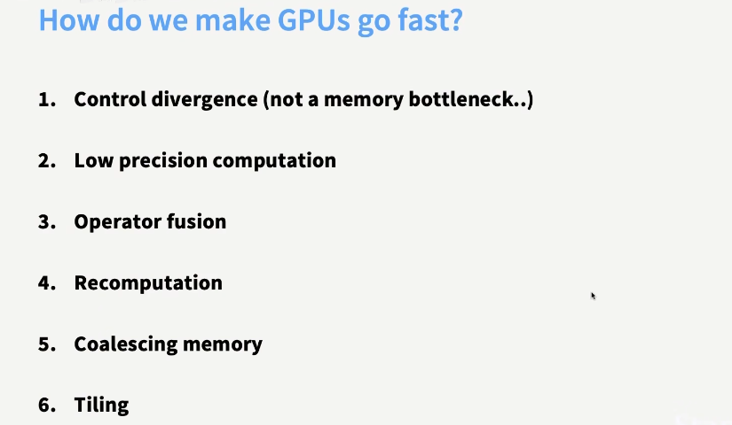

#### 1、Control divergence
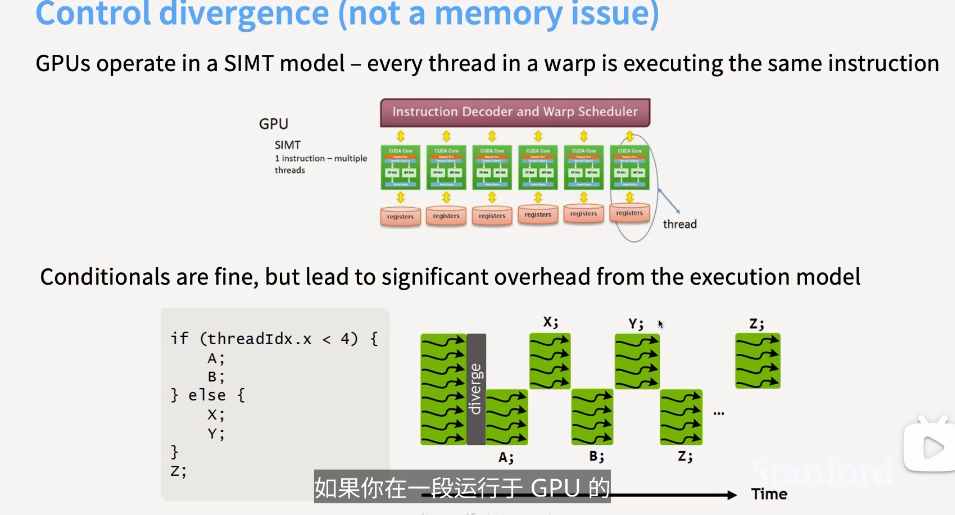
为什么慢：
- 控制流分歧属于计算/执行架构问题，**而非内存问题**，代码里用 if-else 条件分支在逻辑上没问题，但由于 GPU 的执行模型，会带来巨大的性能开销。
- 原本可以 32 个线程并排一步走完的流程，因为分支不同，被迫拆成了两步（先走 `if`，再走 `else`
- 如果分支嵌套极深或者极其频繁，GPU 的并行加速比会被彻底摧毁，甚至退化成比 CPU 还慢

**优化思路：**
**规避数据相关的分支**：如果某个 if 条件依赖于当前的 Token 数据，就极容易引发 Warp 分歧。尽量用数学运算（如掩码 Masking、乘法代替选择）来平替 if-else。

**保持同一 Warp 内执行路径一致**：如果必须有分支，尽量让分支的粒度对齐 Warp（32 的倍数）。比如 threadIdx.x 的前 32 个线程走一条路，后 32 个走另一条路，这样每个 Warp 内部是统一的，就不会有分歧。

#### 2、Low precision computation
使用低精度（FP16/BF16，甚至是 FP8）存储和传输数据：

- 显存带宽占用减半：显卡可以在同样的时间内喂给计算核心双倍的数据。
- 显存容量占用减半：可以放入更大的模型或更大的 Batch Size。
- 计算速度翻倍：现代 GPU 的 Tensor Core 处理 FP16/BF16 的硬件峰值算力（FLOPs/s）远高于 FP32。
现代模型在训练时需要 **混合精度训练**（Mixed Precision） 和 Loss Scaling：用 FP16 存数据省带宽，用 FP32 维护主权重保精度。

#### 3、Operator fusion
算子融合是指将计算图中的多个独立算子（Operators）合并成一个单一的 Kernel（核函数），在 GPU 上一次性执行完毕。
#### 4、Recomputation
在训练神经网络时，不保存前向传播过程中所有的中间激活值（Activations），而是只保存少数几个“检查点（Checkpoints）”。在反向传播需要用到这些中间激活值时，利用最近的检查点重新进行一次前向计算来临时生成它们。用完即销毁。
**收益（省显存）**：激活值的显存占用从随层数线性增长变为常数量级（只需保存检查点的数据）。这允许我们训练更大的模型、使用更大的 Batch Size 或更长的上下文。
**代价（算力增加）**：计算量增加了约 33%。
**实现经典策略**：每隔 L层保存一个检查点（L 为总层数），这样显存和重计算的开销都最小化。
#### 5、 Coalescing memory
当 GPU 执行内存读取/写入指令时，如果同一个 Warp（32个线程） 中的线程访问的是全局内存（Global Memory）中连续、对齐的内存地址，硬件会自动将这些请求“合并”成一次或少量的宽泛内存事务（Memory Transaction）。
#### 6、Tiling
通过重新组织线程和计算顺序，将数据分块，从而最小化全局内存访问

Tiling（分块）的逻辑是：“**在全局内存里跑得慢，那我们就切一块搬到极快的缓存里算**。”
1. 协作加载 (Coalesced Load)：不再让每个线程独立去全局内存取数。而是让一个 Block 内的所有线程（如 256 个线程）排好队，手拉手（Coalesced），把 M 矩阵的一块（Tile）和 N 矩阵的一块（Tile）一次性搬运到 SM 内部的 Shared Memory（共享内存） 或寄存器中。

2. 分块计算 (Tiling Compute)：线程在 Shared Memory 内部进行矩阵乘法。由于 Shared Memory 速度极快（延迟仅 20 多个时钟周期），数据可以无限次复用，彻底告别全局内存。

3. 流水线滑动 (Pipelining)：算完这块 Tile 后，再协作把下一块 Tile 搬进来，像铺地砖一样把整个大矩阵算完。

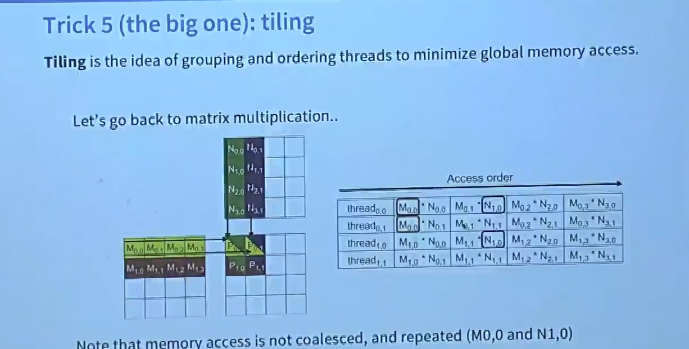

#### Recal
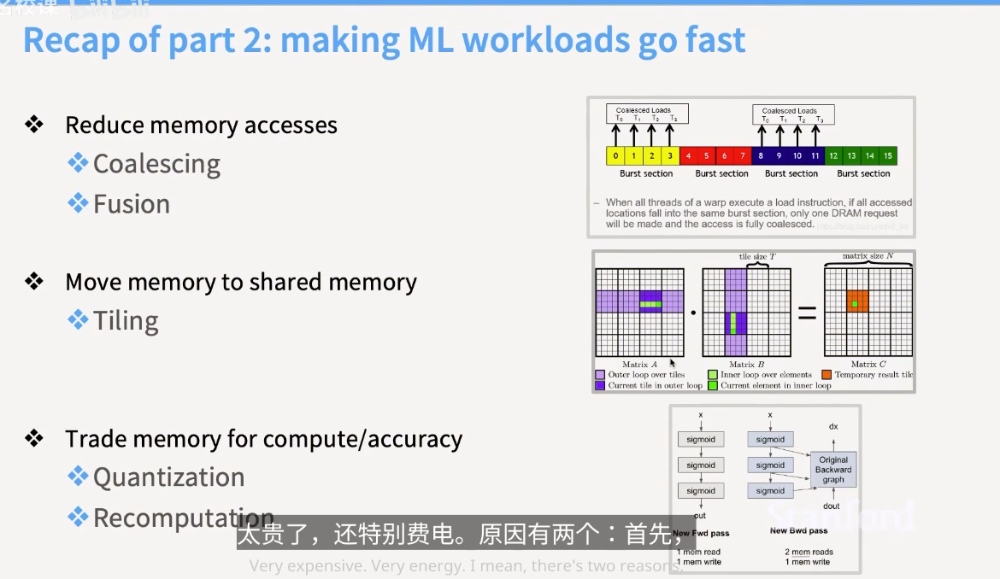

### 三、FLASH ATTENTION
FlashAttention 极大地加速了注意力计算，它的核心不是减少了计算量（FLOPs），而是大幅减少了全局内存（HBM）的读写次数。

#### 1、分块
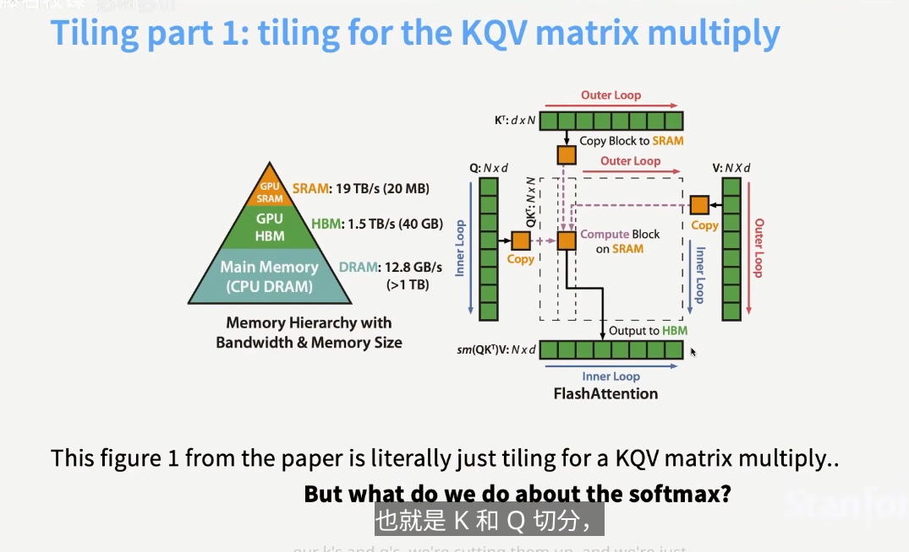

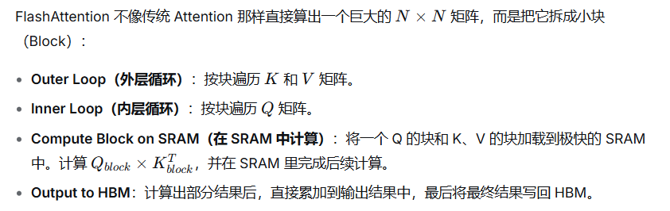

#### 2、在线Softmax
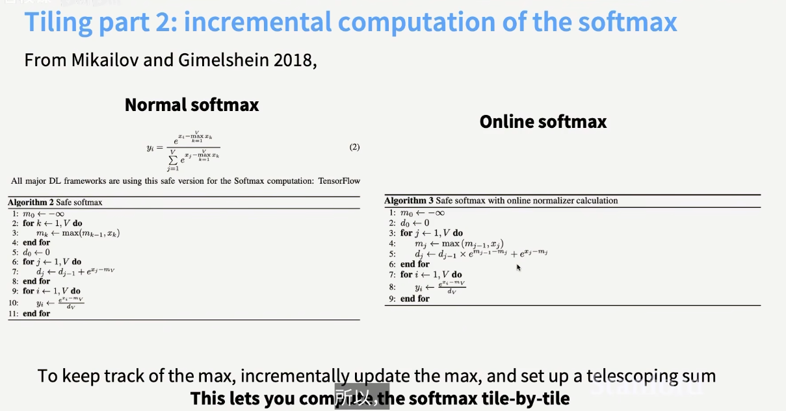

标准 Softmax 的数学定义：必须知道当前行全局的最大值（防止指数爆炸），以及全局的指数和（分母）。
**但**Tiling 的物理限制：把 Q,K 切成小块流入 SRAM 后，每次只能看到部分数据。如果不把整行存下来，**根本无法提前知道**全局最大值和分母。

通过增量更新最大值，并利用一种“望远镜求和”的数学技巧，让我们可以分块（tile-by-tile）计算 Softmax.只需遍历一遍。
一边读取数据，一边动态更新当前的最大值 m_j和累加和 d_j

#### 3、 FlashAttention 的前向传播 (Forward Pass)
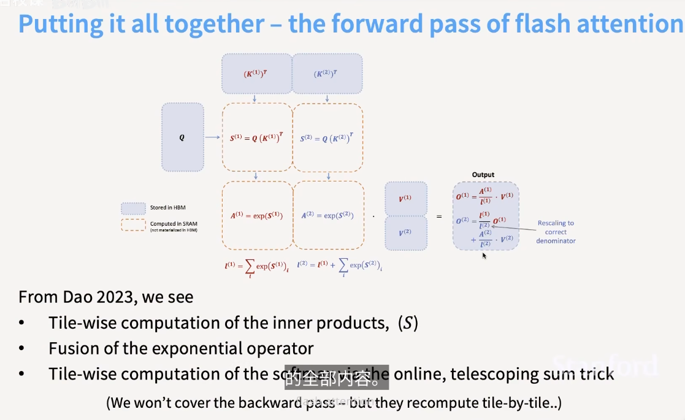

#### ReCap:
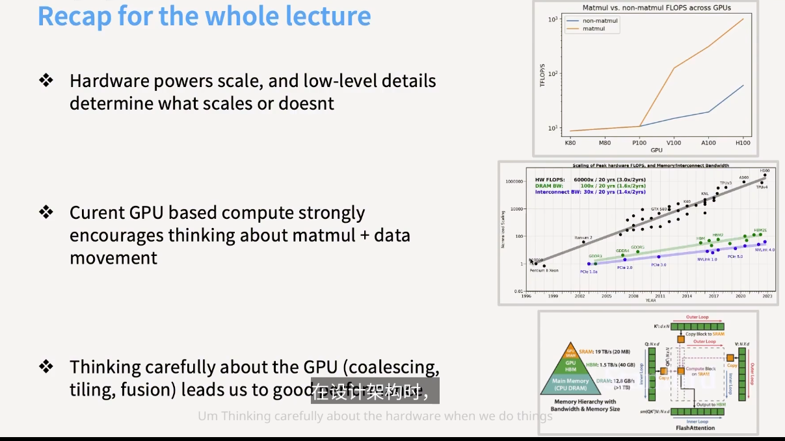