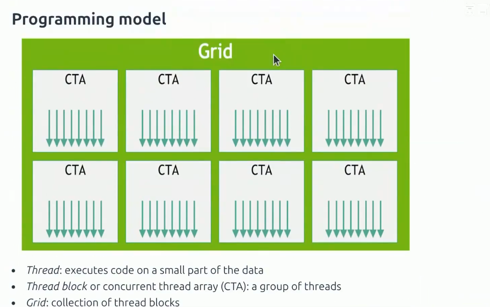
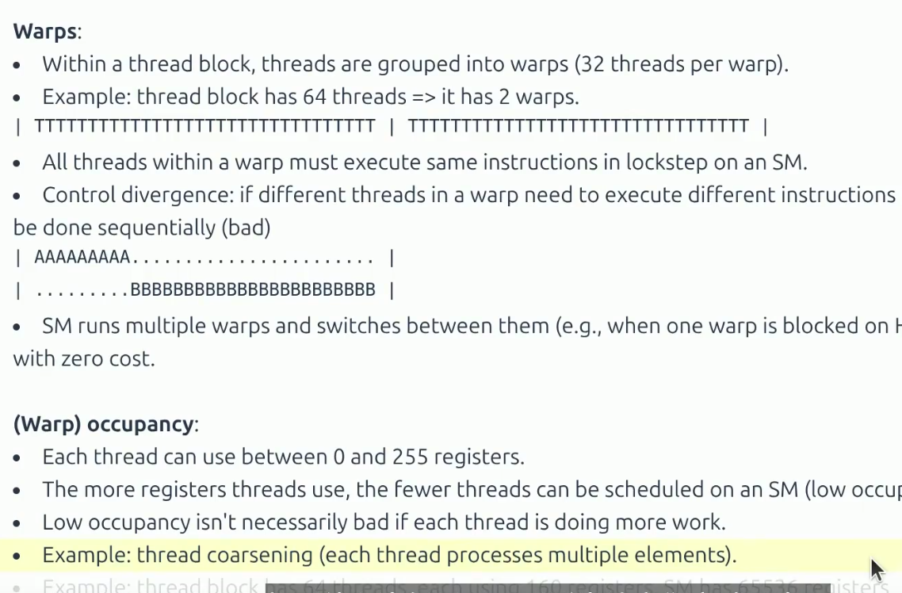

### 一、GPU
1、

- Grid（网格）：对应一次 Kernel 的启动（Launch）。它代表整个 GPU 设备（Device）上要执行的任务全集。

- CTA / Thread Block（线程块）：这是硬件资源分配的核心单元。图中的每个 CTA 会被整体调度到一个 SM（流多处理器） 上。一个 SM 可以同时驻留多个 CTA（具体取决于寄存器、Shared Memory 的消耗）。

- 关键点：同一个 CTA 内的 Thread 可以通过极快的 Shared Memory（SRAM）进行通信和同步（__syncthreads()）。而不同 CTA 之间的 Thread 无法直接同步，它们只能通过代价高昂的 Global Memory（HBM）交互。

- Thread（线程）：图中每个 CTA 里的“小箭头”，对应 CUDA Core 上执行的指令流。但请记住，物理硬件调度的最小单位不是单个 Thread，而是 Warp（32 个 Thread）。

2、

#### 1. Warp 与 SIMT 架构 (Single Instruction, Multiple Threads)
- 硬件物理结构：一个 Warp 固定包含 32 个 Thread。这不是软件规定的，而是因为 SM（流多处理器）内部的 CUDA Core 是被划分为 4 个处理块（Processing Blocks），每个块有 8 个 Core，一次调度正好执行 32 个线程。

- Lockstep（步调一致）：Warp 内的 32 个线程**共享同一个 Program Counter (PC，程序计数器)**。它们在同一时刻只能接收同一条指令。

- Control Divergence（控制流分歧）：也就是图中 AAAAAAA... 和 ....BBBBBBB 的图示。如果 32 个线程中，16 个走 if 分支，16 个走 else 分支，硬件会把两条路径串行化。

	- 底层代价：走 if 时，另外 16 个走 else 的线程会被 Mask 掉（挂起/休眠，不执行指令），反之亦然。直接导致算力利用率减半甚至更多。

	- LLM 中的实战：这就是为什么在写 Attention 的 causal mask 或者处理变长序列（Padding）时，必须极度小心。如果在同一个 Warp 内，有的线程处理的是有效 Token，有的处理的是 Padding，就会触发严重的 Warp 分歧，导致 KV Cache 的算力白白浪费。

#### 2. 零成本上下文切换 (Zero-cost context switch)
幻灯片提到：“当某个 warp 阻塞在内存访问时，SM 可以在多个 warp 之间切换，成本为零”。

CPU vs GPU：CPU 做线程上下文切换时，需要把寄存器数据写回内存（保存现场），代价极高（几千个周期）。但 GPU 采用的是 硬件多线程（Hardware Multithreading）。

**物理现实**：SM 内部有海量的物理寄存器堆。一个 SM 上可以同时驻留几十个 Warp，每个 Warp 独占一组寄存器。当 Warp A 撞上“内存墙”（比如向 HBM 发出读取请求，需要等几百个周期），SM 的 Warp Scheduler 会直接下一个时钟周期切换到 Warp B 执行。

本质：用“线程级并行（TLP）”来掩盖“长延迟”。这也是为什么我们在 GPU 上追求高 Occupancy 的根本原因——你需要足够多的备胎（Warp）来填补内存延迟的坑。

#### 3. Occupancy（占用率）与 Thread Coarsening（线程粗化）
这是幻灯片下半部分的核心，也是高性能 Kernel 优化的分水岭：

寄存器墙 (Register Pressure)：每个 SM 的寄存器数量是固定的（比如 65536 个）。如果每个 Thread 使用 255 个寄存器，那么一个 Warp 就需要 255 * 32 = 8160 个寄存器。SM 能容纳的 Warp 数量骤降，Occupancy 变得极低。

反直觉结论：“Low occupancy isn't necessarily bad if each thread is doing more work.”

Thread Coarsening（线程粗化）：也就是幻灯片高亮的例子。假如你有一个1024×1024 的矩阵，你有两种选择：

	不粗化：启动 100 万个线程，每个线程算 1 个元素。（上下文切换频繁，每个线程都要去 HBM 读数据）
	
	粗化：启动 25 万个线程，每个线程用寄存器算 4 个元素。（每个线程占用更多寄存器，Occupancy 下降）
	为什么粗化有好处？

		- 复用寄存器数据：如果每个线程算 2x2 的块，4 个线程就可以共享读取的数据，极大减少了 Global Memory 的访存次数（算术强度提升）。

		- 隐藏延迟：一个线程内部通过指令级并行 (ILP) 执行多条独立指令（比如同时算 4 个加法），即使不需要切换 Warp，也能填补流水线的气泡。

经典案例：FlashAttention 的 Forward Kernel 就是典型的“低占用率但极高效率”的代表。它把大量的寄存器用于缓存 Q,K,V 的 Tile 块，导致 SM 上驻留的 Warp 很少（低 Occupancy），但每个线程内部干了极其复杂的 Online Softmax 运算（高 ILP），从而把 HBM 访存降到了极致。

### 二、基准测试与性能分析
#### 1、宏观基准
在跑大模型（如 LLaMA 训练/推理）时，我们通常看两个核心指标：

Throughput（吞吐量）：每秒处理的 Token 数（Tokens/s）或每秒完成的样本数（Samples/s）。
Latency（延迟）：生成单个 Token 的时间（Time to First Token, Time per Output Token）

#### 2、围观基准 （工具：Nsight Systems (nsys) 和 Nsight Compute (ncu)。）
##### 1. nsys（系统级时间线分析）
它告诉你 Kernel 之间的“空隙”在哪里。
- CPU-GPU 重叠：你的 DataLoader 是否阻塞了 GPU？CPU 下发 Kernel 的速度（Launch Overhead）是否跟得上 GPU 的执行速度？

- 通信开销：在多卡训练中，All-Reduce 的时间占比是多少？

- Kernel 融合效果：如果你看到几十个耗时极短的小 Kernel 连续排队，说明缺少 Fusion（算子融合），大量的时间浪费在了 Kernel Launch 和 HBM 中间结果回写上。
##### 2. ncu（Kernel 级显微镜）
它能精确到每一个 Warp 的微观行为。打开 ncu，你需要死盯以下几个指标（直接关联我们之前的硬件知识）：

- **Achieved Occupancy vs. Theoretical Occupancy（实际 vs 理论占用率）**：

	- 理论占用率受限于寄存器（Registers）或Shared Memory的分配（还记得上一张图的 Thread Coarsening 吗？寄存器用太多会导致占用率暴跌）。

	- 实际占用率低，通常是因为 Tail Effect（长尾效应） 或者 Warp Divergence。

- Warp State Statistics（Warp 阻塞原因）：为什么 Warp 跑不动？

	- Stall Long Scoreboard：Warp 在等 HBM 的数据（内存墙）。

	- Stall Short Scoreboard：Warp 在等 Shared Memory（或者 L1 Cache）的数据。

	- Stall MIO Throttle：Shared Memory Bank Conflict（存储体冲突） 严重，或者特殊的数学运算（如 exp, sin）塞满了 SFU（特殊功能单元）管线。

	- Stall Barrier：在等 __syncthreads()，说明 CTA 内不同 Warp 负载不均衡（有的 Warp 算得快，有的算得慢）。

- Memory Workload Analysis（访存分析）：

	- Global Memory Coalescing：看 Sectors per Request。理想情况下，一个 Warp 读取 32 个连续 FP16 元素（64 Bytes），应产生 2 个 32B 的 Sector。如果你看到请求了 32 个 Sector，说明访存没有合并（Uncoalesced），内存带宽被浪费了 16 倍。
#### 3、注意事项
 1. **不 Warmup**：第一次运行 Kernel 时，GPU 会经历频率提升（Boost Clock）、L2 Cache 冷启动。必须预热（例如跑 10 次），丢弃前几次的数据。

2. **没有同步**：CUDA Kernel 是异步下发的。你记录的 start_time 和 end_time 可能只是 CPU 下发指令的时间，GPU 还在后台慢吞吞地跑。必须用 torch.cuda.synchronize() 或 CUDA Event 来卡点。

3. **L2 Cache 假象**：如果测试矩阵乘法，数据量很小，数据可能直接在 L2 Cache 命中了，测出的带宽极其漂亮。要测试真实的 HBM 峰值，必须用大尺寸、超显存容量的数据（如 16GB+ 的 Tensor）。

### 3、Triton
将GPU编程的抽象层级从“线程（Thread）级”提升到“块（Block/Tile）级”，把繁琐的硬件细节交给编译器，让开发者专注于算法逻辑的块级数据流表达