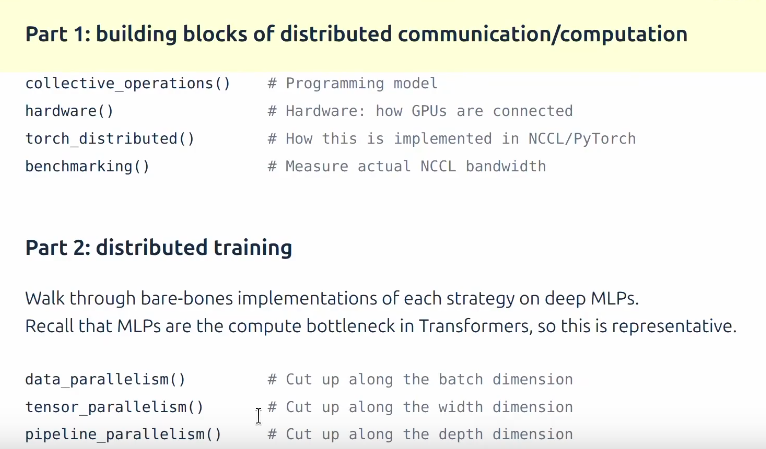
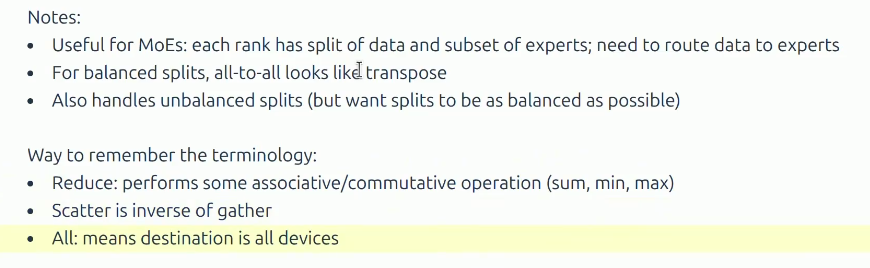
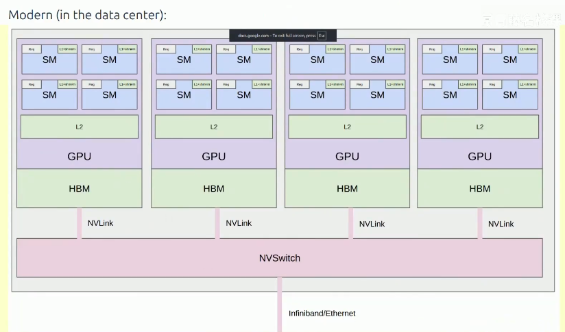
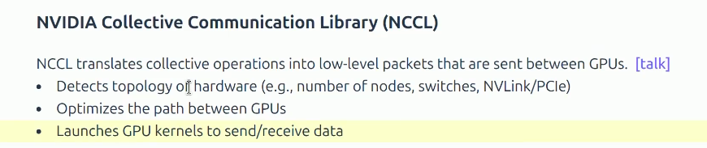
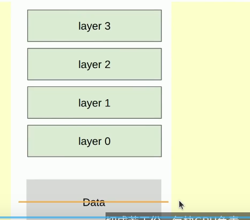
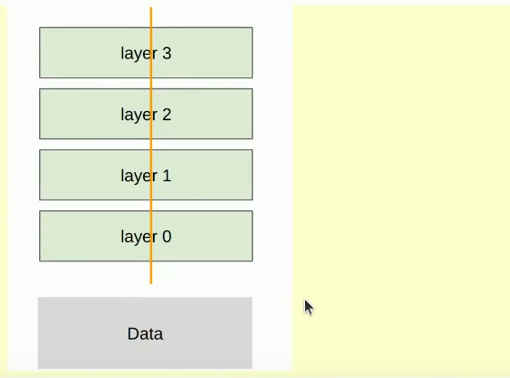
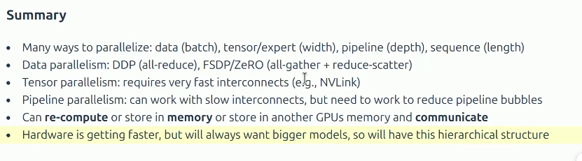

 

### 一、搭建分布式计算/通信
#### 1、集合通信操作
#### 分布式通信最核心的四个基础原语
##### 1）、广播（Broadcast）
一个 Root 节点把一份**完整的数据**发给所有其他节点。场景是**训练初始化**时，GPU 0 把模型权重广播给其他所有 GPU

##### 2）、分发（Scatter）
Root 节点把数据**切成 N 份**，分发给 N 个节点。（Broadcast 的变体).场景：多卡训练时，把一个大 Batch 的训练数据切分，分发给不同的 GPU。

##### 3） 、聚合（Gather）
所有的节点把各自的数据发给一个 Root 节点。（Scatter 的逆操作）.场景：推理时，把多张卡上算出的局部结果汇总到一张卡上做最终拼接。

##### 4）、归约（Reduce）
所有节点把数据发给 Root，并且在这个过程中执行结合律运算（如 Sum, Max, Min）。
**场景**：传统参数服务器（Parameter Server）架构中，所有 Worker 把梯度发给 Server，Server 求和（Sum）。Reduce 不只是网络搬运！它需要消耗 **GPU 的 SM 算力。**

##### 5）、补充
深度学习里，单独用这四个词的时候极少，用的都是带 All 前缀的变态变种。All 意味着：**所有节点的最终状态一致**。

- All-Gather = Gather + Broadcast

	- 逻辑：大家把数据拼在一起，然后每个人都复制一份完整的。对应 TP（张量并行）中拼接激活值。

- Reduce-Scatter = Reduce + Scatter

	- 逻辑：大家把数据加起来，然后把结果切分，每人发一块。对应 ZeRO 优化器中，梯度规约后直接分发给各个卡，节省显存。

- All-Reduce = Reduce-Scatter + All-Gather（NCCL 的 Ring 终极实现）

	- 逻辑：所有卡的数据汇总（求和），然后所有卡都拿到完整的求和结果。

	- 硬核推导：这就是为什么标准的 Ring All-Reduce 分两步。第一步，数据在环上传一圈，边传边加，走完一圈后每张卡都拿到了某一块的完整和（Reduce-Scatter）；第二步，每张卡把自己手里的“完整和”沿着环发一圈，大家就都有了（All-Gather）。通信量直接减半，且完美贴合物理总线带宽。

- All-to-All = Scatter (所有节点同时) + Gather (所有节点同时)

	- 逻辑：回归到你上一张 PPT 的 MoE，每个人把不同的数据散出去，同时从别人那里收集自己需要的。它是分布式通信的终极形态，也是最容易让网络交换机冒烟的元凶。

#### 2、硬件

##### 1）、
大模型并行的核心法则——“高频、大流量的通信（如 TP、MoE 的 All-to-All）必须留在 NVLink 域内；低频、容忍延迟的通信（DP、PP）才走 IB 网络

传统以太网开销巨大：两次内存拷贝，加上 CPU 陷入内核态（Kernel Space）的开销。CPU 不仅被占满，而且延迟极高

现代大模型标配 --- RDMA: 
允许 GPU 显存直接与网卡进行 DMA 传输。
RDMA 允许一台机器上的 GPU 直接读取或写入另一台机器上 GPU 的显存。
数据搬运完全由网卡（HCA/NIC）和底层硬件完成，无需 CPU 参与，无需操作系统内核干预，零拷贝（Zero-copy）。

##### 2）、NCCL

NCCL（NVIDIA Collective Communications Library）是大模型多卡训练的“底层交通总指挥”。它通过**探测硬件物理拓扑**（NVLink/InfiniBand）自动规划最优路线，在 Ring/Tree 等算法间动态切换，并直接在 **GPU 上启动轻量级 Kernel**，利用 RDMA 技术绕过 CPU，将上层的高级集合操作（如 All-Reduce）翻译为 GPU 之间的底层数据包，以极致压榨物理带宽，最终把多卡集群拼装成一台“超级大显卡”。

#### 3）、torch.distributed
它是 PyTorch 分布式系统的胶水层与调度员，负责将高层的张量操作无缝翻译为底层 NCCL 的通信包，并通过连续内存强制映射和计算-通信重叠（Bucket）机制，在榨干物理网络带宽的同时，把通信延迟死死隐藏在 GPU 的算力之下。

#### 4）、benchmarking
它是用 Algbw/Busbw 指标结合 Alpha-Beta 模型，在严格规避 Cache 污染和异步陷阱的前提下，测出物理硬件的“真实吞吐极限”，并通过计算-通信重叠时间，精准定位整个大模型训练流水线中最拖后腿的物理瓶颈（是 SM 算得太慢，还是 NVLink/IB 传得太慢）。

### 2、分布式训练
数据并行、张量并行、流水线并行
本质上是在计算维度（Batch, Width, Depth）、通信原语（All-Reduce, All-to-All, P2P）和物理带宽（NVLink vs IB）之间做极致的权衡。
#### 1、data_parallelism（DP）-切Batch
硬件逻辑：模型完整复制在每张卡上，吃不同的数据。

通信原语：反向传播结束后的 All-Reduce（大包，Ring 算法）。

把数据切开成若干份，每块GPU负责一部分数据

- Losses are different across ranks (computed on local data)
- 不同 Rank（进程/显卡）上的 Loss（损失值）是不同的（基于本地数据计算得出）。

- Gradients are all-reduced to be the same across ranks
- 梯度通过 All-Reduce（全规约）操作后，在各个 Rank 上保持一致。

- Therefore, parameters remain the same across ranks
- 因此，（更新后的）参数在各个 Rank 上保持完全相同。

#### 2、Tensor_parallelism(TP)- 切Width(矩阵列/行)

硬件逻辑：把单层的权重矩阵 W 切块，例如 Y=XW 切成 Y= [XW _1 ,XW _2 ]。

通信原语：极度频繁的 All-Reduce / All-Gather（每层前向、反向都要传）。

通信极其频繁。TP 绝对不能跨节点（跨 IB），否则延迟会直接杀死算力

#### 3 、 流水线并行 (PP - Pipeline Parallelism) —— 切 Depth（层）
- **硬件逻辑**：把模型按层切开，卡 1 算前 10 层，卡 2 算后 10 层。
    
- **通信原语**：**P2P（点对点）**。卡 1 算完把激活值发给卡 2。
    
- **物理瓶颈与优化**：
    
    - **气泡（Bubble）效应**：这是 PP 的致命伤。卡 2 必须等卡 1 算完才能动。为了掩盖气泡，必须把大 Batch 拆成多个 Micro-batch 塞入流水线（如 1F1B 调度）。
        
    - **显存代价**：为了填满流水线，必须同时驻留多个 Micro-batch 的激活值（Activation），导致显存压力剧增（催生了 **重计算 Recomputation** 和 **1F1B 调度**）。
        
    - **物理约束**：通信量相对较小，主要传激活值，**非常适合跨越节点走 IB 网络**。

### 3、Summary

总结 (Summary)

有多种并行化方式：数据并行（沿 batch 维度切分）、张量/专家并行（沿宽度维度切分）、流水线并行（沿深度/层数维度切分）、序列并行（沿序列长度维度切分）。

数据并行：DDP（底层依赖 all-reduce 全规约），FSDP/ZeRO（底层依赖 all-gather 全收集 + reduce-scatter 规约分发）。

张量并行：需要极快的互联网络（例如 NVLink）。

流水线并行：可以在较慢的互联网络下工作，但需要努力减少流水线气泡（bubbles）。

（显存管理三法则）：可以重新计算（re-compute），或者存储在显存中（memory），或者存储在另一块 GPU 的显存中并通过通信来获取（communicate）。

硬件（算力/带宽）正变得越来越快，但人们永远会追求更大的模型，因此这种层级化（hierarchical）的并行结构将长期存在。