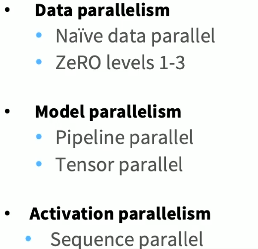

### 一、Data parallelism
#### 1、Naive data parallel(原生数据并行)
底层：每张卡有完整的权重、梯度和优化器状态。反向传播后，通过 NCCL 执行大包 All-Reduce。
（每台机器计算部分梯度求和，会在每次梯度更新前同步所有梯度，具体就是先交换所有梯度进行同步，再执行参数更新。）

痛点：**显存利用率极差**。每张卡都存了一份完整的 𝑊、∇W 和 Adam 的 m,v（在混合精度下，这部分占总显存的大头）。
每台机器的每个GPU将分配到B/M个样本。当批次规模足够大时，每个GPU都能获得相当规模的批次数据，可以充分饱和计算资源，但是每批次需要传输两倍参数量的数据，因为全归约操作的通勤成本约等于待归约数据量的两倍

#### 2、ZeRO levels 1-3（零冗余优化器）

底层本质：用通信量换显存。把原本冗余的“三座大山”切片（Sharding）扔给不同的 GPU 存。
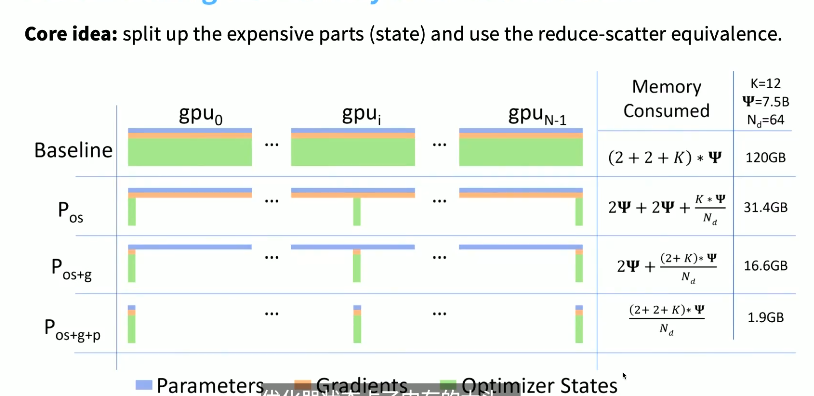
**ZeRO-1（切优化器状态）**：每张卡只存 1/N 的 Adam 状态。通信操作变成 Reduce-Scatter + All-Gather。
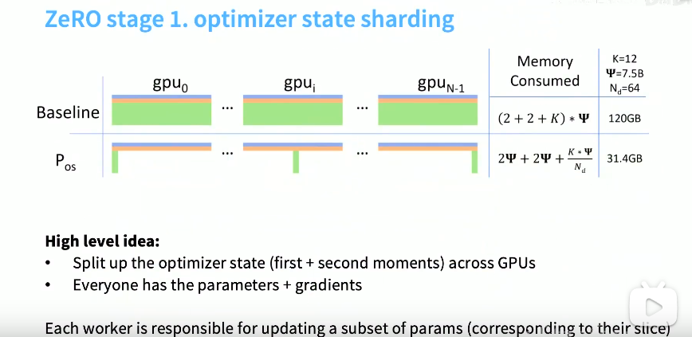

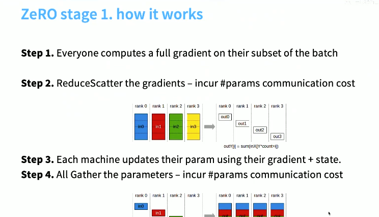
**ZeRO-2（加切梯度）**：连梯度也只存1/N。
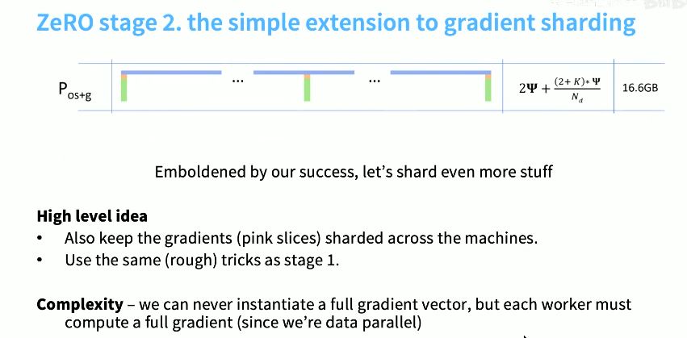

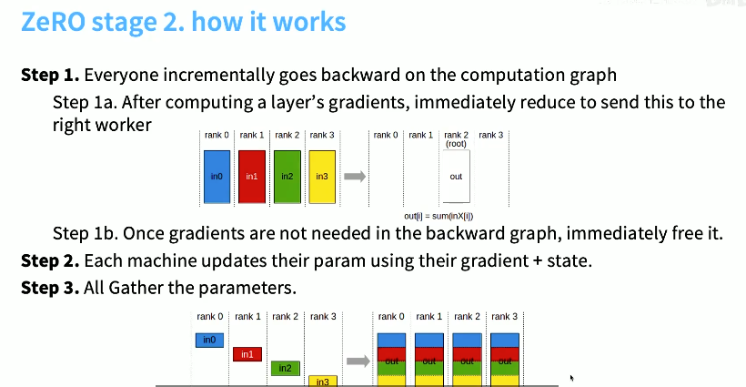

**ZeRO-3（加切权重）**：连模型权重也切了。前向/反向时需要用 All-Gather 临时把别人的权重拉过来，算完立刻扔掉。这就是 PyTorch 原生 FSDP（Fully Sharded Data Parallel）的底层实现。
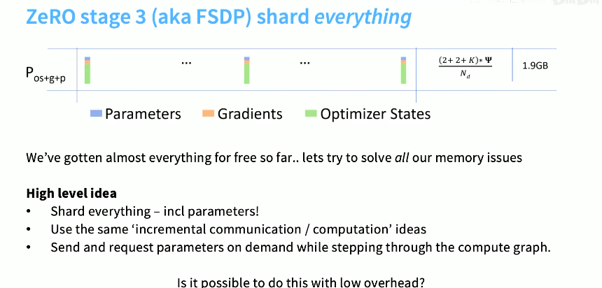
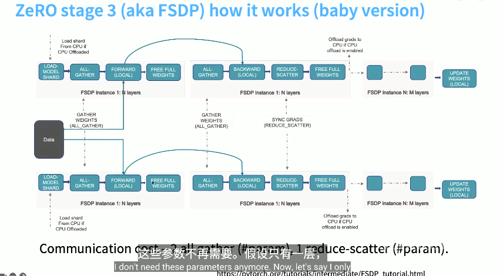

3、Issue remain with data parallel

### 二、Model parallelism

#### 1、Tensor parallel (TP，张量并行) —— 切 Width（切矩阵）
- **硬件痛点**：单张卡算不动，或者单层权重太大。
    
- **怎么切**：拿最典型的矩阵乘法 Y=XWY=XW 来说。Megatron-LM 发明了精妙的切法，把 WW 按列切（W1,W2W1​,W2​），或者按行切。每张卡算一部分，最后把结果拼起来。
    
- **通信底牌**：极其频繁且海量。因为 Transformer 每一层（Attention 和 FFN）的前向和反向，只要算完局部矩阵，就必须立刻进行 **`All-Reduce` 或 `All-Gather`** 把结果拼回完整的张量，否则下一层没法算。
    
- **物理死穴**：**绝对不能跨机！** 它的通信频率和延迟要求，必须死死锁在单机内部，利用 **NVLink（甚至 NVSwitch）** 那高达 900 GB/s 的带宽来硬抗。
    
- **优点**：计算和通信能高度重叠，单机内扩展性极好，是把小集群（单机 8 卡）算力榨干的终极武器。

ps: Transformer 单层激活值（Activation）显存占用:
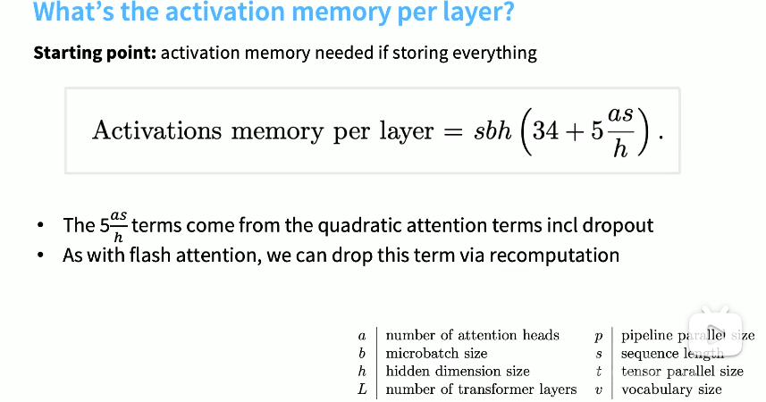

当引入张量并行（Tensor Parallel, TP）后，激活值显存到底是怎么变化的：
- **t**: 张量并行度 (tensor parallel size)
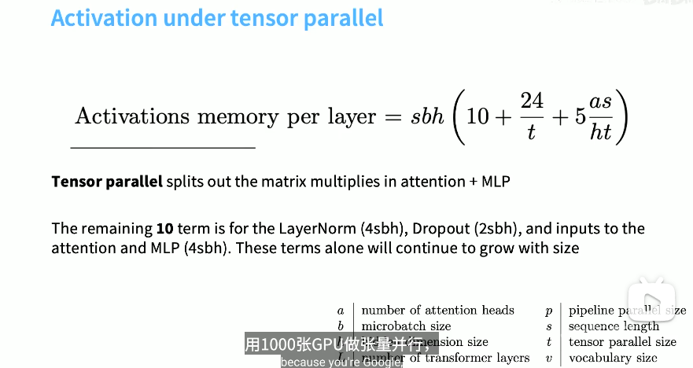

---

#### 2、 Pipeline parallel (PP，流水线并行) —— 切 Depth（切层数）

- **硬件痛点**：模型层数太多（如百层以上的 Transformer），单卡哪怕只存一层也放不下（算上激活值），或者想把模型扩展到几十上百张卡。
    
- **怎么切**：按层切。GPU 0 跑 Layer 1-10，GPU 1 跑 Layer 11-20……
    
- **通信底牌**：极低频。只在两个相邻的 GPU 之间通过 **P2P（点对点）** 发送**激活值（Activations）**。
    
- **物理优势**：**完美适配跨机（IB 网络）！** 因为你传的只是单向的激活值，不需要所有卡一起开会同步，哪怕网速慢一点，只要流水线排得满，也能跑。
    
- **致命代价：气泡（Bubble）**。GPU 1 必须等 GPU 0 算完才能动。为了填满流水线，必须切出极多的 Micro-batch。这导致大量中间激活值同时堆在显存里，所以 PP 必须叠加 **Recomputation（重计算）** 来省显存，以及用 **1F1B 调度算法** 来压缩气泡。
    

#### 3、总结：模型并行的“物理阶级”

从硬件拓扑的视角看，模型并行（TP+PP）是一场**“通信换容量”**的极致妥协：

1. **TP 是“同频共振”**：它要求极快的网络（NVLink），它把单卡的算力放大，适合在单机内部做“纵向深挖”。
2. **PP 是“接力长跑”**：它容忍慢速网络（IB），把模型的深度拉长，适合在多机之间做“横向扩展”。

在实际的万卡集群（如 GPT-4、Llama 3 的训练）中，模型并行是这样嵌套的：  
**机器内（8 卡）用 TP 切矩阵，机器间用 PP 切层数。** 这样既避开了 TP 跨机的网络灾难，又让 PP 的流水线跨越了不同机器。

### 三、Activation parallelism

### 1、Squence parallelism
#### **让显存真正实现线性扩展 —— 序列并行 (Sequence Parallel)**
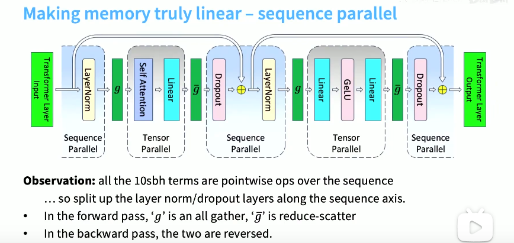

观察（Observation）：所有 10sbh 的项都是沿序列维度（sequence axis）的逐点操作（pointwise ops）。

方法：因此，沿着序列轴切分 LayerNorm/Dropout 层。

通信原语：
在前向传播中，g 是 all-gather（全收集），g_bar 是 reduce-scatter（规约-分发）。
在反向传播中，这两者的操作正好反转。
 (注：g 代表 forward 中的 gather 操作，g_bar 代表其逆操作 reduce-scatter)

 最后总结：
 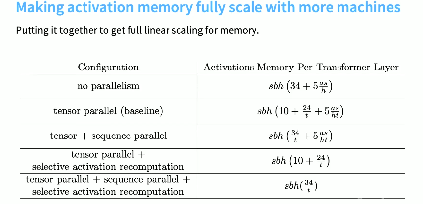

#### 2、Expert parallelism
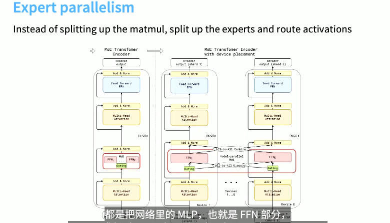
EP 的底层执行流完全打破了传统并行的套路：

- **Router（路由计算）**：每个 Token 通过本地的 Gate 网络，算出自己最想去哪几个专家（Top-K）。
    
- **Dispatch（分发 / All-to-All）**：这是最硬核的一步。每张 GPU 把自己不需要的 Token 打包，通过 **`All-to-All`** 发送给目标专家所在的 GPU。**数据在物理网络间发生了真真切切的“大洗牌”。**
    
- **Local Compute（本地计算）**：专家在自己的 GPU 上，对本卡收到的所有 Token 跑 FFN（前馈网络）的矩阵乘法。
    
- **Combine（合并 / All-to-All）**：算完之后，再把结果顺着原路 `All-to-All` 传回给 Token 最初所在的 GPU。

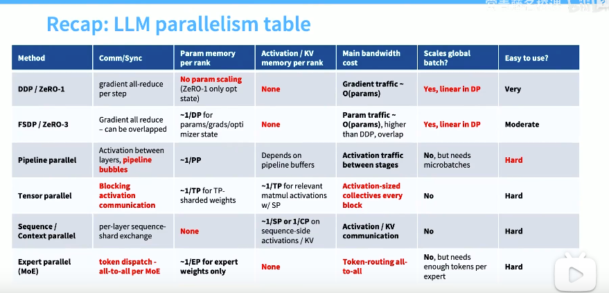

#### 并行指导原则：**3D（4D）并行——把所有策略整合在一起**
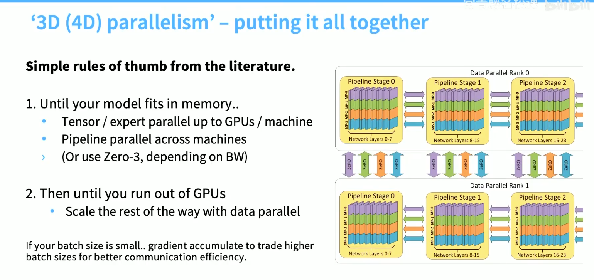
- **经验法则 1（解决显存容量）**：直到模型能装进内存为止。
    
    - **TP / EP**：最高只用到单机 GPU 的数量（限制在单机内）。
        
    - **PP**：用于跨机器扩展。
        
    - **ZeRO-3**：可根据实际的网络带宽情况，作为跨机的备选方案。
        
- **经验法则 2（解决集群扩展）**：模型装下后，直到耗尽所有 GPU。
    
    - **DP**：剩下的部分全部用数据并行（Data Parallel）来扩展。
        
- **通信优化技巧**：
    
    - 当全局 Batch Size 较小时，使用**梯度累积（Gradient Accumulation）**来换取更好的通信效率。
        
- **4D 并行组合结构**：
    
    - 纵向组合 PP（切层）。
        
    - 横向组合 DP（切数据）。
        
    - 节点内部组合 TP / EP（切矩阵/专家）。
        
    - 底层结合 ZeRO（切优化器状态）。
- 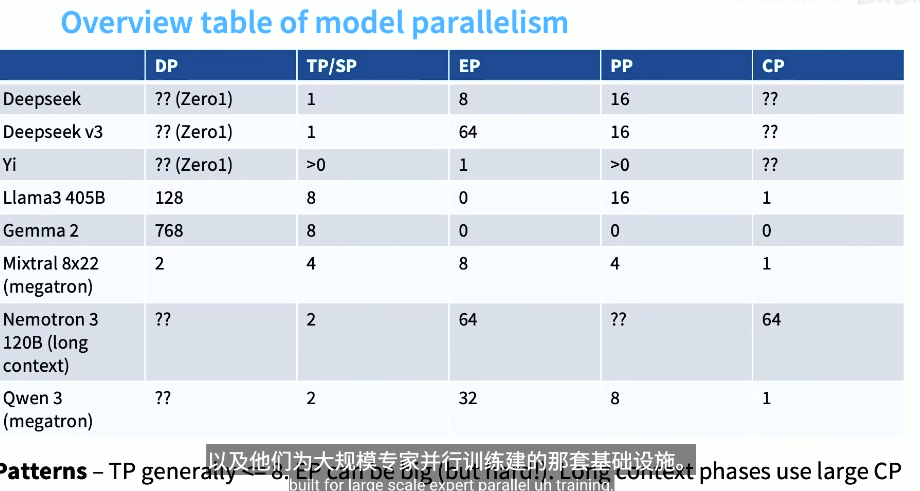