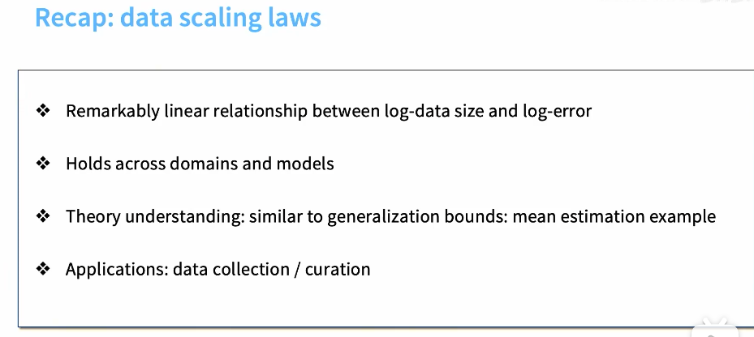
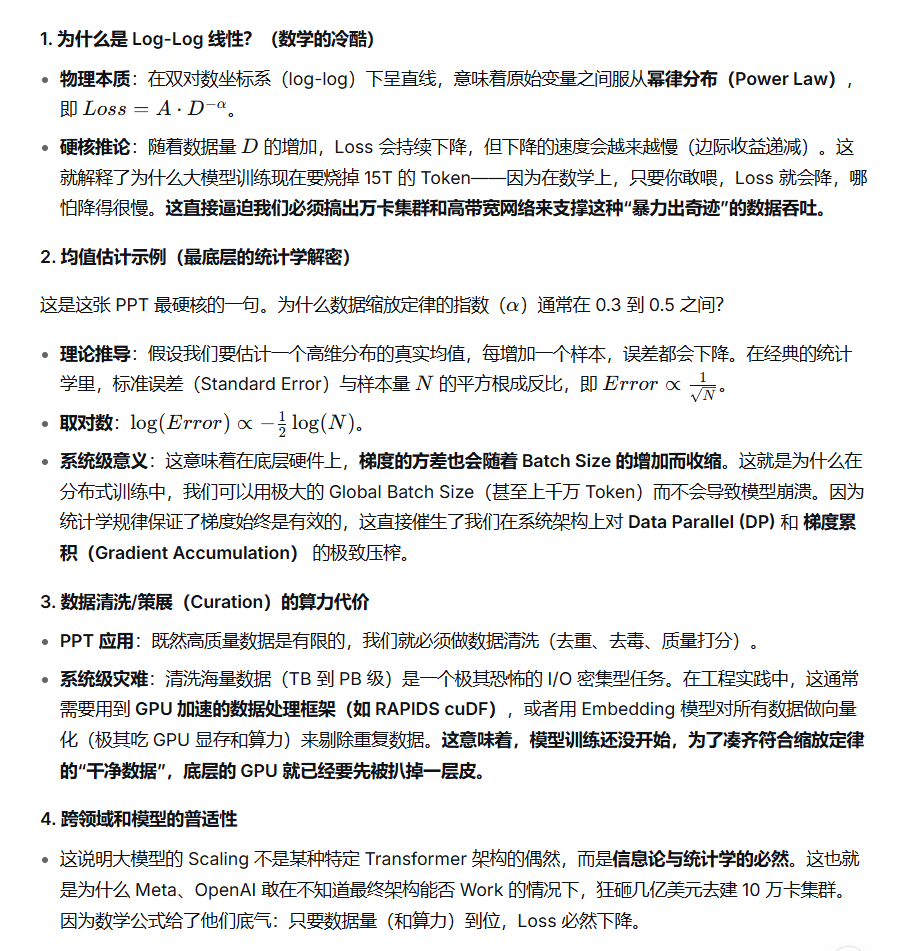
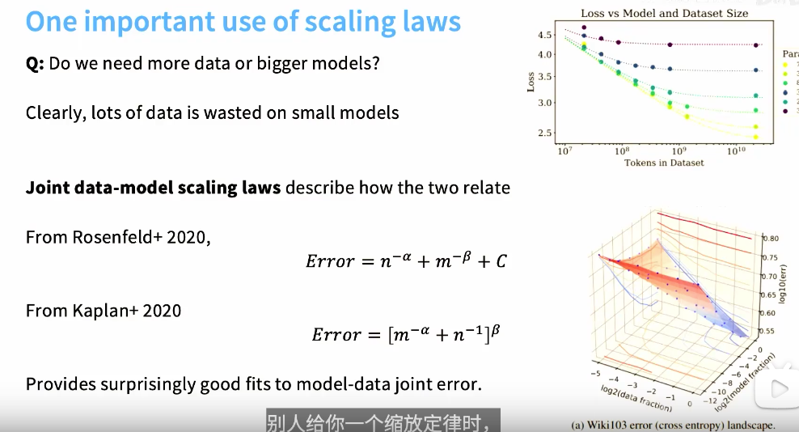
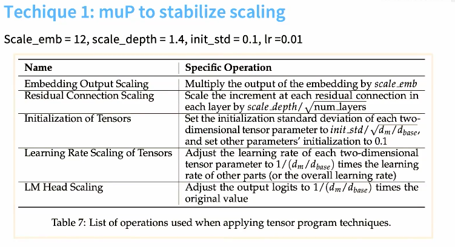
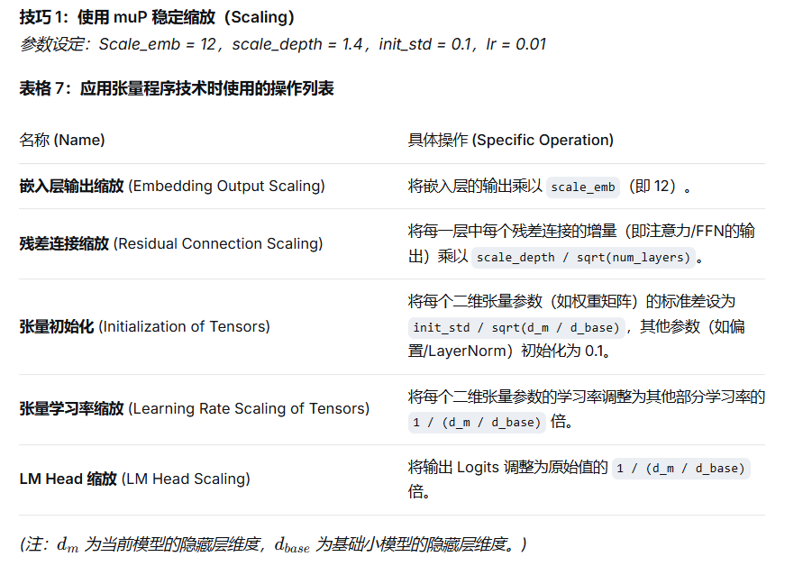
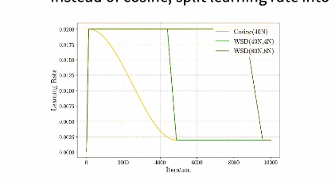
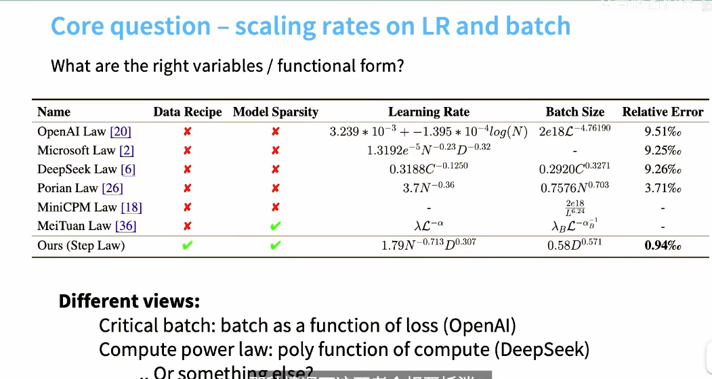
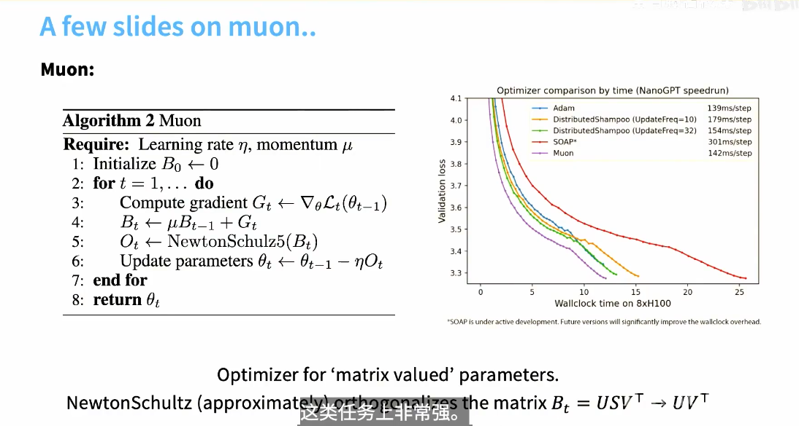
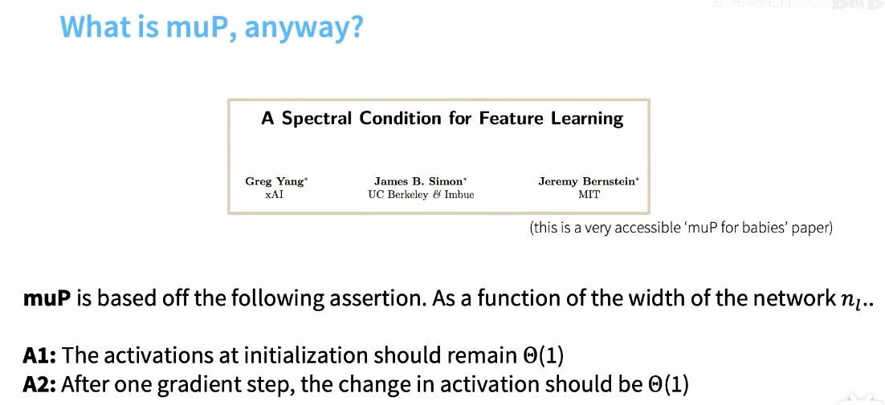
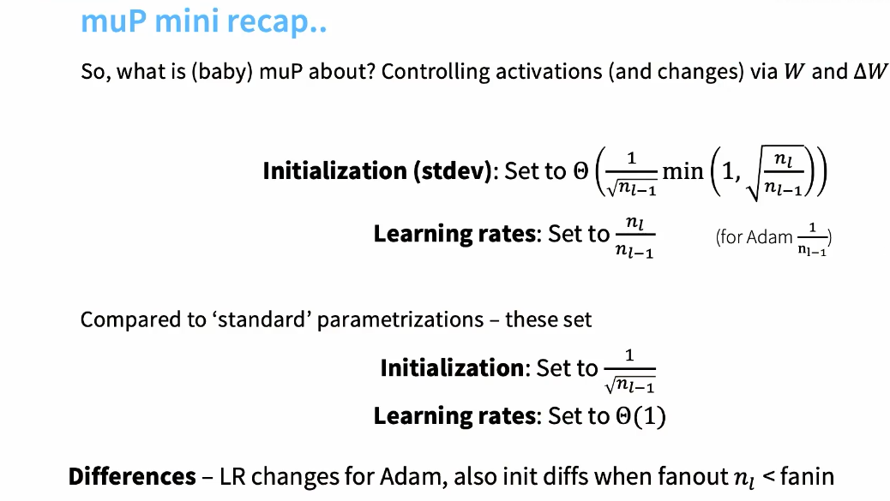

### 一、Data scaling laws

### 二、Model engineering Scaling laws
#### 1、该放大Transformer而非LSTM
#### 2、ADAM与SGD差不多（缩放）
### 3、长宽比
在模型缩放时，长宽比存在一个**近似保持不变的最优区间**。这个区间保证了模型结构在变大时，计算效率和表达能力能同步提升。

#### 4、批大小
临界批大小（CBS）
当批大小（Batch Size）超过这个临界值后，继续增大Batch Size，对降低Loss的收益会急剧减小（进入bias-limited区域，即收益递减区）。在CBS以下（noise-limited区域），增大Batch Size能有效降低梯度噪声，加速收敛。

#### 5、学习率
模型越大，学习率应该越小
经验法则：按照宽度的倒数来缩放/mup 

### 三、缩放定律一个重要的应用：联合数据-模型缩放定律（Joint data-model scaling laws）

n：数据量（Dataset Size）

m：模型参数量（Model Size）

C：不可约误差（Irreducible Error）。这是数据本身的信息熵极限（即就算你拥有无限算力和完美模型，误差也降不到 0）。对应底层就是无论你怎么优化访存，总会有个物理底线。

### 四、实践（前沿）中的缩放定律
#### 1、MuP初始化方法

batch_size:取决于数据集规模和模型规模
#### 2、预热稳定衰减学习率（WSD-LR）

##### 一、 Warmup（预热）：保护 HBM，防梯度爆炸
*   **底层逻辑**：模型刚初始化时，权重是随机的，HBM 里的激活值方差极大。如果直接上大学习率，反向传播的梯度会瞬间变成 NaN（溢出）。
*   **硬件视角**：在这短短几百/几千步里，GPU 的算力并未打满，但它是必须交的“保护费”。我们之前讲的 muP 是为了初始化保稳定，而 Warmup 是在动力学上保稳定。

##### 二、 Stable（稳定期）：榨干算力的“超长待机”
*   **底层逻辑**：Warmup 结束后，学习率保持在一个恒定值（通常是峰值学习率，如 3e-4），持续极长的时间（可能占总步数的 80% - 90%）。
*   **系统硬核点**：
    *   **MFU 最大化**：在这个阶段，梯度更新幅度大，模型在疯狂吸收知识。从 Roofline 模型看，此时是标准的 Compute-bound，GPU 的 SM 满载运转。
    *   ==🔴**随时可停（容错与弹性）**==：这是 WSD 最致命的诱惑。因为学习率是恒定的，你随时可以因为（1）预算花完了、（2）集群故障了、（3）新数据来了 而直接截断训练。拿着当前的权重（Checkpoint）直接用，模型依然是个好模型。
    *   **对比 Cosine**：Cosine 在后期学习率无限趋近于 0，这意味着在最后 20% 的步数里，你花了数千万美元的算力，但梯度几乎不怎么更新了，纯属浪费。

##### 三、 Decay（衰减期）：注入高质量数据的“退火（Annealing）”
*   **底层逻辑**：在 Stable 期跑完后，开启一段极短的（占总步数 10% - 20%）快速衰减期（通常用线性衰减或 $1-\sqrt{x}$）。
*   **系统硬核点（数据退火）**：在这个阶段，学习率迅速降低，模型不再“大跨步”学新知识，而是开始**“微调与收敛”**。DeepSeek、MiniCPM 等模型在这里玩了一个绝杀：**在 Decay 阶段，直接把训练数据全换成最高质量的语料（如数学、代码、领域私有数据）**。相当于用极少的算力，给模型做了一个丝滑的 SFT（指令微调）。

### 3、DS的直接拟合缩放定律来指导超参选择->
用拟合出的缩放定律，去反向指导“架构设计”和“算力预算分配”，而不是单纯调调学习率。

deepSeek 是通过直接拟合适配自身架构的缩放定律，完成了“算力预算分配（选MoE） -> 架构参数定标（671B/37B） -> 训练动力学配置（muP/WSD超参） -> 数据配方退火”的全链路系统工程。

### 4、当模型变大时，学习率（LR）和批大小（Batch Size）到底该怎么缩放？

(注：变量 N 为参数量，D 为数据量，C 为计算量，L 为 Loss。)

#### 5、Muon优化器

##### 1. Adam 的局限：把矩阵当成“一堆独立的数字”
*   在 Transformer 中，权重其实都是大矩阵。但 Adam 是 **Element-wise（逐元素）** 的。它给每个权重元素分配独立的 $m$（一阶矩）和 $v$（二阶矩），进行独立的缩放。
*   **底层物理代价**：这意味着 Adam 完全无视了矩阵作为一个整体的**几何结构**（比如奇异值方向）。而且，Adam 需要额外占用 **2倍于模型参数量的显存**（m 和 v）。

##### 2. Muon 的魔法：矩阵正交化（Orthogonalization）
Muon 的核心操作（第5步）是：把累加后的动量矩阵 $B_t$ 进行 SVD 分解（ $B_t = USV^T$），然后**把奇异值矩阵 $S$ 直接扔掉，变成 $UV^T$**。
*   **数学直觉**：这相当于把梯度更新的方向“正交化”了。不论某个方向上的梯度有多大多深，Muon 把所有的奇异值都拉平到 1，保证更新步长在矩阵的各个维度上是各向同性的（均匀的）。
*   **收益**：防止了梯度的“尖峰爆炸”，让模型在极其崎岖的 Loss 曲面上，能以更平滑、更均匀的步幅下降（完美解释了右图为什么紫色线下降最快且最稳）。

##### 3. 硬件底层的极致博弈（为什么在 GPU 上极其硬核？）
计算 SVD 是 $O(N^3)$ 的，极其昂贵。直接在 GPU 上跑 SVD 会直接把算力吸干。所以，Muon 用了 **Newton-Schulz 迭代** 来**近似**正交化。
*   **底层硬件视角**：Newton-Schulz 本质上是一系列**矩阵乘法**。
*   **性能转换**：原本 Adam 更新是一个极度吃显存带宽的 **Memory-bound** 操作（需要读梯度、读 m/v 状态、写回参数）。而 Muon 的 Newton-Schulz 是矩阵乘法，直接将 Optimizer Step 变成了极度吃算力的 **Compute-bound** 操作。
*   **完美契合 Tensor Core**：现代 GPU 的 Tensor Core 算矩阵乘法快到飞起，而 HBM 带宽往往受限。Muon 用强大的 GPU 算力（GEMM）代替了昂贵的显存访问（Element-wise 读写），极大压榨了 GPU 的算力甜点。

##### 4. 显存与通信的红利
*   **省显存**：Muon 只需要存动量（类似一阶矩 $B_t$），不需要存二阶矩 $v$。在千亿参数的模型上，这直接省下了一个模型的显存！
*   **通信友好**：如果底层通信（如 All-Reduce 或 ZeRO 切分）只传动量，那比传 Adam 的 $m$ 和 $v$ 省去了一半的 NCCL 带宽。

#### 6、Mup

**正文：**
muP 基于以下断言。作为网络宽度 $n_l$ 的函数……
*   **A1**：初始化时的激活值（activations）应保持为 $\Theta(1)$。
*   **A2**：经过一步梯度更新后，激活值的变化量（the change in activation）也应为 $\Theta(1)$。

（注： $\Theta(1)$ 在算法复杂度中代表“常数级别”，即不随网络宽度 $n_l$ 的增大而膨胀或消失。）

---

在传统的参数化（Standard Parameterization, SP）中，如果把网络变宽（维度 $n_l$ 变大），网络就会“走火入魔”：
*   **如果参数调不好**：激活值会呈指数级爆炸，到后面直接变成 `NaN`（在 FP16 下直接溢出）。
*   **如果参数调得太保守**：激活值会急剧缩小到 0，梯度直接消失（Vanishing Gradient），模型根本学不到东西。

muP 就是来解决这个问题的。它要求无论你把 $n_l$ 扩到多大（哪怕是一万），上述的 A1 和 A2 必须同时成立。

#### 1. 拆解 A1：初始化时的前向稳定性
*   **底层现象**：矩阵乘法本质上是一堆数字的累加。如果宽度 $n_l$ 变大，累加的项变多，如果不做缩放，输出的方差就会爆炸。
*   **标准解法（如 Kaiming/Xavier 初始化）**：权重的初始方差通常正比于 $1/n_l$。这样第一层算出来的激活值是 $\Theta(1)$ 的常数。
*   **系统意义**：保证了前向传播时，数据在 HBM 里的数值范围始终在安全区（比如 FP16 的 -65504 到 65504 之间）。

#### 2. 拆解 A2：梯度更新的“特征学习”魔法（muP 的灵魂）
*   **传统痛点**：在标准参数化（SP）下，哪怕 A1 满足了。当你跑了一步梯度下降（SGD 或 Adam）后，权重更新了 $\Delta W$。此时，由于矩阵乘法的放大效应，**激活值的变化量 $\Delta x$ 会随着宽度 $n_l$ 的增大而爆炸或消失**。这意味着大模型和小模型的动力学行为完全不一样。
*   **muP 的解法**：muP 强行用数学公式（比如我们上一张 PPT 里看到的，把学习率按 `1 / (d_m / d_base)` 缩小）压制住权重的更新幅度。使得 $\Delta \text{Activation}$ 始终保持为 $\Theta(1)$。
*   **核心收益**：保证了无论模型多宽，**每一层在梯度更新后，对特征表达的改变幅度都是恒定且均衡的**。这就是所谓的“最大更新（Maximal Update）”——每一层都在以最大的、不崩溃的步长进行学习。

#### 3. “谱条件（Spectral Condition）”是什么意思？
这篇论文的标题是“特征学习的谱条件”。结合我们刚刚聊的 **Muon 优化器**，你会发现绝妙的闭环：
*   Muon 是对**动量矩阵**做 SVD 正交化（扔掉了奇异值）。
*   而这篇论文指出，要让 A2 成立，权重的更新矩阵的**谱范数（最大奇异值）**必须受到严格控制。
*   **底层物理视角**：矩阵的谱范数就代表了该层对输入向量的最大放大倍数。如果谱范数随着宽度变大而变大，激活值必定爆炸。muP 的数学本质，就是让整个网络在每一层的**谱范数保持恒定**。

