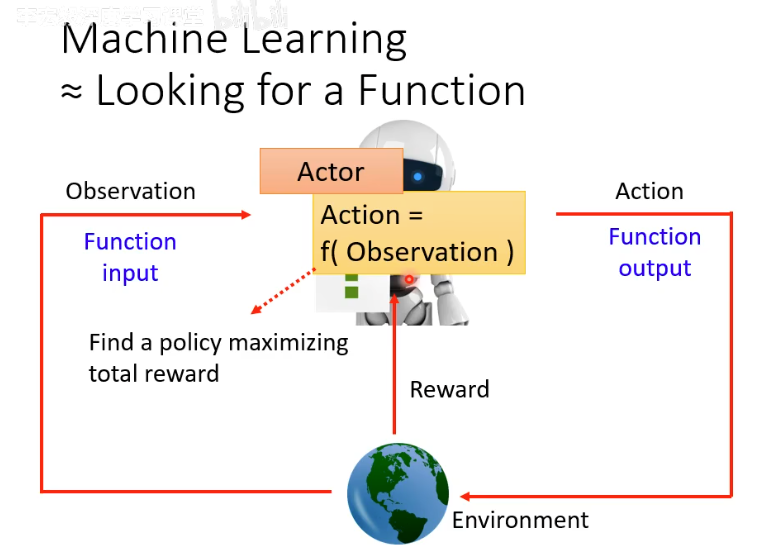
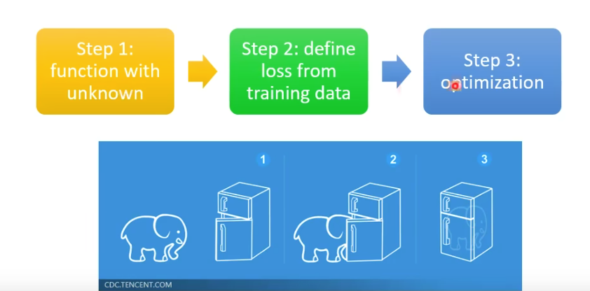
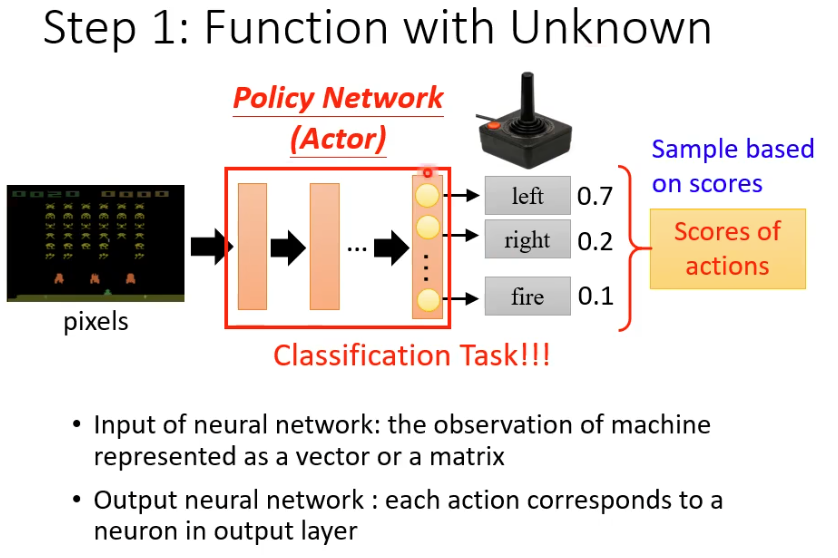
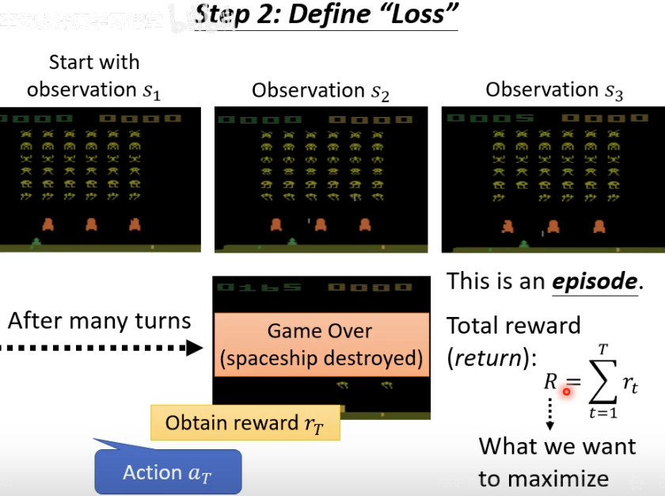
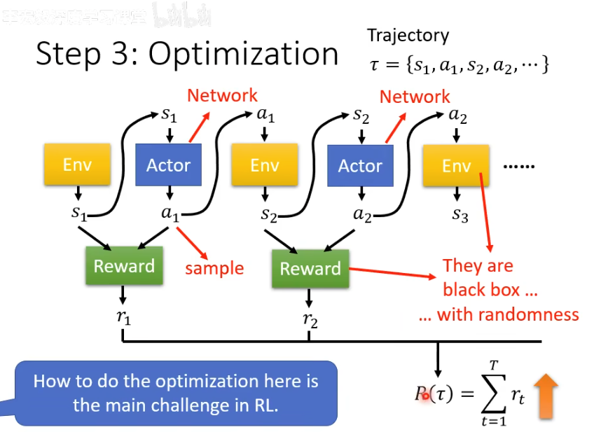

当人类也不知道最佳答案的时候，就是强化学习上场的时候
### 一、什么是RL
和机器学习类似，强化学习也是寻找一个（能得到最大奖励的）Function：

和ML一样亦有三个步骤：

#### 1、未知数的function

 **"Function with Unknown"**（带有未知参数的函数）就是**神经网络本身**，而它里面的“未知参数（Unknown Parameters）”指的就是**神经网络的权重（Weights）和偏置（Biases）**。
#### 2、定义Loss
我们想让总reward最大，就让 -总reward最小 ->求损失

#### 3、Optimization
用梯度下降（SGD/Adam）等优化器去求让 Loss 最小的参数
目标是让期望回报 E[R(τ)] 最大化，然后更新网络的权重θ。

这张图非常经典，它展示了强化学习（RL）最核心的“试错”流程，也点出了你学习 RL 最需要跨越的一道坎：**Step 3（优化）到底怎么做？**

结合你熟悉的反向传播（Backprop），我们来拆解一下这张图里的“难点”以及它是如何被解决的。

### 1. 先看懂图里的流程（Trajectory 轨迹）
*   **Actor（网络）**：接收状态 $s_1$（比如游戏画面），输出动作的概率分布，然后**采样（sample）**出一个具体动作 $a_1$（比如“向右”）。
*   **Env（环境）**：接收 $a_1$，环境发生变化，返回下一个状态 $s_2$，并给出奖励 $r_1$。
*   这样循环下去，收集到一连串的数据 $\{s_1, a_1, s_2, a_2, \dots\}$，这就叫一条 **轨迹（Trajectory, $\tau$）**。
*   把这条轨迹上所有的奖励加起来： $R(\tau) = \sum_{t=1}^T r_t$，这就是这条轨迹的总得分。

### 2. 为什么图里说“Env 和 Reward 是带随机性的黑盒”？
这是 RL 优化最大的难点。
*   **黑盒**：你不知道环境的内部代码是怎么写的，你只能去“试”。
*   **随机性（Randomness）**：有两点。第一，你的 Actor 是根据概率**采样**的（输出 0.7，也有 0.3 的概率选别的）；第二，环境本身可能也有随机性（比如游戏里怪物随机移动）。这意味着，即使你用**一模一样的网络参数**，跑两次游戏，得到的 $R(\tau)$ 可能完全不同。

### 3. 到底怎么做优化？（核心痛点）

你现在的目标是让期望回报 $E[R(\tau)]$ 最大化，然后更新网络的权重 $\theta$。

**问题来了：**
*   在监督学习里，Loss 是算出来的，网络输出和标签一对比，直接求导（反向传播）就行。
*   但在 RL 里，**环境（Env）和奖励（Reward）是黑盒**。你没法对游戏引擎求导，你不能写一个公式说“我把动作 $a$ 增加 0.1，游戏得分 $r$ 会精确增加多少”。既然没法求导，**反向传播的链式法则在这里就断掉了**。

 那到底怎么更新网络？（Policy Gradient 的魔法）

既然不能直接对黑盒求导，我们只能在**策略网络（Actor）内部**想办法。这就是 **Policy Gradient（策略梯度）** 的由来。

*   **通俗理解**：因为没法求导，我只能“蒙”。我让 Actor 跑一局游戏，拿到总分 $R(\tau)$。如果得分很高，我就去**增大**这条轨迹里所有动作的采样概率；如果得分很低，我就**减小**这些动作的概率。
*   **数学魔法（对数求导技巧）**：虽然环境不可导，但我们的 Actor（神经网络）是可导的。我们可以把“让总奖励最大化”这个目标函数，推导成一个可以求导的形式：

$$
\nabla_\theta J(\theta) = E \left[ R(\tau) \nabla_\theta \log \pi_\theta(a_t|s_t) \right]
$$

（这里的 $(\pi_\theta)$ 就是你的 Actor 网络）。

**看懂这个公式，你就懂了图底部的难点怎么破了：**

*  $(\nabla_\theta \log \pi_\theta(a_t|s_t))$ 这一部分，就是你在深度学习里非常熟悉的**交叉熵的梯度（Cross-Entropy Gradient）**。你可以用 PyTorch 的 `loss.backward()` 轻松算出来。
*   $(R(\tau))$ 就是一个**权重（Weight）**。
* 如果这局游戏赢了， $R(\tau)$ 是正数，算出来的梯度就顺着方向走（鼓励这个动作）；如果这局游戏输了， $R(\tau)$ 是负数，梯度就反向（抑制这个动作）。

