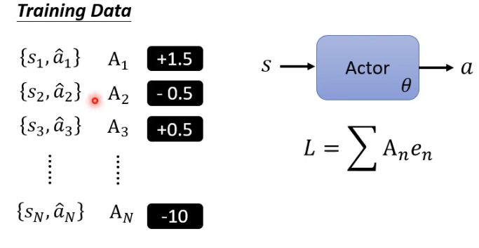
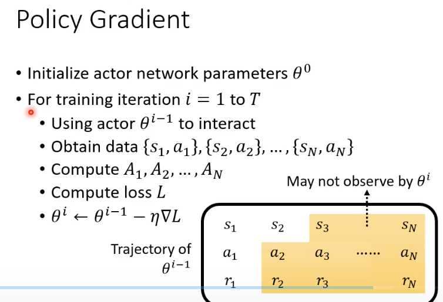
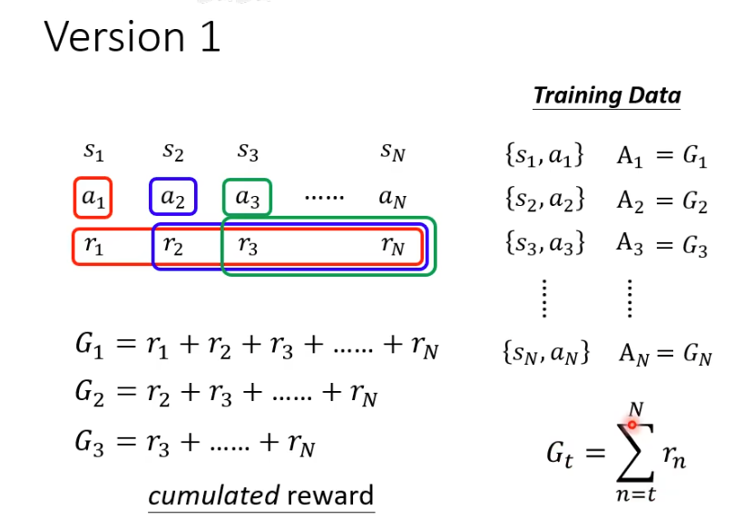
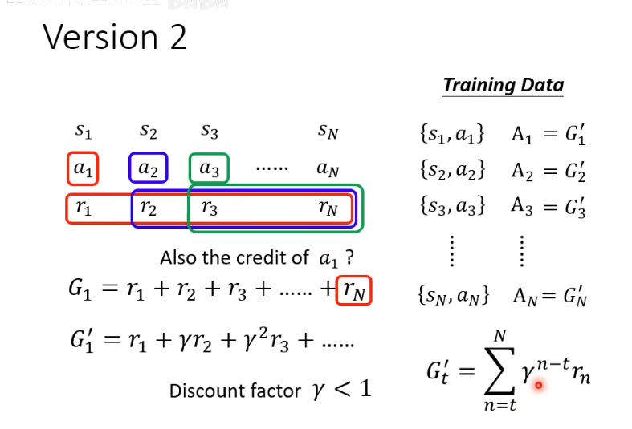
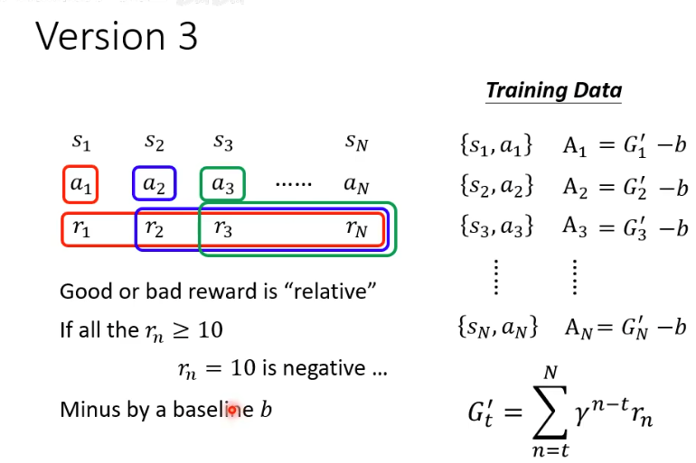
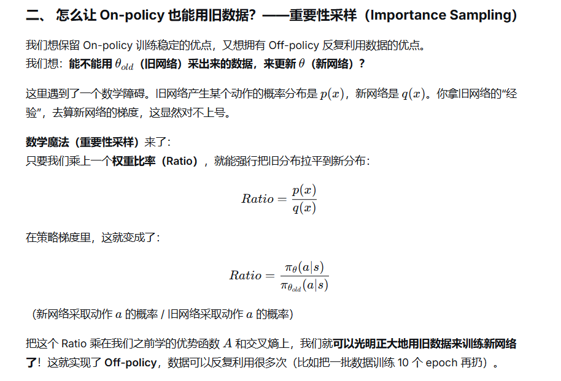
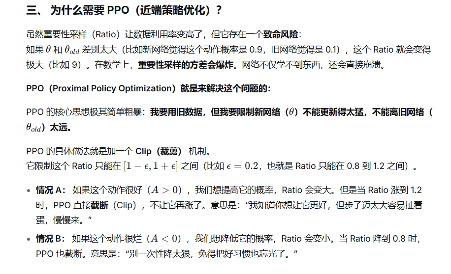

L:损失函数
An:优势值/权重
e_n: 交叉熵（动作an的负对数概率）

### 1、Reinforce算法

它的核心逻辑用四个字概括就是：**“秋后算账”**。
1.  **蒙（采样）**：让当前的 Actor（网络）去玩游戏，一路瞎玩，记录下所有的状态 $s$、动作 $a$ 和每步的奖励 $r$。
2.  **算总分**：玩到游戏结束（或者达到设定的最大步数），算一算从第 $t$ 步开始，后面一共拿了多少分，也就是图里的 $G_t$（累积回报）。
3.  **调概率**：把每一对 $(s_t, a_t)$ 当作训练数据，把 $G_t$ 当作权重，用梯度下降去更新网络：
    *   如果 $G_t > 0$，说明这局玩得不错，**提高** $a_t$ 的概率。
    *   如果 $G_t < 0$，说明这局玩砸了，**降低** $a_t$ 的概率。

### 2、 **折扣因子（Discount Factor, γ）**
解决了 Version 1 中“把未来所有的奖励不加区分地全算在当前动作头上”的不合理问题

r是当前立即收获的reward
当某个动作距离当前动作越远，其这个动作的奖励的权重就越小，呈指数级衰减。

### 3、基准线

### 4、On-policy vs Off-policy

#### 1) On-policy（同策略）：边玩边学，用完就扔
*   **做法**：你的机器人当前叫“张三”。张三去走迷宫，摸索出了一套经验（数据）。然后用这套数据更新了张三的大脑，张三变成了“张三 Pro”。这时候，张三 Pro 变聪明了，原来踩过的坑它可能不会再踩，原来的路线它可能不会再走。**因此，之前张三收集的那些数据，对于张三 Pro 来说“已经过时了”**，只能扔掉，让张三 Pro 重新去摸索。
*   **代表算法**：最基础的 Policy Gradient (REINFORCE)、A2C/A3C。
*   **特点**：稳定，因为数据永远是最新的。但**极其极其浪费算力**（就像你复习只能看昨天的笔记，一旦学懂了，昨天的笔记就不准了，逼着你重新写一份笔记）。

#### 2)Off-policy（异策略）：看别人的录像来学
*   **做法**：张三去走迷宫收集数据。张三不仅自己学，他还把数据存进了一个“经验池”（Replay Buffer）。张三 Pro 升级后，不需要自己亲自去跑，他可以直接从“经验池”里拿出张三之前（甚至别的机器人）跑的数据来学习。
*   **代表算法**：Q-learning（特别是 DQN）。
*   **特点**：**数据利用率极高**。可以反复看“旧录像”。但缺点是：因为数据和当前策略不匹配，学起来容易出偏差，甚至学崩。

---

---

### 四、 总结

1.  **On-policy**：自己边玩边学，数据用完就扔。（浪费算力，但稳定）
2.  **Off-policy**：拿着别人（或以前）的数据反复学。（数据效率高，但容易学崩）
3.  **PPO**：用 Importance Sampling 引入了 Off-policy 的高效（旧数据用几次），同时用 **Clip（裁剪）** 强行按住新网络暴走的冲动（保持稳定）。

**一句话概括 PPO 的江湖地位：它是目前在“数据利用率（Off-policy）”和“训练稳定性（On-policy）”之间找到最完美平衡点的算法，也是纯强化学习（RL）领域目前的绝对霸主。**