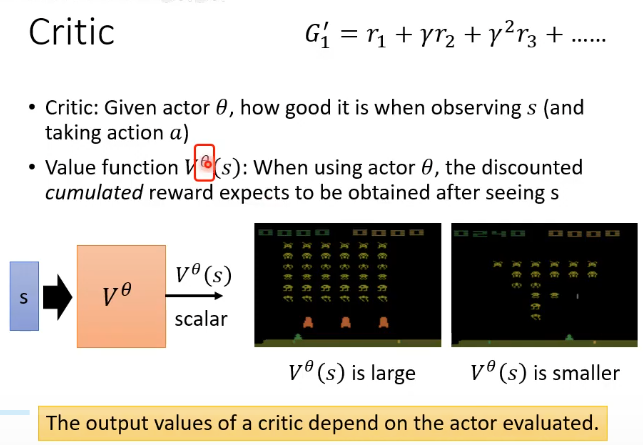
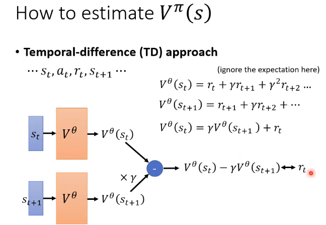
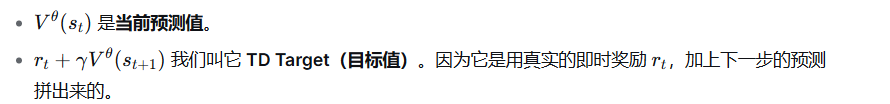
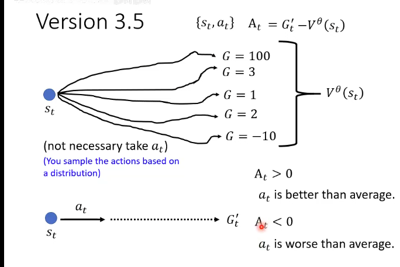
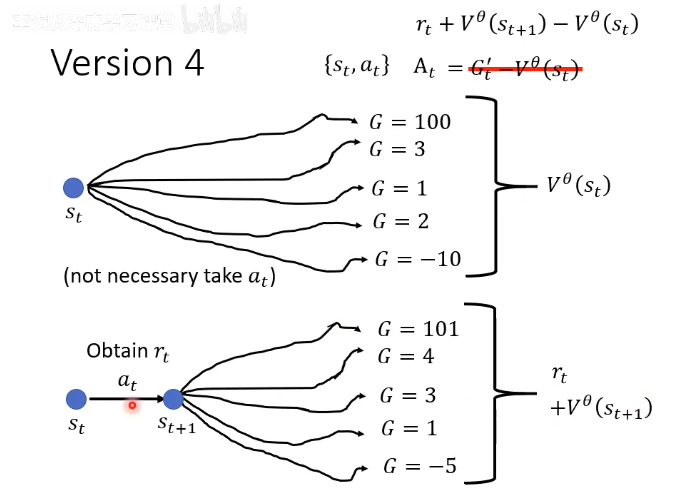
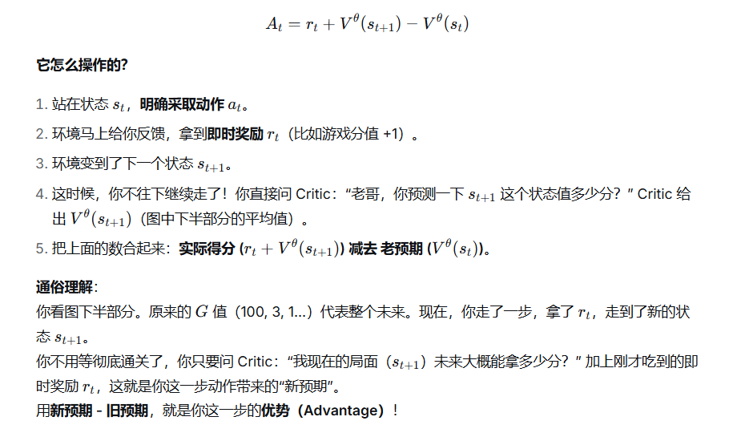
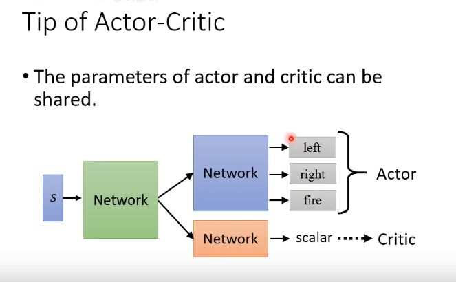

- θ 代表 Actor 的网络参数(Actor 是一个函数（Function,也就是具体的策略）)。
- V(s) 表示“站在状态 s，未来能拿多少分”。但是，“能拿多少分”完全取决于“谁来玩”。
- 准确的写法是 V ^θ (s)：“在智能体使用策略 θ 的情况下，站在状态 s，预期未来能拿多少分。

### 1、怎么训练Critic（TD（Temporal-Difference，时序差分））

### Advantage Actor-Critic

#### 参数共享

**算力与内存极大节省：**

	Actor 和 Critic 面对的是同一个环境、同一个画面（状态 s）。底层提取特征的工作（比如识别屏幕上的外星人）是完全一致的。让两个网络各自算一遍，纯属浪费算力。共享底座可以省下一半的前向传播计算量和内存。

**特征表征更强大：**

	如果 Actor 和 Critic 共享底座，那么在反向传播时，Actor 传来的梯度（“怎么选动作”）和 Critic 传来的梯度（“状态值多少分”）会共同更新底座参数。这就相当于 Actor 和 Critic 互相交流经验，让底座提取出的特征既有利于做决策，也有利于做价值评估，学到更本质的特征。

**训练更稳定：**

	两个网络分家时，可能各自学偏。共享底座后，它们被强迫在对状态的理解上保持一致性，这往往能平滑训练过程。
