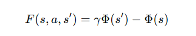

**Reward Shaping 就是人为地给它加一些“中间奖励**

为了让中间奖励不改变最终的最优策略，我们引入一个势能函数（Potential Function） Φ(s)。
它给每个状态设定一个“势能”，中间奖励 𝐹必须满足：

意思就是：你这一步的额外奖励，必须等于“下一个状态的势能”减去“当前状态的势能”的折扣。只要满足这个公式，AI 就算想作弊，它也刷不到额外的分，因为绕一圈回到原点，势能差为 0，你拿不到任何奖励。这就在数学上保证了最优策略不变。

#### Reward shaping -Curiosity
Curiosity（好奇心）代表的是一种极其特殊的设计：内在奖励（Intrinsic Reward）

经典灾难：“**嘈杂电视问题**”（Noisy TV Problem）
如果在《超级马里奥》里，某面墙上的电视在播放随机的雪花噪点。AI 刚看到这面墙时，好奇心想：这个画面没见过！于是去看了。结果：**预测误差永远极大，好奇心奖励永远爆表。** AI 就像被吸干了灵魂一样，**死死盯着电视屏幕，再也不去通关了**。