### 1、*Self-attention机制的矩阵表示*
#### (1)
将矩阵拼接起来计算效率更高：
将输入的sequence（I）分别乘上Wq,Wk,Wv就能得到Q K V
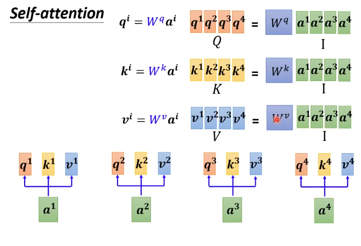

#### (2)注意力分数的计算
对于任意向量(比如a1)的注意力分数，也可以将向量拼接起来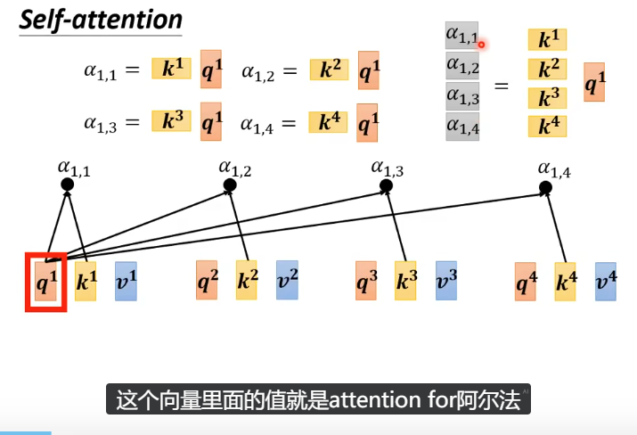

同理**所有的注意力分数**：也可以拼接
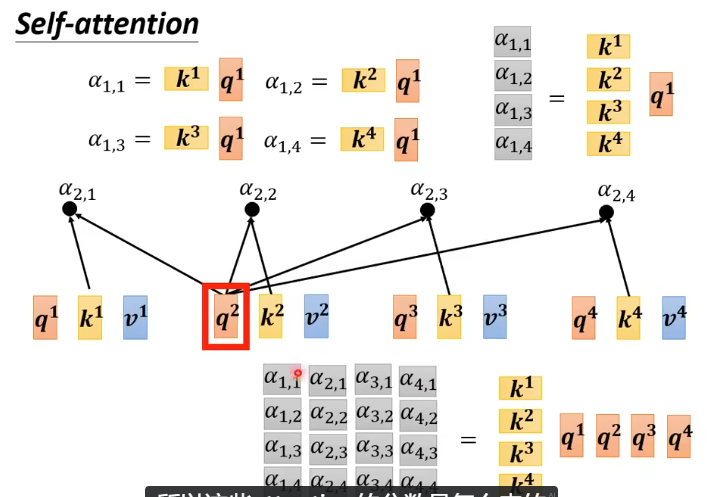
#### （3）然后softmax:
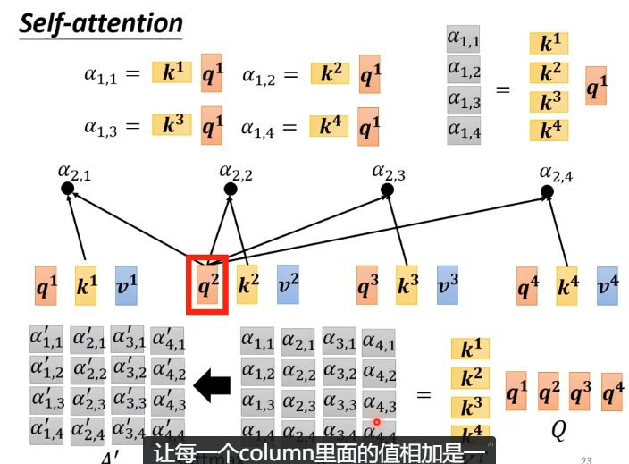

#### （4）最后计算做得到O输出：
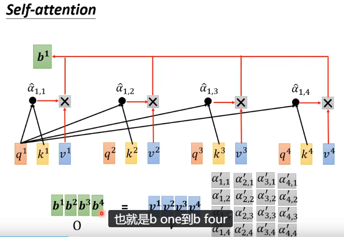

#### （5）总结：
最后想要学习的也就是Wq,Wk,Wv
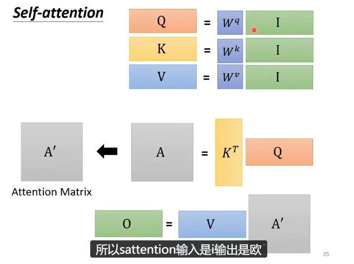

### 2、*Multi-head Self-attention*
#### （1）将向量分别与n个（2为例）不同的Wq,Wk,Wv计算得到2个q,2个k,2个v
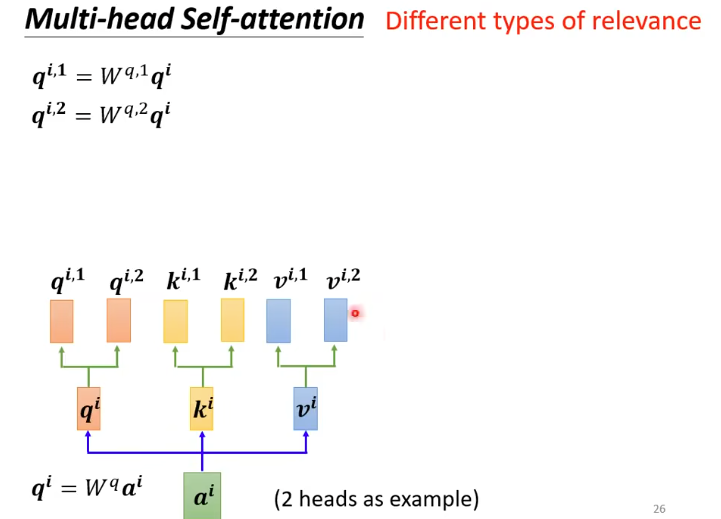

#### （2）其他向量也会得到2个不同的qkv
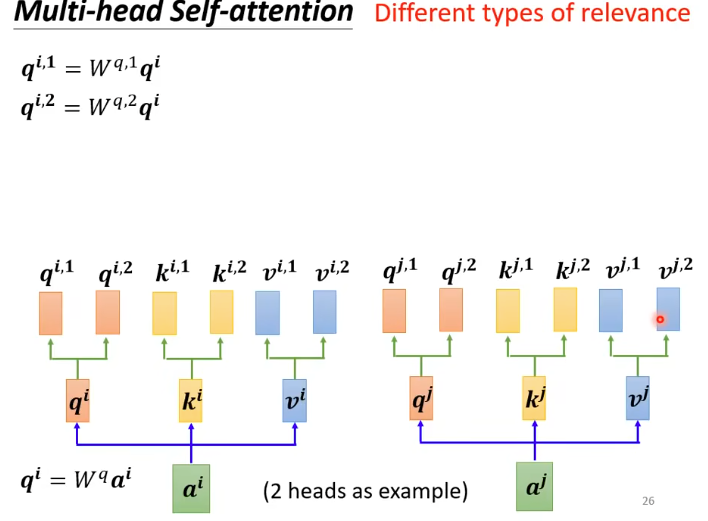

#### （3）注意力分数计算
qi1只与ki1和kj1计算->得到注意力分数 - >在softmax后 与vi1和vj2相乘 累加得到bi1
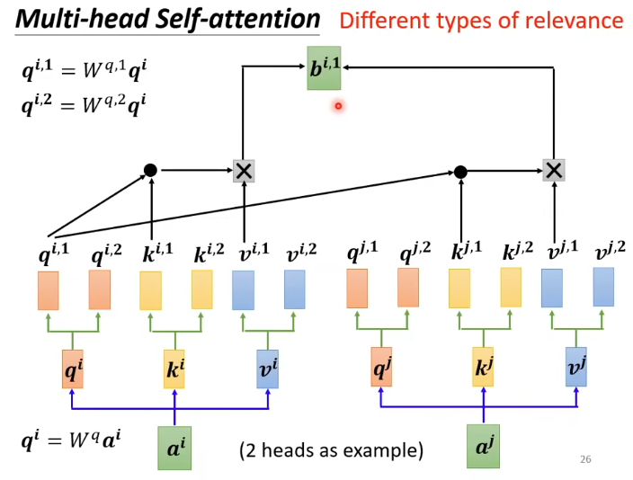

同理bi2:
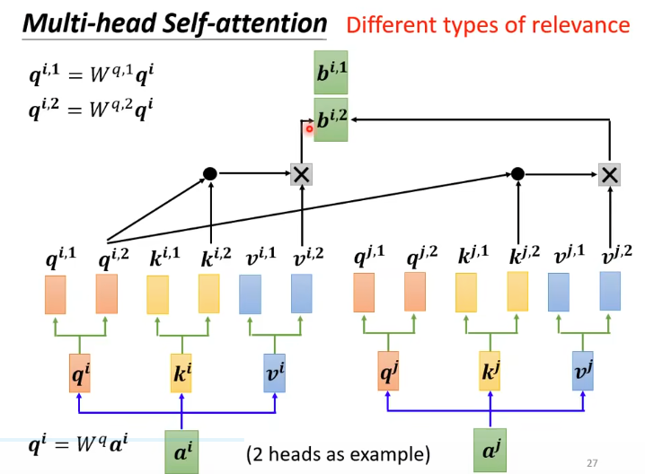
最后在通过 W^O 做线性变换 → 最终输出：
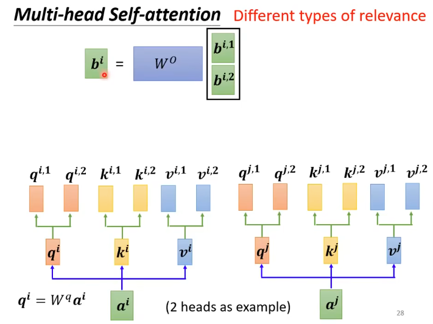

### 3、位置编码
为每一个位置设置一个vector,即positional vector记作 e^i,将其和向量a^i相加即可
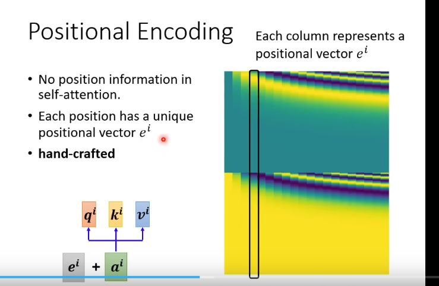
每一列都是位置向量

